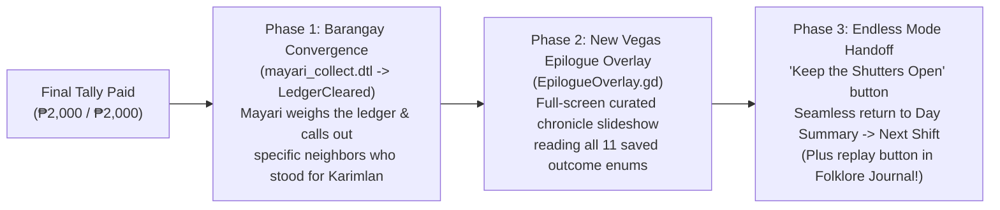

# Barangay Convergence, *New Vegas* Epilogue & Papa Ulap Wire — Execution Plan

> **Craft & Pacing Bibles:** [MASTER_DIALOGUE_AND_NARRATIVE_DESIGN_GUIDE.md](file:///c:/Users/John%20Reniel/sari-saring-katha/docs/MASTER_DIALOGUE_AND_NARRATIVE_DESIGN_GUIDE.md) · [MASTER_STORY_PACING_AND_WORLDBUILDING_GUIDE.md](file:///c:/Users/John%20Reniel/sari-saring-katha/docs/MASTER_STORY_PACING_AND_WORLDBUILDING_GUIDE.md)  
> **UI Skill Standard:** `game-ui-design` (90% Title-Safe Zone, Keyboard/Controller-First Navigation, High-Contrast Readability, Purposeful Motion, Zero Clutter)  
> **Architecture Spec:** [MACRO_NARRATIVE_ARCHITECTURE_SPEC.md](file:///c:/Users/John%20Reniel/sari-saring-katha/docs/MACRO_NARRATIVE_ARCHITECTURE_SPEC.md) (Step 5: *Kaer Morhen* Convergence Finale + *New Vegas* Epilogue)

---

## 1. The Player Experience Flow (End-to-End)

When the player pays the final peso on Lola's **₱2,000 Silver Ledger** (`tier == "cleared"` in `GameManager._handle_open_tally_offer()`):



**Core Design Guarantees:**
- **Zero Soft-Lock / Zero Game Over:** Rushing the ₱2,000 purely with cash triggers a valid, dignified **"Clean Ledger, Empty Bench"** ending — never a failure screen.
- **Zero Last-Minute "Pick Your Ending" Buttons:** Every epilogue card is earned from the player's actual saved `character_outcomes` across the 11 cast members.
- **Replayable & Updatable:** Finishing additional neighbor arcs in Endless Mode updates their saved outcome — and a **"Replay Chronicle"** button (in the Folklore Journal or Ledger overlay once sealed) lets the player re-watch the updated Epilogue anytime!

---

## 2. Phase 1 — The Barangay Convergence (`mayari_collect.dtl` -> `LedgerCleared`)

Following the **Kaer Morhen Pattern** (`O(N)` linear writing producing rich permutations) and **6–16 word vertical rhythm** (zero `[pause]`, zero em-dashes, zero poster quotes):

### Ending Tier Determination (Computed on Seal)
`Global_CompletedNeighborsCount` (0–10) + `Flag_MayariQueenAtCounter` determines the **Macro Ending Tier**:
1. **Tier S — *"The Warm Crossroads"* (`ally_count >= 6`):** Karimlan's whole street rallies around Lola's awning; Biringan's Silver Council permanently recognizes the store as an open border.
2. **Tier A — *"A Steadfast Street"* (`ally_count >= 2`):** A loyal circle of neighbors vouches for Lola's counter; the Silver Pact seals with genuine warmth.
3. **Tier B — *"Clean Ledger, Empty Bench"* (`ally_count < 2`):** Every peso paid cleanly and on time, yet the bench outside stayed quiet. Fair, respectful, strictly transactional — honoring `MACRO_NARRATIVE_ARCHITECTURE_SPEC.md`.

### Dynamic Neighbor Callouts Inside `LedgerCleared`
Right before sealing the ledger, Mayari checks up to **3 standout completed neighbor outcomes** (via already-synced `Flag_*` booleans!) so the player hears concrete dot-connecting callbacks right at the counter:
- `Flag_KapQuitSmoking` -> *"The giant under the acacia tossed his lighter and stood watch by your corner."*
- `Flag_AnaFlewAgain` -> *"Your karinderya neighbor took to the sky again, and left warm adobo on your wood."*
- `Flag_BrahimTrueAlbularyo` -> *"The young albularyo's brass bell and Grand Agimat hum straight through the mist."*
- `Flag_RosalynAtPeace` -> *"Even the highway bend went quiet once that last candy errand was finished."*
- `Flag_SmkLivingEmblem` -> *"A gilded rooster bowed by the creek so the whole street learned the Litao's name."*
- `Flag_PiloChampion` -> *"An old duwende and a seven-foot tikbalang brought sipa back to the half-court."*

At the end of `LedgerCleared`, emit **`[signal arg="show_epilogue"]`** so `GameManager.gd` smoothly launches `EpilogueOverlay.gd`!

---

## 3. Phase 2 — Modernized *New Vegas* Epilogue UI (`Scripts/UI/EpilogueOverlay.gd`)

Designed strictly with **`game-ui-design`** principles + matching `DaySummaryOverlay.gd`'s rich **Espresso & Antique Gold** visual language (so it feels bespoke to *Sari-Saring Katha*, not a generic grey modal):

### Visual & Layout Architecture (90% Title-Safe Zone)
```text
┌─────────────────────────────────────────────────────────────────────────┐
│  [10% Outer Safe Margin — Deep Moonlit Espresso Backdrop #0E0C0A @ 96%] │
│  ┌───────────────────────────────────────────────────────────────────┐  │
│  │  KARIMLAN CHRONICLE  ·  THE SILVER PACT SEALED     [Slide 03/13] │  │
│  │  ━━━━━━━━━━━━━━━━━━━━━━━━━━━━━━━━━━━━━━━━━━━━━━━━━━━━━━━━━━━━━━━ │  │
│  │                                                                   │  │
│  │  ┌─────────────────────┐   [OUTCOME SEAL PILL: e.g. TRUE ALLY]   │  │
│  │  │                     │                                          │  │
│  │  │   Framed Portrait   │   KUYA KAP                               │  │
│  │  │   (Warm Gold Rim +  │   The Acacia Holds                       │  │
│  │  │    Subtle Drift)    │                                          │  │
│  │  │                     │   "Two concrete, vivid sentences of      │  │
│  │  │                     │    slice-of-life aftermath anchored to   │  │
│  │  └─────────────────────┘    physical objects—zero poster quotes." │  │
│  │                                                                   │  │
│  │  ● ● ◉ ○ ○ ○ ○ ○ ○ ○ ○ ○ ○   [◀ Prev]  [Space / Next ▶]  [Skip] │  │
│  └───────────────────────────────────────────────────────────────────┘  │
└─────────────────────────────────────────────────────────────────────────┘
```

### Key `game-ui-design` Standards Enforced
1. **90% Title-Safe Framing:** All critical text, portraits, and controls stay strictly inside `anchor 0.08..0.92` horizontal and `0.08..0.92` vertical.
2. **Keyboard & Controller-First Navigation:**
   - `Space` / `Enter` / `Right` / `D` / Click card -> Advance to next slide (or complete fade-in immediately if mid-transition).
   - `Left` / `A` -> Go back to previous slide (players LOVE re-reading epilogue cards!).
   - `Esc` -> Jump directly to the Final Summary & Endless Mode card (never accidentally drops the player without closure).
   - Clear diegetic keycap hints (`TopBannerQueue.create_keycap_pill`) at bottom-right.
3. **Typography & Contrast:**
   - Uses `UIStyle.FONT_FREDOKA_BOLD` (32–36px headers), `FONT_FREDOKA_SEMIBOLD` (20px outcome titles), and `FONT_FREDOKA_REG` (19–21px body with generous line-height & `#FFF6E5` cream on `#161310` espresso — >12:1 contrast ratio).
4. **Purposeful Motion (Communication, Not Decoration):**
   - Smooth 0.35s cross-fade + gentle 16px horizontal slide-in on the portrait card.
   - **Outcome Seal Stamp** (Antique Gold for Best Ally, Warm Sage for Steady/Bittersweet, Soft Slate for Distant/Unfinished) pops in with a subtle 0.22s settle — instantly communicating *which branch* the player earned without needing color alone (always paired with a text label + Lucide icon!).
5. **Progressive Disclosure & Pacing:**
   - **Slide 1 (Opening):** *Karimlan & Lola's Tindahan* (Tier S / Tier A / Tier B headline + stats strip: Days Open, Neighbors Befriended, Silver Ledger ₱2,000/₱2,000).
   - **Slides 2–12 (Cast Chronicle):** All 10 neighbors + Reyna Mayari in cluster order (Triangle A -> Pair 1 -> Pair 2 -> Triangle B -> Reyna Mayari), skipping *unmet* characters (so players aren't spoiled on characters they never unlocked, while showing a warm *"Story Still Unfolding"* card for characters they met but haven't finished yet!).
   - **Final Slide (Closing):** *Uncle Mario & Lola's Counter* + warm sign-off + **"Keep the Shutters Open (Endless Mode)"** primary gold button.

---

## 4. Phase 3 — Complete 33-Outcome Epilogue Copy Registry (`Scripts/Progression/EpilogueCatalog.gd`)

A clean, data-driven `RefCounted` catalog keeping all epilogue copy separate from UI rendering!
- **All 33 bespoke outcomes** covered (matching every `[signal arg="outcome:..."]` in the codebase):
  - **Kuya Kap:** `quit_smoking` / `cutting_back` / `kept_the_smoke` + `unfinished`
  - **Manang Ana:** `flew_again` / `steady_kitchen` / `closed_ledger` + `unfinished`
  - **Buboy:** `trusted_runner` / `teks_buddy` / `still_goofing` + `unfinished`
  - **Lolo Pilo:** `grand_champion` / `happy_trickster` / `quiet_mound` + `unfinished`
  - **T.K.:** `trail_warden` / `modern_strider` / `restless_wanderer` + `unfinished`
  - **Rodel:** `remembered_anito` / `coastal_envoy` / `drifting_tide` + `unfinished`
  - **Sarimanok:** `living_emblem` / `proud_patron` / `passing_spectacle` + `unfinished`
  - **Brahim:** `true_albularyo` / `steady_apprentice` / `textbook_herbalist` + `unfinished`
  - **Danilo:** `watchful_ally` / `bench_regular` / `distant_eyes` + `unfinished`
  - **Rosalyn:** `peaceful_anchor` / `lingering_guest` / `faint_echo` + `unfinished`
  - **Reyna Mayari:** `queen_at_the_counter` / `honored_charter` / `clean_ledger` + `unfinished`
- **Voice & Craft Contract:** 2–3 crisp, concrete sentences per card (max ~40–50 words), anchored in physical artifacts (the tossed lighter, warm adobo container, 1968 plaza coin, woven bandana, river stone, golden okir feather, Tatay's brass bell, dried sampaguita, enchanted Silver Peso) — **zero** cliché proverbs, **zero** em-dashes, **zero** `suki`, **zero** Danilo sunglasses, **zero** Rosalyn shawl.

---

## 5. Phase 4 — Papa Ulap's Radio Cross-Web Breadcrumbs (`Dialogue/Timelines/PapaUlap.dtl` + `RadioInteractable.gd`)

To complete the **Peripheral World-Leak Window** from `MASTER_STORY_PACING_AND_WORLDBUILDING_GUIDE.md`, add 5 one-shot Papa Ulap radio news-flashes triggered by your neighbors' major world flags (played once on idle/flavor radio checks when no market event is pending):
1. **Triangle A (`ana_utang_accepted_early` or `buboy_trusted_errand`):** *"Word along the road says someone finally got a night off from the stove. Good breeze up above the rooftops, mga kapitbahay."*
2. **Triangle A (`kap_sub_candy`):** *"Folks near the corner acacia say the air smells like mint candy instead of tobacco smoke lately. Keep breathing easy, Karimlan!"*
3. **Pair 1 (`pilo_wager_set` or `tk_rematch_accepted`):** *"Action down at the basketball half-court! One tiny 1968 legend and one very tall rookie are bringing sipa back to the street."*
4. **Pair 2 (`rodel_sheltered_bird` or `smk_honored_rodel`):** *"Neighbors by the creek bamboo say a dazzling golden bird bowed low so everyone learned to greet the Litao by name."*
5. **Triangle B (`brahim_lantern_ward` or `danilo_traced_tether`):** *"Drivers rounding the old highway bend say the cold fog lifted by the waiting shed. Keep your porch bulbs warm, mga kapitbahay."*

---

## 6. Implementation Order & Files Touched

| Step | Files | Purpose |
| :--- | :--- | :--- |
| **1. Data Catalog** | `Scripts/Progression/EpilogueCatalog.gd` *(new)* | All 33 bespoke outcomes + 11 unfinished fallbacks + 3 Macro Karimlan endings + Uncle Mario closing card. |
| **2. Epilogue UI** | `Scripts/UI/EpilogueOverlay.gd` *(new)* | Modernized *New Vegas* chronicle slideshow (`game-ui-design` compliant, keyboard/mouse/gamepad nav, portrait framing, outcome stamps, Endless Mode handoff). |
| **3. Convergence & Wiring** | `Dialogue/Timelines/mayari_collect.dtl`, `Scripts/World/GameManager.gd`, `Scripts/Progression/StoryManager.gd` | Expand `LedgerCleared` with Barangay Convergence callouts + `[signal arg="show_epilogue"]` handler + save `epilogue_seen` flag + Replay hook in Ledger/Journal. |
| **4. Papa Ulap Wire** | `Scripts/World/Interactors/RadioInteractable.gd`, `Dialogue/Timelines/PapaUlap.dtl` | Wire the 5 one-shot cross-web radio breadcrumbs (consumed via `CharacterProgressionManager.mark_reactive_line_consumed`). |
| **5. Verification** | Automated hygiene check + Godot headless boot | Verify 0 script/parse/compile errors, 0 missing outcome keys, 0 forbidden terms (`suki`, sunglasses, shawl, `[pause]`, em-dashes). |

---

Ready to execute this plan? Let me know if you want any tweaks to the layout, ending tiers, or replay hook — otherwise say **go** and I'll build all 4 phases cleanly!
