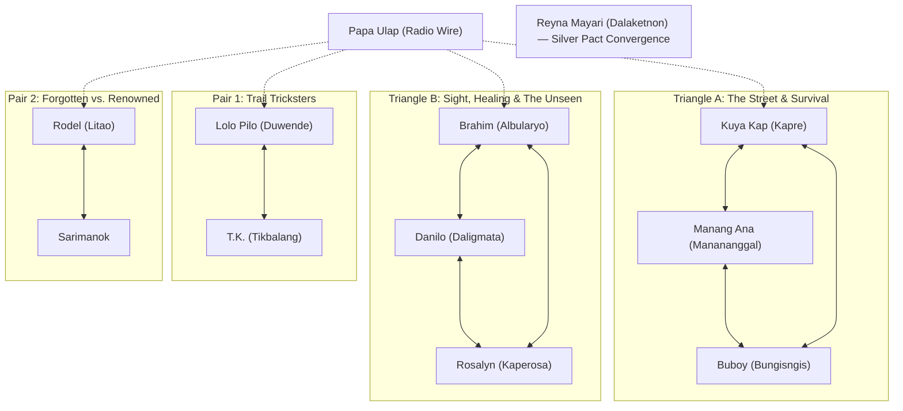

# Sari-Saring Katha — Macro Narrative & Reactive Dialogue Architecture Spec

> **Craft Bible:** [MASTER_DIALOGUE_AND_NARRATIVE_DESIGN_GUIDE.md](file:///c:/Users/John%20Reniel/sari-saring-katha/docs/MASTER_DIALOGUE_AND_NARRATIVE_DESIGN_GUIDE.md)
> **Status:** Locked & Confirmed (Macro Understanding Gate Passed)

---

## 1. Locked Decision Log

| # | Decision Area | Locked Choice | Why |
| :--- | :--- | :--- | :--- |
| **1** | **Progression & Dialogue Architecture** | **Hybrid Spine (6 tight chapters per character) + *Hades* Priority-Bucket Layer (`P1`–`P4`)** | Reuses `CustomerData.chapters` + `StoryPrerequisiteGroup`, cuts ~33% of filler chapters, and makes every everyday visit reactive via the 3-Slot Sandwich Pattern without scope creep. |
| **2** | **Macro Climax & Convergence** | **Barangay Convergence + *New Vegas*-Style Epilogue** | Reyna Mayari is fair/non-evil (honoring an old covenant). Rushing the Silver Pact with pure money triggers a valid *"Clean Ledger, Empty Bench"* transactional ending (zero soft-lock), while investing in neighbors brings earned allies to witness/vouch at the sealing. |
| **3** | **Mechanics-as-Dialogue & Fail-Forward** | **Core 4 Counter Verbs** (Pricing/Utang memory, 1–2 signature *VA-11 HALL-A* item substitutions per character, full Minigame Fail-Forward, Journal Taboo Trapdoors) | Turns the store's actual gameplay verbs into narrative choices while keeping special substitution logic tightly scoped. |
| **4** | **Intersecting Barangay Web** | **Organic Mixed Web** (some 3-character triangles, some 1-to-1 pairs, some self-contained solitary arcs + Papa Ulap's Radio & Danilo ambient thread) | Feels natural and character-true rather than forcing artificial links on solitary characters. |
| **5** | **Delayed Consequence Signaling** | **Subtle Diegetic Cue + Quiet Folklore Journal Note** | Preserves cozy store immersion (zero corner pop-up banners during dialogue) while rewarding attentive players; explicit dot-connecting lines fire when payoffs detonate 2–4 visits later. |

---

## 2. The 6-Chapter Core Arc Spine (`P0`)

Every neighbor's story is distilled into **6 punchy chapters** (8–16 lines max per beat; 60–90 seconds read/play time) organized into 2 clean Acts (or 3 tight 2-chapter movements):

| Chapter | Dramatic Role | Required Craft & Mechanical Elements |
| :--- | :--- | :--- |
| **Ch. 1 — The Hook** | Late entry into their surface mask + concrete want. | Establish 5-axis voice immediately. Zero biography dump. 1 real posture choice (*Accept / Reject / Deflect / Silence*). |
| **Ch. 2 — The Crack** | First subtextual slip or friction with a counter verb (price, utang, riddle, or minigame). | Sets **Flag #1** or first **Behavioral Tally** shift (`+1` / `-1`). Includes Fail-Forward if a minigame/check occurs. |
| **Ch. 3 — The Web / Taboo** | Cross-character ripple **or** Folklore Journal Taboo Trapdoor. | Rewards reading the Journal or listening to another neighbor with a **Trapdoor** that skips buildup and shifts trust. |
| **Ch. 4 — The Pressure** | High-stakes moral/scarcity dilemma (utang, secret item substitution, or protecting a secret). | Sets **Flag #2 (Delayed Consequence)** with a subtle diegetic cue + quiet Journal note. |
| **Ch. 5 — The Detonation** | Delayed consequence pays off 2–4 visits later; character drops their mask. | Explicitly connects the dots back to Ch. 2–4. Branches cleanly on **Parallel Track** (*Warm/Trusted* vs. *Guarded/Transactional*). |
| **Ch. 6 — The Resolution** | Character makes their *own* fateful decision based on accumulated Behavioral Tally. | Exports **1 final outcome enum** (`[char]_outcome = "ally" | "bittersweet" | "estranged"`) for Mayari's Convergence & Epilogue. |

---

## 3. The Everyday Reactive Layer (`P1`–`P4` Sandwich Pattern)

All non-story `Purchase`, `Visit`, and `Smalltalk` encounters are assembled dynamically using the **3-Slot Sandwich Pattern**:

### Priority Buckets (Evaluated Top-Down on Encounter Start)
- **`P0` (Critical Arc):** Eligible Story Chapter (`CustomerData.chapters[n]`). Always preempts `P1`–`P4`.
- **`P1` (Delayed Payoff / Cross-Web):** One-shot reactive lines unlocked by `world_flags` from another neighbor or a past dilemma (marked consumed once played).
- **`P2` (Recent Gameplay Memory):** One-shot reactions to your last transaction with this customer (e.g., *overcharged yesterday*, *won/lost haggle*, *refused/accepted utang*, *won/lost minigame*).
- **`P3` (Live World State):** Active Market Event, Weather, or Mayari Favor/Omen card.
- **`P4` (Evergreen Voice Bark):** Non-repeating shuffle-bag request/exit line unique to that character's 5-axis voice.

---

## 4. Technical Wiring Spec (Godot / Dialogic Hooks)

Only **4 small engine hooks** are needed to power the entire architecture cleanly:

1. **Dialogic Flag & Context Bridge (`TransactionSession.gd` + `CharacterProgressionManager.gd`):**
   - On encounter start, sync live context vars (`Global_ActiveEvent`, `Global_LastHaggleResult`, `Global_LastUtangResult`, `Global_LastPriceFairness`, plus the current character's `world_flags` and `behavioral_tally`).
   - Support two Dialogic signals:
     - `[signal arg="flag:key=value"]` $\rightarrow$ writes to `CharacterProgressionManager.set_world_flag(key, value)` (and optionally triggers the subtle diegetic cue + Journal footnote).
     - `[signal arg="tally:char_id=+1"]` (or `-1`) $\rightarrow$ nudges that character's accumulated behavioral tally.
2. **Priority-Bucket Opener Resolver (`DialogueContextResolver.gd` — lightweight helper):**
   - Evaluates `P1`–`P3` rules for the current customer against `world_flags` + live store state, marks the chosen one-shot line consumed, and passes `Transaction_ReactiveOpener` (or `""` if none) into Dialogic before `Greeting` runs.
3. **Signature Item Substitution Hook (`TransactionSession.gd`):**
   - Before firing `WrongItem`, check if the active story chapter defines a **registered substitute item/category** (e.g., `chapter_substitute_item` or `category == "candy"` on a specific beat). If matched, route to `label SubstituteItem` in that character's `Story.dtl` instead of `WrongItem`!
4. **Minigame Fail-Forward Signal (`TransactionSession.gd`):**
   - Pass `{Transaction_MinigameWon}` (`true` / `false`) back into Dialogic after any story-triggered minigame so the chapter **always advances** along either the Win or Fail-Forward branch—never brick-walling progress.

---

## 5. Locked Organic Mixed Web

- **Triangle A (`Kuya Kap` $\leftrightarrow$ `Manang Ana` $\leftrightarrow$ `Buboy`):** Everyday barangay survival—*utang*, late-night flights, old trees, and a blunt kid who accidentally exposes secrets.
- **Triangle B (`Brahim` $\leftrightarrow$ `Danilo` $\leftrightarrow$ `Rosalyn`):** Sight, healing, and the unseen—Danilo (*Daligmata* soul-finder) spots Rosalyn (*Kaperosa*), and Brahim (*Albularyo*) crafts wards/talisman remedies.
- **Pair 1 (`Lolo Pilo` $\leftrightarrow$ `T.K.`):** Trail tricksters (*Duwende* + *Tikbalang*) testing old-world etiquette (*tabi-tabi po*, inside-out shirt).
- **Pair 2 (`Rodel` $\leftrightarrow$ `Sarimanok`):** Forgotten water anito vs. renowned royal emblem—two proud spirits wrestling with how mortals remember or reduce them.
- **Solitary Pillars (`Reyna Mayari` & `Uncle Mario`) + Ambient Wire (`Papa Ulap`):** Mayari stays dignified until the Convergence; Uncle Mario anchors Lola's human legacy; Papa Ulap broadcasts 1-line delayed-consequence ripples.

---

## 6. Production Guardrails & Rollout Order

- **Strict State Budget:** Max **3 `world_flags` + 1 integer behavioral tally** per character. Zero orphan flags (every flag written must have a scheduled payoff in this spec or the character's dossier).
- **Non-Goals:** No live 2-way simultaneous Tambayan bench interruptions; no Game Over / soft-lock fail states; no rewriting the full cast until **1 Gold-Standard Pilot Character** is built, wired, and validated end-to-end.
- **Rollout Sequence:**
  1. **Map the Organic Mixed Web** (which neighbors form triangles, pairs, or solitary arcs).
  2. **Wire the 4 lightweight engine hooks** (Dialogic flag/tally signals, `P1`–`P3` opener resolver, substitute-item label, minigame fail-forward var).
  3. **Pilot Character #1** end-to-end (Voice Dossier $\rightarrow$ 6-Chapter Arc $\rightarrow$ Reactive Barks $\rightarrow$ Playtest).
  4. **Roll out across the remaining cast** one character at a time.
  5. **Build the Barangay Convergence & Epilogue** reading each character's single outcome enum.
