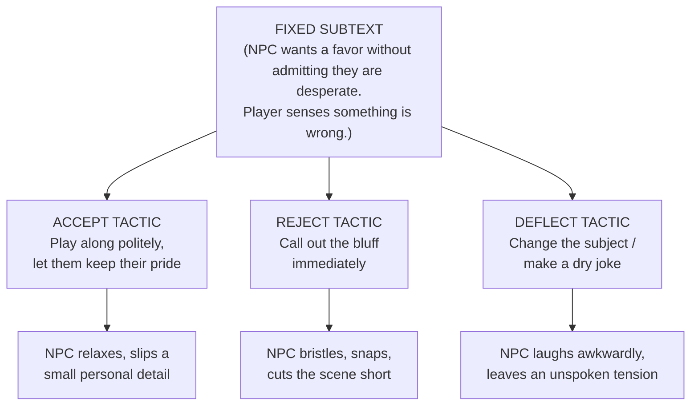
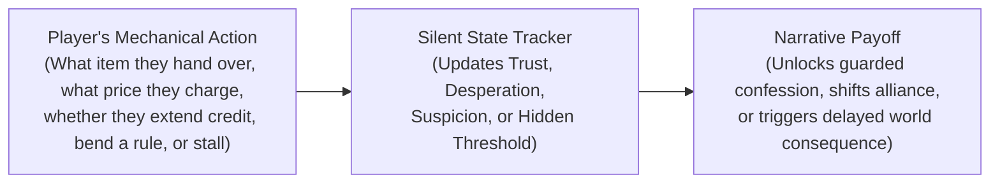
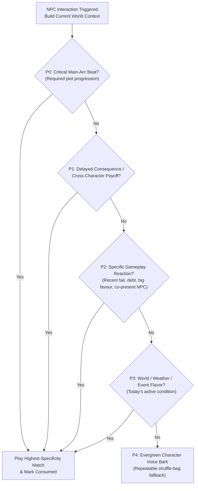
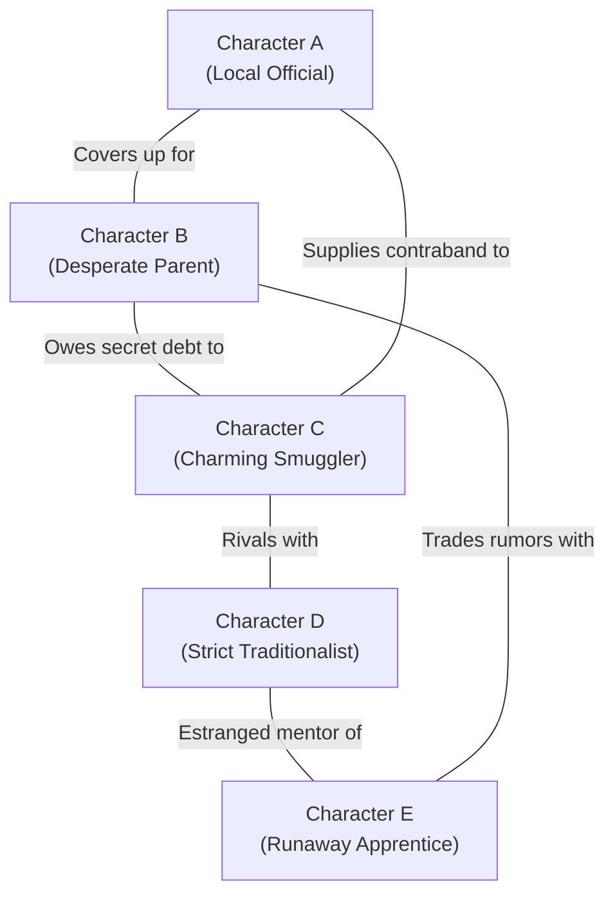
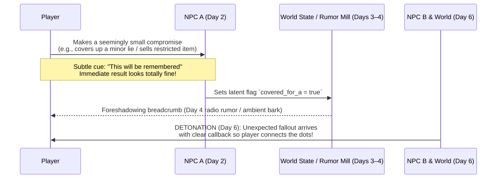

# The Master Guide to Interactive Dialogue & Reactive Narrative Design

> A comprehensive, production-ready craft and systems bible synthesized from industry masterclasses, GDC postmortems, and landmark narrative games (*Disco Elysium*, *Hades*, *Pyre*, *Fallout: New Vegas*, *Pentiment*, *The Witcher 3*, *80 Days*, *VA-11 HALL-A*, *Papers, Please*, *Strange Horticulture*, *Firewatch*, *Citizen Sleeper*, and *Left 4 Dead*).
>
> **Universal Scope:** This guide contains zero legacy project assumptions. Every rule, architecture, and example is universal and designed to be applied from a blank slate to any cast, genre, or interactive story.

---

## Table of Contents

1. [Part I: Killing "Spacebar Spam" — Line-by-Line Dialogue Craft](#part-i-killing-spacebar-spam--line-by-line-dialogue-craft)
   - [1.1 Why Players Mash Spacebar (The Root Diagnosis)](#11-why-players-mash-spacebar-the-root-diagnosis)
   - [1.2 The Fixed Subtext / Fluid Surface Rule (Jon Ingold / inkle)](#12-the-fixed-subtext--fluid-surface-rule-jon-ingold--inkle)
   - [1.3 Vertical Rhythm & The Social-Feed Cadence (Disco Elysium)](#13-vertical-rhythm--the-social-feed-cadence-disco-elysium)
   - [1.4 Late Entry, Early Exit & Killing Throat-Clearing](#14-late-entry-early-exit--killing-throat-clearing)
   - [1.5 Priority Filters, Alley-Oop Elimination & Offset Mutation](#15-priority-filters-alley-oop-elimination--offset-mutation)
   - [1.6 Trapdoors & Killing "Menu Tidying" Checklists](#16-trapdoors--killing-menu-tidying-checklists)
   - [1.7 Silence, Interruption & Physical Prop Timers (Firewatch)](#17-silence-interruption--physical-prop-timers-firewatch)
   - [1.8 Radical Voice Differentiation & Bark Engineering](#18-radical-voice-differentiation--bark-engineering)
2. [Part II: Gameplay Interactivity, Choice Architecture & Consequence](#part-ii-gameplay-interactivity-choice-architecture--consequence)
   - [2.1 Mechanics-as-Dialogue: Non-Verbal Choice Systems](#21-mechanics-as-dialogue-non-verbal-choice-systems)
   - [2.2 Reactive Architecture Without Scope Creep (Hades & Valve)](#22-reactive-architecture-without-scope-creep-hades--valve)
   - [2.3 Intersecting Quest & Social Webs (Fallout: New Vegas & Pentiment)](#23-intersecting-quest--social-webs-fallout-new-vegas--pentiment)
   - [2.4 Mastering "Failing Forward" (Disco Elysium, Pyre & Citizen Sleeper)](#24-mastering-failing-forward-disco-elysium-pyre--citizen-sleeper)
   - [2.5 Weaponizing Delayed Consequences (The Witcher 3 & Pentiment)](#25-weaponizing-delayed-consequences-the-witcher-3--pentiment)
   - [2.6 Structural Topologies That Prevent Combinatorial Explosion](#26-structural-topologies-that-prevent-combinatorial-explosion)
3. [Part III: The Production Blueprint — Writing & Shipping Without Scope Creep](#part-iii-the-production-blueprint--writing--shipping-without-scope-creep)
   - [3.1 Character Voice & Agenda Blueprint (Universal Template)](#31-character-voice--agency-blueprint-universal-template)
   - [3.2 Scene Construction Blueprint (Universal Template)](#32-scene-construction-blueprint-universal-template)
   - [3.3 State-Variable Hygiene & Scope Budgeting](#33-state-variable-hygiene--scope-budgeting)
   - [3.4 The Ruthless 8-Point Editing Pass](#34-the-ruthless-8-point-editing-pass)
4. [Primary Sources & Industry Talks Referenced](#primary-sources--industry-talks-referenced)

---

# Part I: Killing "Spacebar Spam" — Line-by-Line Dialogue Craft

## 1.1 Why Players Mash Spacebar (The Root Diagnosis)

Players do not skip dialogue because they hate reading. The exact same players who mash spacebar through a 40-word RPG dialogue box will happily read 3,000 words of *Disco Elysium*, *Hades*, or a group chat at 2:00 AM.

Players spam spacebar when **four subconscious alarms** go off:

1. **Predictable Trajectory:** By word four of a sentence, the player already knows how the sentence ends—and how the next three lines will go. Reading feels slower than thinking.
2. **Pure Information Transfer:** Characters are acting as Wikipedia articles with faces, handing over plot facts, lore, or polite pleasantries with zero interpersonal friction.
3. **Zero Conversational Velocity:** Selecting a choice does not alter the speed, temperature, or direction of the scene; every option politely loops back to the exact same next line.
4. **Wall-of-Text Visual Fatigue:** Uniform 3-line blocks of 25–35 words hit the eye like homework, stripping away comedic timing, tension, and human breath.

> **The Iron Law of Interactive Writing:** Every click of the advance button must deliver **friction, surprise, subtext, or power shift**. If a line only bridges point A to point B, cut the bridge and jump straight to B.

---

## 1.2 The Fixed Subtext / Fluid Surface Rule (Jon Ingold / inkle)

In his landmark talk *"Sparkling Dialogue"*, inkle co-founder Jon Ingold (*80 Days*, *Heaven's Vault*, *Overboard!*) diagnoses why most branching dialogue feels flat: writers try to branch the **plot facts** while leaving the scene emotionally neutral. Great interactive writing does the exact opposite.

### The Architecture: Lock the Subtext, Branch the Tactics
Great scenes are never about the literal words on the page; they are **status transactions** (testing, hiding, cornering, deflecting, pleading, bluffing).



- **Why this kills spacebar spam:** When surface words are just *weapons* used to hide or probe an underlying truth, the player has to **actively decode** what the NPC actually means. You cannot skim subtext without missing the game.
- **The Three-Posture Choice Triad (Accept / Reject / Deflect):**
  Never write three flavors of "Tell me more" (*"What happened?" / "Are you okay?" / "Explain."*). Give the player three fundamentally different **conversational moves**:
  1. **Accept / Lean In:** Take their bait, validate, or cooperate.
  2. **Reject / Push Back:** Challenge their premise, set a boundary, or call the lie.
  3. **Deflect / Sidestep:** Pivot with humor, focus on a mundane task, or refuse to engage on their terms.

---

## 1.3 Vertical Rhythm & The Social-Feed Cadence (Disco Elysium)

Lead writer Robert Kurvitz and the ZA/UM team built *Disco Elysium* around a radical realization: **modern game text is not competing with novels—it is competing with social media feeds and instant messaging.**

### Hard Rules for Line Length & Cadence
1. **The 8–14 Word Sweet Spot:**
   - Average spoken bubble/line: **6 to 14 words**.
   - Hard ceiling for 90% of lines: **22 words (max 2 short sentences)**.
   - Save a 30-word line for *once per scene* when a character loses control, rants, or drops their guard.
2. **Staccato Contrast (Long $\rightarrow$ Crash):**
   Follow a winding, defensive, or poetic line with a **brutally short 1–4 word reply**. Contrast creates rhythm; uniform line lengths create hypnosis.
   - *Flat:* `"I've been working double shifts down at the docks all week just to cover the rent, and honestly I don't think my back can take another month of this."` $\rightarrow$ `"That sounds really exhausting, you should probably see a doctor soon."`
   - *Rhythmic:* `"Double shifts at the docks since Tuesday. My spine sounds like dry gravel."` $\rightarrow$ `"Quit, then."` $\rightarrow$ `"Funny."`
3. **One Thought Per Click:**
   Never pack a reaction *and* a topic change *and* a question into a single text box. Split the reaction from the pivot, or better yet, **delete the reaction** and let the pivot imply it.
4. **Kill Fake Typography Crutches:**
   - Ban habitual ellipses (`...`), excessive pause tags, stuttering (`"I-I mean..."`), and stage-sighs (`"*Sigh*"`).
   - If a line needs three ellipses to feel sad, the words aren't doing the work. Use **concrete physical nouns** instead of punctuation crutches.

---

## 1.4 Late Entry, Early Exit & Killing Throat-Clearing

Screenwriter William Goldman's cardinal rule—**enter the scene as late as possible, leave as early as possible**—is ten times more critical in games where pacing is interactive.

### The 3 Lines You Must Delete From Every Draft
When writers draft a scene, the first 2–3 lines are almost always **throat-clearing** (characters walking up, saying hello, commenting on the time/weather, establishing why they are standing there), and the last 2 lines are **doorway goodbyes** (*"Anyway, thanks! See you around!"*).

#### Before (Throat-Clearing + Doorway Exit — 7 clicks of dead air):
> **NPC:** "Hey there! Busy afternoon, huh?"
> **Player:** "Yeah, it's been pretty steady."
> **NPC:** "Well, I was just walking back from my shift and figured I'd stop by to ask you something."
> **NPC:** "Did anyone drop off a brass key here earlier? I lost mine near the square."
> **Player:** "Haven't seen one, sorry."
> **NPC:** "Ah, shoot. My landlord is going to kill me. Well, thanks anyway! Catch you later!"

#### After (Late Entry, Early Exit — 2 clicks, high subtext):
> **NPC:** "Tell me someone turned in a brass key."
> **Player:** "Nothing all day."
> **NPC:** "Great. Guess I'm climbing my own fire escape tonight." *(Exits)*

**Notice what happened:** Word count dropped by **70%**, character personality *tripled*, and the scene ended on a punchy image instead of *"Thanks anyway, bye!"*

---

## 1.5 Priority Filters, Alley-Oop Elimination & Offset Mutation

### 1. Character Priority Filters (Never Personality Adjectives)
Never write a character using adjectives like *"grumpy"*, *"quirky"*, or *"wise"*. Adjectives produce caricatures. Instead, pass every piece of scene information through a **tactical filter**:
- **What do they want in the next 60 seconds?**
- **What are they trying NOT to admit?**
- **What is their habitual strategy to get what they want?** (e.g., *guilt-tripping disguised as politeness*, *aggressive over-precision*, *changing the subject to numbers*, *oversharing trivia so nobody asks how they are*).

Exposition is never boring when it is **filtered through an obsession or a defense mechanism**. When an anxious character rattles off hyper-specific prices or schedules to avoid talking about a breakup, the exposition *is* the characterization.

### 2. Banning the "Alley-Oop" Setup Line
An **alley-oop line** occurs when Character A asks an unnatural, writerly question solely so Character B can deliver a cool speech (*"Why do you hate the magistrate so much?"* / *"What's that scar from?"*). For a split second, Character A stops being a person and becomes a microphone stand.
- **Fix 1 — Delete the prompt:** If Character B is angry enough to talk about the magistrate, let a mundane friction trigger it unprompted.
- **Fix 2 — Friction over Curiosity:** People rarely reveal their worldview because someone politely asked; they reveal it when **trying to justify a boundary, win an argument, or talk someone into a bad idea**.

### 3. Type-B Offset Conversation ("Duplicate & Mutate")
Flat dialogue (**Type A**) works like ping-pong: Question $\rightarrow$ Answer. Statement $\rightarrow$ Agreement. Every exchange closes the loop, giving the player zero forward pull.

Alive dialogue (**Type B**) **offsets** every reply: acknowledge the implication of Line 1, then **introduce a new complication or assumption** that forces the next line forward.
- *Type A (Closed):*
  - `"You're out late."` $\rightarrow$ `"Yeah, I had to finish a delivery."`
- *Type B (Offset — jumps straight past the literal question):*
  - `"You're out late."` $\rightarrow$ `"Don't start. You sound like my sister."`

---

## 1.6 Trapdoors & Killing "Menu Tidying" Checklists

One of the worst habits traditional RPGs taught players is **Menu Tidying** (also called *hub exhaustion*): presenting a vertical list of 4 questions (`Who are you?` / `Tell me about the town` / `Rumors?` / `Goodbye`), training the player to robotically click 1, 2, 3 from top to bottom while skimming.

### How to Destroy Menu Tidying Forever
1. **Mutually Exclusive Questions ("Pick One, Lose the Rest"):**
   An NPC doesn't stand frozen in time waiting to be interviewed. Give them patience for **one** prying question before their ride arrives or they change the subject. Suddenly, choosing *which* question to ask is an actual gameplay decision.
2. **Conversational Trapdoors (Reward Sharpness With Speed):**
   Borrowing Jon Ingold's *trapdoor* technique: if a player notices a clue and picks a sharp, perceptive dialogue option, **reward them by skipping 4 lines of slow buildup** and dropping straight into the NPC's stunned reaction. When choices visibly accelerate or derail scenes, players stop sleepwalking and read every option like a loaded weapon.
3. **Micro-Reactive Texture Choices (*Disco Elysium*):**
   Not every choice needs to alter the macro-plot. Include **textural choices**—letting the player be petty, deadpan, overly literal, superstitious, or suspicious—followed by **1–2 lines of bespoke NPC micro-reaction** before rejoining the spine. Two lines of sharp acknowledgment make the player feel deeply *heard* at almost zero structural cost.

---

## 1.7 Silence, Interruption & Physical Prop Timers (Firewatch)

Dialogue feels stagey when it happens in an airless vacuum where time freezes.

1. **`[Say Nothing]` as a Power Move (*Firewatch* / Telltale):**
   In human conversation—especially when someone makes an unfair excuse, confesses something heavy, or asks too much—**staying silent** is often louder than any line of text. Offering `[...]` / `[Keep working quietly]` lets the NPC squirm, fill the dead air, talk themselves out of their own lie, or respect your discretion.
2. **Physical Prop Timers ("What Else Is Happening?"):**
   Never stage a serious conversation in a void unless it is the climax of the entire game. Anchor dialogue to **simultaneous physical business**—counting change, packing a crate, wiping a spill, checking a ledger, glancing at a line forming outside. Props give characters something toproject emotion onto (*arguing about a dented can instead of arguing about trust*) and create natural scene deadlines.
3. **Earned Interruption:**
   Have characters cut each other off mid-sentence (`—`) when someone hits a nerve, or pivot abruptly when another person walks into earshot.

---

## 1.8 Radical Voice Differentiation & Bark Engineering

### The 5 Axes of Distinct Character Voice
Before writing a single line for any cast member, lock in five orthogonal settings so no two characters share the same linguistic fingerprint:

| Axis | Spectrum Examples |
| :--- | :--- |
| **1. Sentence Geometry** | Clipped 3-word fragments vs. breathless run-on clauses vs. formal balanced periods |
| **2. Status Posture** | Apologetic space-shrinker vs. brisk transactional equal vs. territorial elder |
| **3. Metaphor / Worldview Domain** | Sees everything as *debt/math*, *luck/omens*, *health/rot*, *engines/repairs*, or *audience/clout* |
| **4. Code-Switching / Register** | Street vernacular, stiff textbook formality, bureaucratic jargon, generational slang |
| **5. Forbidden Words ("Never Says")** | Never says *"please"*, never says *"I think"*, never uses contractions, never names emotions |

> **The Blind Cover Test:** Export 20 lines of dialogue with all speaker names stripped. If a playtester cannot identify the speaker of at least 18 out of 20 lines from rhythm and diction alone, the voices are still generic.

### Bark Engineering (Lines Seen 50+ Times)
Short repeatable lines (greetings, ambient remarks, transaction reactions, combat/minigame callouts) obey completely different laws than story scenes:
- **Zero Jokes in High-Frequency Pools:** A clever pun is funny once, grating on hearing #4, and infuriating on hearing #20. High-frequency barks should be **tonal, rhythmic, and grounded**, saving sharp jokes for rare/conditional triggers.
- **Shuffle-Bag + Cooldown Hygiene:** Never use pure `rand()` for barks (which causes back-to-back repeats). Always draw from a non-repeating shuffle bag per character/state.
- **3-Word Rule for Functional Barks:** If a bark triggers during fast mechanical play, keep it under **6 words** so the eye absorbs it peripherally without halting hands-on flow.

---

# Part II: Gameplay Interactivity, Choice Architecture & Consequence

## 2.1 Mechanics-as-Dialogue: Non-Verbal Choice Systems

One of the highest-leverage breakthroughs in modern narrative games (*VA-11 HALL-A*, *Papers, Please*, *Strange Horticulture*, *Undertale*, *80 Days*) is **removing the artificial wall between "gameplay" and "dialogue menus."**

Instead of pausing the game to ask `[A] Be generous` or `[B] Be ruthless`, **let the player's mechanical actions during gameplay *be* their statement.**



### Four Proven Non-Verbal Choice Patterns

1. **The Opaque Action Menu (*VA-11 HALL-A* Pattern):**
   - *How it works:* An NPC asks for one thing verbally, while their subtext betrays that they need (or secretly crave) something else. Serving *what they asked for* keeps things professional; serving *what they actually needed* (or slipping in an extra ingredient/item) quietly crosses a hidden threshold and unlocks a completely different confession.
   - *Why it shines:* It rewards **paying attention to the character** rather than clicking the glowing blue "Paragon" button. Players feel like geniuses when they deduce an unstated need on their own.

2. **Moral Friction Through Systemic Scarcity (*Papers, Please* Pattern):**
   - *How it works:* Never frame a choice as `[Good]` vs. `[Evil]`. Frame it as **Empathy vs. Survival Math**. Helping an NPC bend a rule, take a loss, or buy time costs *your* scarce resource (cash, rent quota, inventory, reputation risk).
   - *Why it shines:* Selfishness stops feeling like cartoon villainy—it feels like pressure. Kindness stops feeling like free points—it feels like a real sacrifice, because you paid for it out of your own pocket.

3. **Diegetic Knowledge as Choice Gates (*Strange Horticulture* / *Outer Wilds* Pattern):**
   - *How it works:* Instead of locking a smart response behind `Speech >= 50`, gate it behind **player comprehension**. Clues live in journals, overheard radio broadcasts, item descriptions, or cultural taboos. All options (or mechanical actions) are physically available at all times, *if* the player put two and two together.

4. **Expressive Micro-Actions:**
   - Track subtle behavioral patterns over time: Did the player consistently gouge this NPC when demand spiked, or give them fair deals? Did they solve their requests quickly or dismiss them half-finished? Having an NPC casually call out your *actual mechanical playstyle* three days later creates jaw-dropping immersion.

---

## 2.2 Reactive Architecture Without Scope Creep (Hades & Valve)

How did Supergiant Games ship 22,000+ reactive lines in *Hades*—and Valve ship thousands of context-aware barks in *Left 4 Dead* and *Portal 2*—without drowning in `if/else` spaghetti or missing launch?

They abandoned giant branching flowcharts and used **Priority-Bucket Rule Databases** (Greg Kasavin, GDC 2021; Elan Ruskin, GDC 2012).

### The Architecture: Context Queries + Priority Buckets

Every time an NPC speaks, the game assembles a flat **Context Snapshot** of the world right now:
```text
Context = {
  npc: "Maren",
  relationship_rank: 3,
  recent_event: "storm_warning",
  owes_player_money: true,
  last_interaction_outcome: "failed_minigame",
  other_npc_present: "Tomas",
  story_stage: 2
}
```

Instead of a hardcoded script tree, Maren's dialogue pool is organized into **5 strict Priority Buckets**. The engine filters for lines whose prerequisites match `Context` (and haven't been played yet), then picks from the **highest non-empty bucket**:



### Why This Completely Eliminates Scope Creep
1. **Zero Deadlocks:** Critical story (`P0`) always preempts flavor (`P3`), and if a player plays 100 hours, `P4` guarantees nobody ever goes mute.
2. **Additive, Safe Authoring:** Want to add a cool reaction if NPC A and NPC B are in the room during a storm? Drop **one** `4-line` entry into `P2` with criteria `{npc: A, other_present: B, weather: storm}`. You touch **zero** existing timelines. You cannot break the main plot.
3. **Effortless Late-Stage Triage:** During the final stretch before release, `P0` and `P1` are mandatory ship targets. `P2` and `P3` can be expanded or trimmed per character based on remaining schedule with **zero structural surgery**.
4. **Modular Greeting Stitching ("Sandwich Pattern"):**
   Instead of rewriting an entire transaction timeline for every world state, compose encounters from **3 snap-together slots**:
   - **Slot 1 (Reactive Opener — 1–2 lines):** Pulled from the `P1–P3` Priority Bucket (*"Heard you turned down Vane's bribe yesterday. Bold—or stupid."*).
   - **Slot 2 (Core Business / Scene Meat):** The actual request, dilemma, or chapter beat.
   - **Slot 3 (Outcome Closer — 1 line):** Reacts to what the player just did mechanically.

   *Math miracle:* 10 openers $\times$ 5 core transactions $\times$ 6 closers = **300 distinct-feeling encounters** from just **21 tiny snippets**!

---

## 2.3 Intersecting Quest & Social Webs (Fallout: New Vegas & Pentiment)

In weak narrative games, NPCs live in **isolated silos** (Hub-and-Spoke): Character A's 5 chapters are exclusively about Character A; Character B never mentions Character A. The world feels like 10 separate visual novels glued to one room.

In *Fallout: New Vegas* and *Pentiment*, Josh Sawyer and John Gonzalez built **Intersecting Social Webs** where pulling one thread vibrates three others.

### How to Build a High-Density Web on an Indie Scope

#### 1. The Rule of Overlapping Triangles (Not N-Squared Everything)
Connecting 12 characters to all 11 others creates $132$ relationships (impossible scope). Instead, group your cast into **overlapping 3-character triangles** where every character belongs to **two** triangles:



- **Result:** With just **2–3 cross-links per character**, every single character is at most two degrees away from everyone else!

#### 2. Information Triangulation (Gossip, Alibis & Contradictions)
Never let a character's secret be solvable solely by talking to *that same character*.
- **Character A** tells you a polished lie (*"I'm buying extra bandages for stray dogs"*).
- Two days later, **Character C** casually mentions seeing A limping out of an underground ring.
- Next time **Character A** visits, a **new trapdoor option** unlocks—because you heard it from C. And if you confront A, **Character C** later gets mad at you for burning their source!

#### 3. Asymmetric Zero-Sum Loyalties
Design shared bottlenecks where **helping Character A advance their goal materially inconveniences Character B**, and both have sympathetic, human reasons:
- Giving your last scarce supply to B saves their livelihood today, but means A shows up tomorrow empty-handed before a critical inspection.
- No cartoon villains. Only competing human needs in a tight community.

---

## 2.4 Mastering "Failing Forward" (Disco Elysium, Pyre & Citizen Sleeper)

Traditional games treat failure as `Fun Stopped — Reload Save`. When failure blocks content or hands out flat stat punishments, players experience **loss aversion**: they play conservatively, hoard resources, and save-scum until they get the "golden path."

*Disco Elysium*, *Pyre*, and *Citizen Sleeper* proved that **failure is where the best stories live—if you design failure as an alternate forward vector.**

### The 5 Laws of Failing Forward

1. **Failure Changes the Trajectory, Never Halts the Clock (*Pyre* Rule):**
   In Supergiant's *Pyre*, you can lose every single ritual match, including the finale, and the game never shows a Game Over screen—rivals remember beating you, teammates react to the heartbreak, and the plot marches forward into a bittersweet, bespoke arc.
   - **Rule:** Never force a player to replay a narrative minigame, haggle, or skill check just to advance a character's chapter. **Both Win and Loss advance the chapter—into different emotional realities.**

2. **Make the Fail Text Just as Entertaining (or Better) Than Success (*Disco Elysium* Rule):**
   If succeeding a check gives 8 lines of cool lore and failing gives `"Check failed. -5 Rep"`, players will reload 100% of the time.
   - **Rule:** Spend **equal writing budget** on failures. A botched persuasion, a terribly drawn sigil, a lost game, or a clumsy lie should trigger comedy, awkward human vulnerability, unexpected sympathy from the NPC, or an accidental truth slipping out.

3. **Distinguish "White Checks" vs. "Red Checks":**
   - **White Checks (Retryable Only After State Change):** If an NPC refuses to open up today, lock repeat attempts *until* the player learns a new clue from someone else, raises trust, or brings a meaningful object. Never allow brute-force clicking.
   - **Red Checks (Irreversible Story Forks):** High-stakes moments where blundering permanently closes Door A—and immediately cracks open a scrappier, messier Door B.

4. **Mixed-Cost Success & Silver-Lining Failure (*Citizen Sleeper* / *Blades in the Dark*):**
   Replace binary Pass/Fail with four richer states:
   | Outcome | Narrative & Mechanical Shape |
   | :--- | :--- |
   | **Clean Win** | You get what you wanted cleanly, keeping composure and margin. |
   | **Success at a Cost** | You succeed, *but* you owe a favor, lose profit, or raise a third party's suspicion. |
   | **Complication / Sideways Fail** | You fail the task, *but* while cleaning up the mess, the NPC drops their facade and bonds with you over the disaster. |
   | **Hard Fallout** | Someone storms out—triggering an urgent damage-control visit from their friend tomorrow. |

5. **Tempt Suboptimal Play (*80 Days* / Meg Jayanth Rule):**
   Actively *tempt* players to take risky, greedy, nosy, or impulsive options. Safe optimal play produces forgettable stories; near-misses and self-inflicted messes create the stories players tell their friends about.

---

## 2.5 Weaponizing Delayed Consequences (The Witcher 3 & Pentiment)

Why do immediate consequences often feel gamey? Because if you click Option A and instantly see `+10 Gold, -5 Karma`, your brain treats it as a **vending machine**. If you don't like what came out, you reload 30 seconds earlier.

CD Projekt Red (*The Witcher 3*) and Obsidian (*Pentiment*) weaponize **time lag** between action and fallout.



### The 4 Engineering Rules of Delayed Consequences

1. **Decouple the Fuse From the Explosion (2–4 Cycles Later):**
   Let the immediate aftermath of a dubious choice look **deceptively smooth—or even profitable**. Let two or three in-game days pass so the player commits emotionally and mechanically to their timeline before the ripple comes back around.

2. **The "This Will Be Remembered" Tension Signal (*Pentiment* Rule):**
   Josh Sawyer noted a crucial lesson from *Pentiment*: if a choice is *completely* invisible at the moment it's made, delayed fallout can feel random. Give a **subtle diegetic tell** when a player steps on a landmine (a sharp pause, a look from a bystander in the room, a journal note, or a quiet UI chime) *without* revealing **who** noticed or **how** it will detonate. Dread is stronger than surprise—until the surprise hits.

3. **Mandatory Dot-Connecting on Detonation (Paweł Sasko's Rule):**
   When a delayed consequence finally fires hours later, **explicitly echo the concrete detail** of the original choice (*"Where did my kid get money for this? Funny—it's the exact brand you sold on credit Tuesday"*). If the player doesn't instantly go *"OH NO, THAT WAS ME!"*, the delayed consequence failed.

4. **Accumulated Micro-Tallies Over Last-Minute Buttons (*The Witcher 3* Ciri Principle):**
   Never decide the ultimate fate of a character arc with a single `[Save Them] / [Betray Them]` button in the final scene. Track a **3-to-5 point hidden behavioral tally** across their entire arc (e.g., `enabled_habit_count` vs. `encouraged_agency_count`). When the climax arrives, **the character makes their own fateful decision** based on who you shaped them to become across five small moments. That feels transcendent.

---

## 2.6 Structural Topologies That Prevent Combinatorial Explosion

Uncontrolled branching creates Sam Kabo Ashwell's dreaded **Time Cave**: 2 choices across 6 scenes = $2^6 = 64$ endings per character (impossible to write, impossible to QA).

Use these **four scope-safe topologies** instead:

### 1. Branch-and-Bottleneck With State Memory
Branch locally for 3–6 lines (or 1–2 visits) to honor bold player choices, then funnel back into an **inevitable shared event** (an inspection, a storm, a festival, a deadline)—**mutating the opening lines and leverage of that bottleneck** using state flags from the earlier branch.

### 2. Storylets / Salience-Driven Beats (Emily Short)
Instead of rigid Chapter $1 \rightarrow 2 \rightarrow 3 \rightarrow 4$ chains, author small self-contained 8-line **storylets** unlocked by conditions (`trust >= 2 AND saw_argument == true`). Whichever storylets the player qualifies for weave together organically into a custom arc.

### 3. Parallel Track Switching ("Two Lanes, Shared Milestones")
Maintain at most **two emotional lanes** per character arc (e.g., *Guarded/Transactional Relationship* vs. *Trusted Confidant*, or *Enabling Their Vice* vs. *Pushing Tough Love*). Every chapter shares the same situational spine, requiring only **2 variations of key lines** rather than $2^N$ branches!

### 4. The Convergence Finale (*Kaer Morhen* Pattern)
Keep individual character arcs compact and self-contained during Acts 1–2, each culminating in **one clean boolean/enum outcome** (`ally_status = loyal / indebted / estranged / gone`). In the finale, assemble the climax dynamically by checking each character's single outcome flag—producing hundreds of permutations of the ending from $O(N)$ linear writing!

---

# Part III: The Production Blueprint — Writing & Shipping Without Scope Creep

## 3.1 Character Voice & Agency Blueprint (Universal Template)

Complete this sheet for **every character** before drafting a single scene. Remember Meg Jayanth's *"Forget Protagonists"* rule: **NPCs are not quest dispensers waiting for the player to fix their lives; they have active plans they are already executing with or without you.**

```markdown
### CHARACTER DOSSIER: [Name]
- **External Agenda (What they are actively trying to pull off):**
- **Internal Wound / Fear (What they refuse to say out loud):**
- **Habitual Mask / Tactical Filter (How they manipulate or navigate conversations):**
- **Signature Prop / Transaction Anchor (Physical object carrying their subtext):**

#### VOICE FINGERPRINT
- **Sentence Length & Rhythm:** (e.g., clipped 4-word bursts / winding polite deflections)
- **Lexicon & Metaphor Bank:** (e.g., accounting terms, sports bets, folkloric omens, medical precision)
- **Register / Code-Switching Rule:** (When do they slip into formal speech vs. vernacular?)
- **Forbidden Words ("Never Says"):** (e.g., never apologizes, never says "I need", never swears)
- **Affection Tell:** (How do we know they like the player without them saying "thank you"?)

#### INTERSECTING WEB & STATE TRACKING (MAX 3 FLAGS!)
- **Triangle Links:**
  - *Allied / Protective of:* [Character X]
  - *Friction / Secret with:* [Character Y]
- **Tracked Behavioural Tally:** `[char]_stance_score` (What player behavior nudges this +1 vs -1?)
- **Key Delayed Consequence Flag:** `[char]_major_choice` -> Pays off in [Event / Character Y's arc]
```

---

## 3.2 Scene Construction Blueprint (Universal Template)

Never open a script file and "just start typing dialogue." Fill out these 6 lines first; if you can't fill them out, there is no scene yet:

```markdown
1. SCENE SPINE (1 sentence): [Character] tries to get [Concrete Thing] from the player without revealing [Hidden Truth].
2. LATE ENTRY LINE: (Cut the hello—what is the sharpest first sentence that drops us mid-tension?)
3. PHYSICAL PROP / TIMER: (What object, cost, bystander, or clock puts pressure on this exchange?)
4. PLAYER AGENCY HOOK:
   - Verbal Triad: [Accept] / [Reject] / [Deflect or Silence]
   - OR Mechanical Choice: [Serve X vs. Y / Charge High vs. Low / Extend Credit vs. Refuse]
5. FAIL-FORWARD PATH: (If the player refuses, fails the check, or messes up, what interesting sideways turn happens instead of a brick wall?)
6. EARLY EXIT PUNCH: (What concrete image or sharp line ends the scene the microsecond the turn lands?)
```

---

## 3.3 State-Variable Hygiene & Scope Budgeting

To overhaul an entire cast **on schedule before launch** without drowning in scope creep, enforce strict **Narrative Budgeting**:

| Scope Guardrail | Hard Production Rule |
| :--- | :--- |
| **Scene Length Cap** | **8 to 16 lines max** per story beat (60–90 seconds read/play time). Anything longer belongs split across two visits! |
| **Bark Length Cap** | **1 to 2 short lines** (4–14 words per line). Zero exposition in barks. |
| **Flags Per Character** | **Max 3 persistent flags + 1 integer tally** per character. Every flag written **must** have a scheduled read/payoff scene at the moment you create it—ban "orphan flags" set "just in case." |
| **Cross-Web Callbacks** | Exactly **2 incoming** and **2 outgoing** cross-character reactive snippets (`P1/P2` bucket) per cast member. Enough to make the whole world feel telepathically connected; small enough to finish in days, not years. |
| **Pilot-First Pipeline** | Fully write, wire, and playtest **1 character end-to-end** (all chapters + fail-forwards + barks + 2 cross-callbacks) as the **Gold Standard Vertical Slice** before touching Character #2. |

---

## 3.4 The Ruthless 8-Point Editing Pass

Run every finished dialogue script through this checklist before shipping. If a scene fails any check, cut or rewrite on the spot:

1. **The Top-and-Tail Guillotine:** Delete the first 2 lines and the last 2 lines of the scene. Does the scene still make sense—and hit 2x harder? *(90% of the time: keep them deleted.)*
2. **The 15-Word Ceiling Scan:** Highlight every single dialogue box over **20 words**. Break it in two, or cut half the words.
3. **The Poster-Quote Purge:** Highlight any line where a character states the moral, theme, or a wise proverb out loud (*"Sometimes holding on hurts more than letting go"*). Burn it and replace it with a concrete comment about a physical object.
4. **The Alley-Oop Check:** Did the player or NPC ask a convenient setup question just to let the other person monologue? Delete the setup question and trigger the line via conflict.
5. **The Blind Name-Swap Test:** Cover the speaker tag. Could *any* other character in the cast say this exact sentence? Rewrite with their specific sentence geometry and lexicon.
6. **The Trapdoor & Choice Audit:** Do any two player choices lead to the exact same NPC response line? Either give each choice a sharp 1–2 line micro-reaction before merging, or delete the redundant choice.
7. **The Fail-Forward Check:** What happens if the player says "No," loses the minigame, refuses credit, or hands over the wrong thing? Is that path just as memorable as saying "Yes"?
8. **The Out-Loud Breath Test:** Read the entire scene out loud at natural speaking speed. Anywhere your tongue trips, your breath runs out, or you feel slightly embarrassed reading it—the player will mash spacebar. Cut it clean.

---

# Primary Sources & Industry Talks Referenced

- **Jon Ingold (inkle Studios):** *"Sparkling Dialogue: A Masterclass"* (AdventureX / GDC) — Fixed subtext vs. variable surface, Accept/Reject/Deflect choice framing, conversational trapdoors, and eliminating menu-tidying.
- **Greg Kasavin (Supergiant Games):** *"Breathing Life into Greek Myth: The Dialogue of Hades"* (GDC 2021) & *Pyre* Design Postmortems — Priority-bucket evaluation queues, prerequisite filtering, scope-safe reactive pools, and zero-Game-Over failing forward.
- **Elan Ruskin (Valve):** *"AI-driven Dynamic Dialog through Fuzzy Pattern Matching"* (GDC 2012) — Context-query rule databases, specificity scoring, and cascading fallbacks (*Left 4 Dead*, *Portal 2*).
- **Robert Kurvitz & Justin Keenan (ZA/UM):** *Disco Elysium* Craft Interviews & *"Meaningless Choices and Impractical Advice"* (GDC) — Social-feed vertical rhythm, micro-reactivity, textural choices, and White/Red check failing forward.
- **Josh Sawyer (Obsidian Entertainment):** *"Do (Say) The Right Thing: Choice Architecture, Player Expression, and Narrative Design in Fallout: New Vegas"* (GDC 2012) & *Pentiment* Postmortems — Intersecting faction/social webs, denying player omnipotence, and *"This Will Be Remembered"* tension signaling.
- **Mateusz Tomaszkiewicz & Paweł Sasko (CD Projekt Red):** *The Witcher 3* & *Cyberpunk 2077* Quest Design Talks (GDC) — Lesser-evil dilemmas, delayed and "really delayed" consequences, dot-connecting on payoff, convergence finales, and accumulated behavioral tallies.
- **Meg Jayanth (inkle Studios):** *"Leading Players Astray: 80 Days & Unexpected Stories"* & *"Forget Protagonists: Writing NPCs with Agency"* (GDC) — Tempting suboptimal decisions, unmade choices, and autonomous NPC agendas.
- **Fernando Damas (Sukeban Games), Lucas Pope, & Gareth Damian Martin:** *VA-11 HALL-A*, *Papers, Please*, & *Citizen Sleeper* Design Analyses — Opaque mechanics-as-dialogue, moral tension via scarcity, and mixed-cost/clock-driven failing forward.
- **Campo Santo (Patrick Ewing, William Armstrong, Sean Vanaman):** *Firewatch* Dialog System Architecture (GDC) — Silence as an active response, conversational timing windows, and spatial interruptions.
- **Sam Kabo Ashwell & Emily Short:** *"Standard Patterns in Choice-Based Games"* & *Storylets / Salience-Based Narrative* — Escaping the *Time Cave* via Branch-and-Bottleneck, Gauntlets, and condition-driven storylets.
