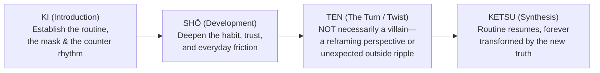
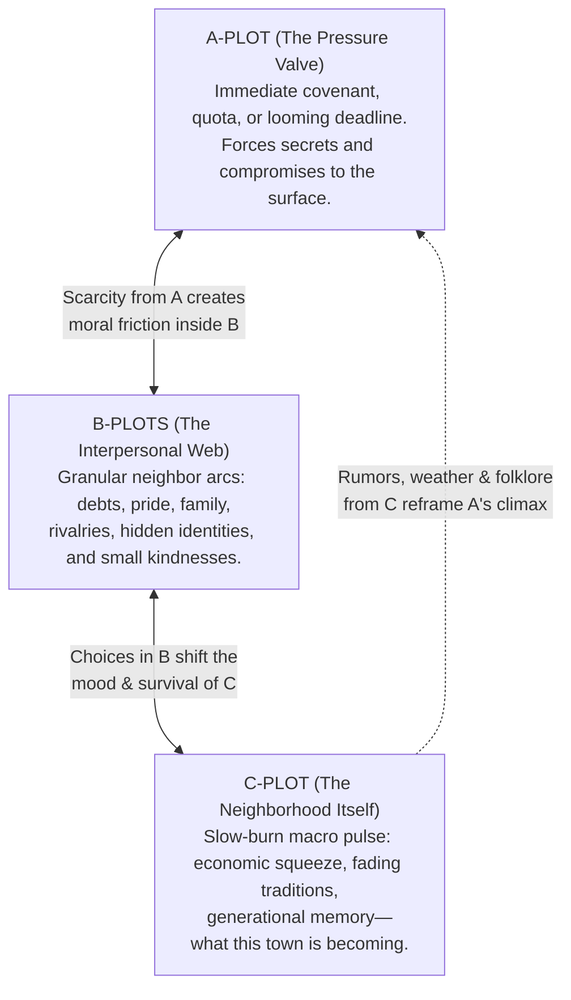

# The Master Guide to Story Architecture, Pacing & Worldbuilding in Single-Location Games

> A universal, web-researched companion bible to [MASTER_DIALOGUE_AND_NARRATIVE_DESIGN_GUIDE.md](file:///c:/Users/John%20Reniel/sari-saring-katha/docs/MASTER_DIALOGUE_AND_NARRATIVE_DESIGN_GUIDE.md), focused on **macro storytelling, daily-loop pacing, iceberg worldbuilding, and weaving ensemble plotlines through a single fixed neighborhood counter**.
>
> Synthesized from GDC postmortems and landmark single-location / town-centric works: *Papers, Please*, *VA-11 HALL-A*, *Coffee Talk*, *Midnight Diner (Shinya Shokudō)*, *Cheers*, *Pentiment*, *Night in the Woods*, *Disco Elysium*, *Kentucky Route Zero*, *Spiritfarer*, *Persona*, and *Hades*.

---

## Table of Contents

1. [Part I: Single-Location ("Bottle") Storytelling — Making One Counter Feel Like a Whole World](#part-i-single-location-bottle-storytelling--making-one-counter-feel-like-a-whole-world)
2. [Part II: Story Structure & Pacing in Daily-Loop Games](#part-ii-story-structure--pacing-in-daily-loop-games)
3. [Part III: Weaving Ensemble Plotlines ("The Town Is the Protagonist")](#part-iii-weaving-ensemble-plotlines-the-town-is-the-protagonist)
4. [Part IV: Iceberg Worldbuilding — The 10% Visible, The 90% Felt](#part-iv-iceberg-worldbuilding--the-10-visible-the-90-felt)
5. [Part V: Practical Story-Weaving & Pacing Audit Templates](#part-v-practical-story-weaving--pacing-audit-templates)
6. [Primary Sources & Case Studies Referenced](#primary-sources--case-studies-referenced)

---

# Part I: Single-Location ("Bottle") Storytelling — Making One Counter Feel Like a Whole World

In an open-world RPG, the player travels to the world. In a **Bottle Game** (a border booth, a late-night diner, a neighborhood storefront), **the world must travel to the player**.

> **The Golden Rule of Bottle Design:** *Do not expand the map; expand the traffic.*

### 1. The Counter as a Liminal Crossroads
The best single-location stories (*Papers, Please*, *VA-11 HALL-A*, *Midnight Diner*, *Cheers*) turn their tiny room into a **neutral threshold** between the chaotic public street and private domestic life:
- **Social Compression:** People who would never share a dining room outside—the strict local official, the broke night-shift worker, the neighborhood kid, the ancient outsider—all stand at the exact same counter. Rigid outside hierarchies dissolve across three feet of wood.
- **Macro-to-Micro Compression:** Never explain a sweeping societal crisis, economic slump, or mythic shift via exposition. Compress it to the width of the counter: a regular who always buys the premium brand suddenly counting coins for the cheapest tin tells the player more about inflation than a 500-word codex entry.

### 2. The Anchor & The Greek Chorus
When the camera never leaves one room, the player needs fixed points of gravity:
- **The Stoic Anchor (The Player Behind the Counter):** Your steady, repeatable daily ritual (wiping surfaces, stocking shelves, counting change) is the calm eye of the hurricane. Your consistency is *why* turbulent characters drop their armor around you.
- **The Greek Chorus of Regulars:** Supporting patrons don't just exist for their own solo subplots—they **digest the town's events together**. When a crisis hits Regular A off-screen, Regulars B and C bring in conflicting theories, jokes, and warnings over the next two shifts.

### 3. Orders & Goods as Emotional Catalysts (*Midnight Diner* Pattern)
In *Midnight Diner*, every single episode is unlocked by a specific dish ordered at the counter. The item is never random fetch-quest cargo—it is a **psychological key**:
- What a character buys reveals **what they are enduring today** (extra coffee = pulling a double shift; bandages = someone got hurt; cheapest instant meal = rent wiped them out; splurging on a luxury treat = celebrating a quiet victory).
- When a regular's **usual order suddenly changes** without explanation, the player immediately feels a narrative hook before a single word is spoken.

### 4. Peripheral World-Leak Windows
To prove the world continues moving outside your walls, let external reality **leak inward through diegetic channels**:
- **Radio / News / Rumor Feeds:** Fragmented headlines, weather warnings, and neighborhood broadcasts heard *between* shifts.
- **Supply & Price Fluctuations:** A delivery running late, a sudden shortage of one staple, or a heatwave spiking cold-drink demand lets the player *feel* the outside world through their shelves.
- **Physical Residue:** Characters arrive wet from rain, dusted in construction chalk, smelling of smoke, or carrying a prop from an off-screen errand.

---

# Part II: Story Structure & Pacing in Daily-Loop Games

## 2.1 Three-Act Conflict vs. *Kishōtenketsu* (Why Cozy/Neighborhood Games Break Under Pure Western Plotting)

Western screenwriting assumes every story requires a **Three-Act Mountain** driven by an antagonist and escalating crisis (*Setup $\rightarrow$ Escalating Conflict $\rightarrow$ Climax*). Forcing that structure onto a neighborhood store game often creates artificial melodrama or cartoon villains.

Instead, master slice-of-life and character-driven games blend or lean on **Kishōtenketsu**—the classical East Asian four-part structure driven by **contrast and perspective shift** rather than combat:

| Dimension | Three-Act Structure | *Kishōtenketsu* Structure |
| :--- | :--- | :--- |
| **Core Engine** | Obstacle & Conflict (Win vs. Lose) | Juxtaposition & Reframing (Mask vs. Truth) |
| **Pacing Shape** | Single vertical mountain peak | Rhythmic, wave-like constellation of peaks |
| **The Midpoint** | Crisis / False Defeat | **The *Ten*** — an unexpected arrival, secret, or perspective shift that recontextualizes everything before it |
| **Best Used For** | Overarching deadline / debt covenant / mystery spine (**A-Plot**) | Everyday neighbor arcs, folklore reveals, quiet healing (**B-Plots & C-Plot**) |

> **The Hybrid Secret:** Use a light **Three-Act spine** for your macro deadline/goal (giving the game forward pull), while letting individual neighbor stories breathe through ***Kishōtenketsu*** (so not every neighbor needs a villain to be gripping).

---

## 2.2 Defeating the "Act 2 Slog" (Tension-Release Curves in Daily Loops)

In daily-loop games (*Persona*, *Spiritfarer*, *Hades*), the biggest pacing killer is the **Act 2 Slog**—the middle stretch where the player has mastered the controls, the novelty of Day 1 has faded, and the ending still feels far away.

### Four Proven Antidotes to the Act 2 Slog
1. **Orchestrate Deliberate "Breathers" (Contrast Creates Impact):**
   Never stack three devastating emotional confession scenes back-to-back. Emotional weight collapses into numbness without a palette cleanser. Alternate heavy character turns with **light comedic banter, tactile chores, or playful minigames**—the contrast makes the next quiet heartbreak hit twice as hard.
2. **Stagger Arc Phases Across the Cast (Never Sync Everyone to Chapter 3 at Once):**
   If every neighbor hits their slow setup on Day 1–2 and their climax on Day 10, the middle days feel flat and the finale feels overcrowded. **Offset your cast's peaks:**
   - While Neighbor A is peaking at their dramatic *Ten* (Turn), Neighbor B is just arriving with a funny fresh hook (*Ki*), and Neighbor C is quietly paying off a delayed consequence (*Ketsu*).
   - Every single in-game day should contain at least **1 small payoff** and **1 fresh curiosity hook** (the *Zeigarnik Effect*).
3. **Incremental Systemic Novelty:**
   Introduce a new neighborhood rule, visitor tier, rumor thread, or counter twist right as the current rhythm becomes autopilot.
4. **Micro-Doses Over Cutscene Walls (*Hades* Rule):**
   Never halt a 5-minute gameplay loop for a 10-minute text dump. Deliver story in **60–90 second micro-bursts** woven seamlessly into the shift so the player's hands stay warm and every day ends with *"just one more shift."*

---

# Part III: Weaving Ensemble Plotlines ("The Town Is the Protagonist")

In single-character RPGs, subplots orbit the hero. In great neighborhood games (*Pentiment*, *Night in the Woods*), **the town itself is the true protagonist**, and every character is a different lens onto the same living community.

### 1. The A / B / C Plot Braiding Architecture

### 2. Three Techniques That Make Separate Stories Feel Woven Into One Tapestry

#### A. Off-Screen Agency ("Lives Don't Pause When They Leave the Counter")
Characters feel like cardboard cutouts when their problems freeze between visits until the player clicks them.
- **The Fix:** Advance off-screen timelines between visits. A neighbor mentions applying for a late shift on Tuesday; on Friday they walk in with oil-stained sleeves and dark circles under their eyes. A kid mentions a dare on Monday; by Wednesday he's limping or bragging about how it went sideways.
- When players realize the neighborhood is living and changing off-screen, the tiny storefront instantly expands into a living town.

#### B. Thematic Mirroring (Even Between Characters Who Never Meet)
Not every character needs a direct plot intersection with every other character. Instead, **braid them thematically**:
- If the central theme of your game is *"What do we owe the past vs. what do we need to survive today?"*, then:
  - Character 1 wrestles with it through **an old addiction/habit**.
  - Character 2 wrestles with it through **family debt and pride**.
  - Character 3 wrestles with it through **being forgotten by modern culture**.
  - The overarching A-Plot wrestles with it through **an inherited covenant**.
- Because every arc asks a different version of the **same human question**, moving from Customer A to Customer B feels like chapters of one cohesive novel rather than random side quests.

#### C. Echoing Props & Shared Geography
Give the unseen town **3 to 5 named off-screen landmarks** (e.g., *the old highway*, *the corner acacia*, *the karinderya down the block*, *the barangay clinic*, *the transformer on Mabini Street*) and reuse them across multiple characters' stories. When Character A mentions a flickering streetlamp on Mabini Street and three days later Character D mentions an incident under that exact lamp, the player builds a **vivid mental map** of a town they never even walked through!

---

# Part IV: Iceberg Worldbuilding — The 10% Visible, The 90% Felt

Popularized by Hemingway and mastered in games like *Disco Elysium* and *Kentucky Route Zero*, **Iceberg Worldbuilding** keeps **90% of the lore underwater** so the visible 10% carries unmistakable weight.

### 1. Ground the Supernatural in the Mundane
High-concept lore feels weightless when characters talk like fantasy encyclopedias. Supernatural or mythic elements become breathtaking when they collide with **domestic banality**:
- Don't have a mythic spirit explain its ancient cosmological origin. Have it complain about **power lines, wet slippers, clinic wait times, or the price of detergent**.
- The contrast between ancient folklore and fluorescent-lit everyday survival creates instant, unforgettable atmosphere.

### 2. Economy & Logistics as Worldbuilding
You never need a history textbook to show a town under pressure. Let the **supply chain and price tags** tell the story:
- Why is a certain staple suddenly expensive or scarce?
- Who pays in crisp bills, who counts centavos, and who asks for credit before Friday?
- Economic friction turns worldbuilding from passive background flavor into **active gameplay tension**.

### 3. Weaponize Unreliable Rumors & Contradictions
Real neighborhoods do not have a unified Wikipedia truth.
- Let two neighbors tell **slightly conflicting versions** of the same local legend or past event.
- Let a radio host pass along half-accurate gossip that the player—who actually saw what happened at the counter—knows is only half the truth.
- Ambiguity invites the player's imagination to fill in the dark water beneath the iceberg.

### 4. Environmental Residue (Design Backward)
Every object on the counter or wall should imply a 10-year history without explaining it: a faded tally mark behind the register, a keepsake left by a regular whose arc you finished, a worn stool outside. Strip away 90% of the explanation; leave only the artifact.

---

# Part V: Practical Story-Weaving & Pacing Audit Templates

Use these two quick checklists whenever mapping a new cast cluster or reviewing a full game's flow:

### 1. The Single-Location World-Weaving Checklist
- [ ] **Shared Geography:** Do at least 3 neighbors reference the same off-screen landmarks (street, tree, clinic, highway, diner) so the player builds a mental map?
- [ ] **Usual-Order Disruption:** Does each major neighbor have a recognizable "usual" purchase whose sudden change signals an emotional turn before they speak?
- [ ] **Off-Screen Momentum:** Does each character's life visibly progress *between* visits so they feel autonomous rather than frozen at the counter?
- [ ] **Thematic Braiding:** Do the B-Plots (neighbors) and C-Plot (town pulse) echo the same central question as the A-Plot (macro goal)?
- [ ] **Mundane-Meets-Mythic:** Is every supernatural/lore element anchored to a concrete, ordinary physical detail or economic cost?

### 2. The Anti-Act-2-Slog Pacing Audit
- [ ] **Staggered Peaks:** Are neighbor *Ten* (Turning Point) chapters staggered across different days/tiers instead of all clumping together?
- [ ] **Breather Cadence:** Is every heavy emotional beat followed by a lighter comedic, mechanical, or warm palette cleanser?
- [ ] **Daily Payoff + Hook:** Does almost every shift deliver at least one micro-payoff (a callback, a rumor resolved, a rank perk) AND leave one unanswered curiosity hook for tomorrow?
- [ ] **No Lore Lectures:** Has every "explain the world" monologue been cut and redistributed into peripheral leaks (radio, prices, conflicting rumors, objects)?

---

# Primary Sources & Case Studies Referenced

- **Bottle & Countertop Storytelling:** *Papers, Please* (Lucas Pope), *VA-11 HALL-A* (Sukeban Games), *Coffee Talk* (Toge Productions), *Midnight Diner / Shinya Shokudō*, and *Cheers* — transit-hub dynamics, orders as psychological keys, peripheral world-leak feeds, and microcosm compression.
- **Pacing & Daily Loops:** *Persona*, *Spiritfarer* (Thunder Lotus), and *Hades* (Supergiant Games) — tension-release curves, deliberate breathers, incremental novelty, micro-dosed narrative queues, and defeating the Act 2 Slog.
- **Non-Conflict Structure:** *Kishōtenketsu* (*Ki–Shō–Ten–Ketsu*) in slice-of-life and cozy game design — perspective twists (*Ten*) over artificial antagonists.
- **Ensemble & Town-as-Protagonist Weaving:** *Pentiment* (Obsidian / Josh Sawyer) and *Night in the Woods* (Infinite Fall) — A/B/C plot braiding, spatial anchoring, temporal layering, and thematic resonance.
- **Iceberg Worldbuilding:** *Disco Elysium* (ZA/UM), *Kentucky Route Zero* (Cardboard Computer), Ernest Hemingway, and Brandon Sanderson — grounding the extraordinary in the mundane, economy-as-lore, unreliable rumors, and environmental residue.
