# Sari-Saring Katha — Developer Architecture Guide

Welcome to the **Sari-Saring Katha** codebase! This guide is written for engineers who want to understand the architecture, add features, and fix bugs without getting lost in implementation minutiae.

---

## 1. The Big Picture

### What is this game?
A first-person cozy shop simulator set in rural Karimlan. You run a traditional Filipino *sari-sari* store serving local folklore neighbors (Kapre, Manananggal, Tikbalang, etc.). 

### Tech Stack
* **Engine:** Godot 4.6 (Forward Plus, Direct3D 12, Jolt Physics 3D).
* **Dialogue:** [Dialogic 2](https://github.com/dialogic-godot/dialogic) with custom speech-bubble positioning in 3D.
* **Architecture Style:** Domain-partitioned folders + global EventBus pub/sub + data-driven custom Resources.

---

## 2. Directory Structure (Where Things Live)

```
sari-saring-katha/
├── Scenes/                  # Packed scenes (.tscn)
│   ├── MainGame.tscn        # The core 3D gameplay level (store interior/exterior)
│   ├── MainMenu.tscn        # Main title screen with 3D backdrop
│   └── UI/                  # Menus, overlays, and HUD components
├── Scripts/                 # All GDScript logic, split by domain:
│   ├── Core/                # Global infrastructure (EventBus, SaveManager, LogManager)
│   ├── Store/               # Shop logic (InventoryManager, DayClock, Restock, Layout)
│   ├── World/               # 3D level nodes (CustomerSpawner, GameManager, Entities, Shelves)
│   ├── Components/          # Reusable 3D behaviors (PlayerController, Raycast interaction)
│   ├── Progression/         # StoryManager (Tiers) & CharacterProgressionManager (Arcs)
│   ├── Data/                # Custom Resource scripts (ItemData, CustomerData, ArcData)
│   ├── Audio/               # AudioManager & pooled sound playback
│   └── UI/                  # Menus, Nokia phone UI, HUD, and overlays
├── Resources/               # Authorable .tres assets
│   ├── items/               # All sellable items & container definitions
│   └── customers/           # Character data, sprites, and arc definitions
└── Dialogue/                # Dialogic timelines (.dtl) and character profiles (.dch)
```

---

## 3. The Core Loops

Understanding the game comes down to three interlocking loops: **The Day Loop**, **The Customer Loop**, and **The Restock Loop**.

```mermaid
graph TD
    subgraph DayLoop ["1. The Day Loop"]
        D1["5:00 AM: Day Starts"] --> D2["Daytime Hours: Customers arrive sequentially"]
        D2 --> D3["8:00 PM: Store Closes"]
        D3 --> D4["Night: Reyna Mayari arrives to collect Quota"]
        D4 --> D5["Autosave to disk"]
        D5 --> D6["Sleep Overlay (Folklore Quote)"]
        D6 --> D1
    end

    subgraph CustomerLoop ["2. The Customer Transaction Loop"]
        C1["Customer arrives at counter"] --> C2["Player left-clicks customer -> Greeting dialogue"]
        C2 --> C3["Customer states requested items (HUD shows icons)"]
        C3 --> C4["Player grabs item from shelf/dispenser and drops on tray"]
        C4 --> C5{"Item correct?"}
        C5 -->|Yes| C6["Money added (or Utang recorded)<br>Customer satisfied & leaves"]
        C5 -->|No| C7["Error animation<br>Item stays in player hand"]
    end

    subgraph RestockLoop ["3. The Restock & Delivery Loop"]
        R1["Click 3D Nokia phone on counter"] --> R2["Dial Uncle Mario (speed dial '*')"]
        R2 --> R3["Order items or Store Tier Upgrades"]
        R3 --> R4["Uncle Mario arrives on 3D tricycle"]
        R4 --> R5["Shelf goods drop in floor bags<br>Candies/sachets auto-fill dispensers"]
        R5 --> R6["Player clicks bag -> unpacks items onto shelves"]
    end
```



---

## 4. Key Systems & How They Work

### A. The Global EventBus (`Scripts/Core/EventBus.gd`)
Rather than nodes holding direct references to each other, high-level events travel through `EventBus`.

**Key signals you will use most often:**
* `EventBus.money_changed.connect(_on_money_changed)`: When the player's balance changes.
* `EventBus.day_started.connect(_on_day_started)`: Morning reset (5:00 AM).
* `EventBus.day_ended.connect(_on_day_ended)`: Evening closed.
* `EventBus.tier_advanced.connect(_on_tier_advanced)`: When store tier upgrades (`1..10`).
* `EventBus.request_sfx.emit("pickup")`: Play any sound effect through the pooled audio manager.

---

### B. Player Interaction & Drag-and-Drop
First-person interaction uses two scripts on the player:

1. **`PlayerInteraction.gd`** (on player's `Camera3D`):
   * Fires a continuous center-screen raycast (`10m` range).
   * **Collision Layer Trick:** Items and shelves live on **Layer 1**. Customers live on **Layer 5**. The customer raycast ignores Layer 1, meaning you can always click the customer behind the counter without items blocking your cursor.
   * Objects you can hover or click inherit from `WorldInteractor.gd`.
2. **`DragManager.gd`** (Autoload):
   * When you click an item, 3D mesh is hidden, and a 2D spring-damper cursor icon appears on a top-level canvas layer.
   * Moving near a shelf projects a 3D ghost preview showing where the item will snap.
   * Dropping on the `TransactionTray` hands the item to the customer. Dropping on the `Trash` deletes it. Dropping on a shelf reparents it to that slot.

---

### C. Shelves vs. Dispensers (Physical vs. Digital Stock)
Items are handled in one of two ways:

| Type | How It Works | Examples | Where to find scripts |
| :--- | :--- | :--- | :--- |
| **Physical Shelf Goods** | Each item is an individual 3D node (`DraggableItem.gd`) placed in pre-calculated slots on a `ShelfSurface.gd`. | Cans, bottles, snacks, chips. | `Scripts/World/Entities/ShelfSurface.gd`<br>`Scripts/World/Entities/DraggableItem.gd` |
| **Container Dispensers** | Fixed jars/strips on the counter with a digital quantity counter in `InventoryManager`. Clicking dispenses a temporary `DraggableItem`. | Candies in glass jars, coffee sachets hanging from wire. | `Scripts/World/Entities/CandyContainerItem.gd`<br>`Scripts/World/Entities/SachetContainerItem.gd` |

**Shelf Layouts use the Strategy Pattern:**
* `ProceduralPackStrategy.gd`: Adds organic depth variation and slight tilts so dry goods look naturally placed on wooden boards.
* `FridgeLayoutStrategy.gd`: Aligns drinks in neat, zero-variance rows inside the beverage cooler.

---

### D. Pricing & The "Pricing Lens"
* Pressing **`Alt`** activates the **Pricing Lens** (`PlayerInteraction.gd`).
* Hovering any product or container shows a 3D billboard (`PricingOverlay.gd`) displaying cost, selling price, and a profit margin heatmap (green $\rightarrow$ yellow $\rightarrow$ red).
* Scrolling the **Mouse Wheel** increases or decreases the item's selling price in `₱0.50` increments.
* When customers buy items, `GameManager.money` earns `item.get_final_price()`. If customers request *Utang* (debt/credit), the tab is recorded in `StoryManager.customer_debts` instead of paying cash upfront.

---

### E. Progression: Tiers vs. Character Arcs
Progression runs on two separate tracks:

1. **Store Tiers (`1..10`)** — Handled by `StoryManager.gd`:
   * As you complete sales, `purchase_counter` fills up.
   * Once full, a Tier Upgrade unlocks in Uncle Mario's restock catalog.
   * Buying and receiving the delivery advances `current_tier`, unlocking new items in the catalog and allowing new customers to appear.
2. **Character Story Arcs (`0..9 Chapters`)** — Handled by `CharacterProgressionManager.gd`:
   * Each customer has a personal narrative arc divided into chapters (stored in their Dialogic timeline).
   * After a customer finishes their story encounter, `global_story_cooldown` triggers a brief cooldown (1–3 generic customer visits) before another story encounter can occur, ensuring a healthy balance of story and routine store gameplay.

---

### F. Save & Load Architecture (`Scripts/Core/SaveManager.gd`)
* **How it works:** Any node that needs to save data joins the `"persist"` group and implements two methods:
  ```gdscript
  func get_save_data() -> Dictionary:
      return { "my_key": value }

  func load_save_data(data: Dictionary) -> void:
      my_key = data.get("my_key", default_value)
  ```
* **Safety:** When saving, it writes to `save_game.tmp`, parses the file back to verify it isn't corrupt, rotates `save_game.json` to `save_game_backup.json`, and swaps the temp file in.
* **Auto-save triggers:** End of each in-game day, whenever 2 customers leave the store, and on store tier advances.

---

## 5. Developer "How-To" Recipes

### Recipe 1: How to add a new sellable item
1. Create a new `ItemData` resource file inside `Resources/items/<category>/YourItem.tres`.
2. Fill in the Inspector fields:
   * `item_name`: The display name (e.g., `"Chicharon"`).
   * `texture`: The 2D PNG sprite.
   * `price`: Wholesale restock price paid to Uncle Mario (e.g., `12.0`).
   * `type`: `SHELF`, `FRIDGE`, `CANDY_CONTAINER`, or `SACHET_CONTAINER`.
   * `category`: `"snack"`, `"can"`, `"bottle"`, etc.
   * `tier`: Minimum store tier required (`1..10`).
   * `item_hint`: Riddle clue used by riddle customers (e.g., `"is crispy and porky"`).
   * `display_height_meters`: In-game 3D world height (usually `0.2` to `0.4` meters).
3. **Done!** `InventoryManager` scans the subfolders on startup and automatically adds it to Uncle Mario's delivery catalog and the customer order pools.

---

### Recipe 2: How to add a new customer
1. Create a `CustomerData` resource in `Resources/customers/YourCharacter.tres`.
2. Set their `character_name`, `sprite_texture`, and assign a `dialogic_character` (`.dch`).
3. Set `unlock_tier`: Which store tier they start appearing at.
4. Set `story_timeline`: Their Dialogic 2 `.dtl` timeline file.
5. In `Scripts/Progression/StoryManager.gd`, add the `.tres` path to the `available_characters` array.

---

### Recipe 3: How to listen to a game event in UI or Gameplay
To react to game events, never poll in `_process()`. Connect to `EventBus` in your node's `_ready()`:

```gdscript
extends Control

func _ready() -> void:
    EventBus.money_changed.connect(_on_money_changed)
    EventBus.day_started.connect(_on_day_started)

func _on_money_changed(new_balance: float) -> void:
    $Label.text = "₱%.2f" % new_balance

func _on_day_started(day_number: int) -> void:
    print("Welcome to Day ", day_number)
```

---

## 6. Developer Golden Rules (What NOT To Do)

1. **Don't hardcode node paths to distant systems.**
   * ❌ `get_node("/root/MainGame/CanvasLayer/HUD/MoneyLabel")`
   * ✅ `EventBus.money_changed.emit(money)`
2. **Don't add micro-subfolders for every 2-3 scripts.**
   * The current folder layout (`Scripts/Store`, `Scripts/World`, `Scripts/UI`, etc.) is already balanced. Splitting folders further causes broken UID references and scene errors in Godot 4.
3. **Don't edit Dialogic variables directly from random places.**
   * Use `DialogicBridge.gd` or update variables before launching a timeline.
4. **Don't instantiate raw shelf items without calling `setup()`.**
   * Physical 3D items need `setup(item_data, transform)` to calculate their collision bounding box and pixel sizing correctly.

---

## 7. Cheatsheet: The Most Important Files

If you only read five files to understand 80% of how the game runs, read these:

1. **`Scripts/Core/EventBus.gd`**: The heartbeat of the game. Reading the signal list shows you everything that can happen.
2. **`Scripts/World/CustomerSpawner.gd`**: Spawns customers, manages arrival timers, and closes the day.
3. **`Scripts/Store/TransactionSession.gd`**: Handles greeting the customer, validating dropped items, and triggering dialogue.
4. **`Scripts/World/DragManager.gd`**: How clicking, dragging, and dropping items in 3D works.
5. **`Scripts/World/MarioManager.gd`**: How ordering goods from Uncle Mario on the Nokia phone triggers restock deliveries.

