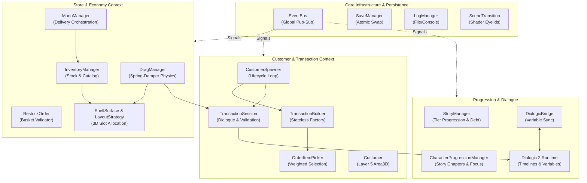
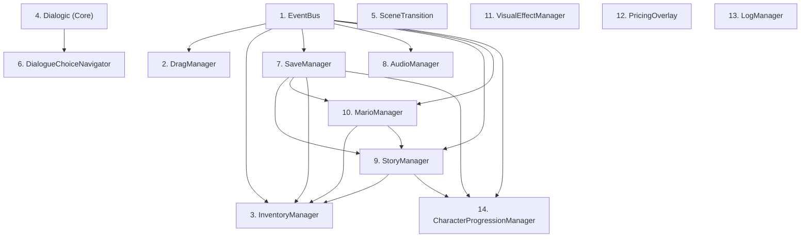
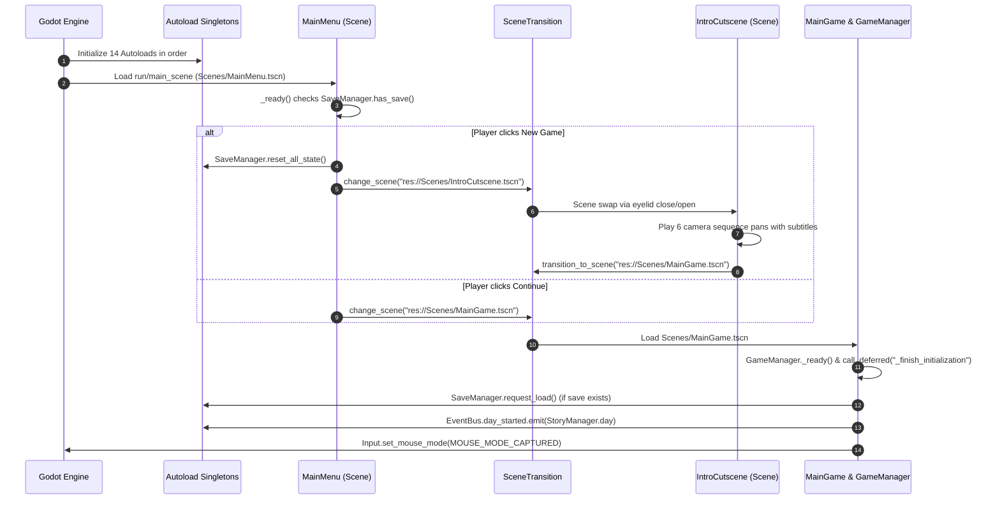
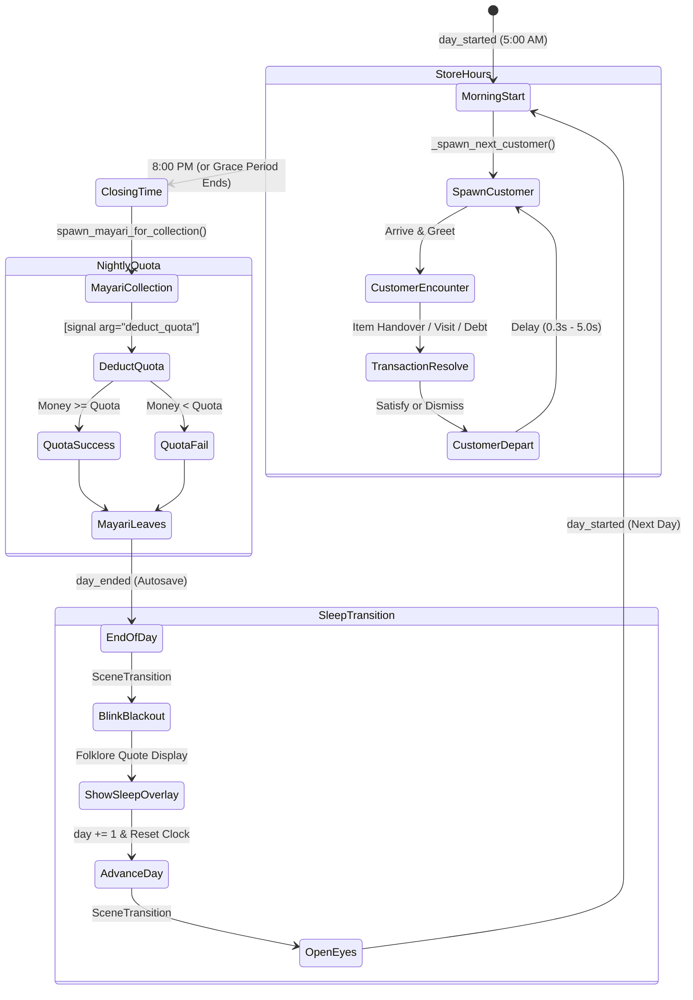
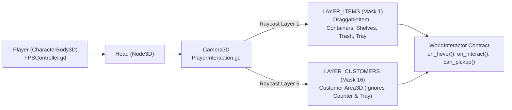
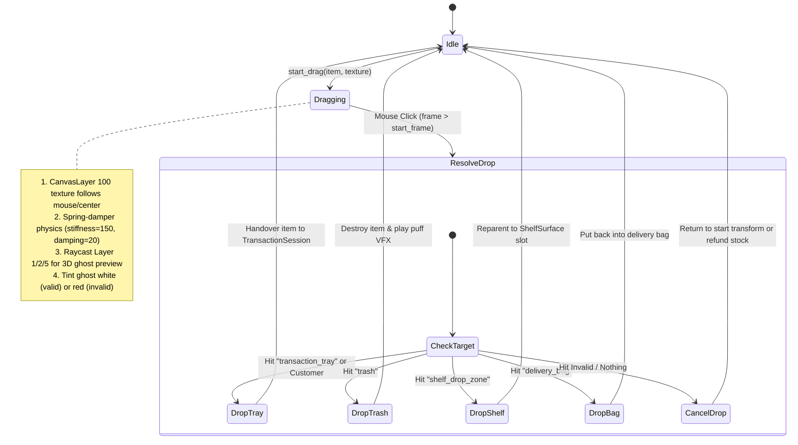
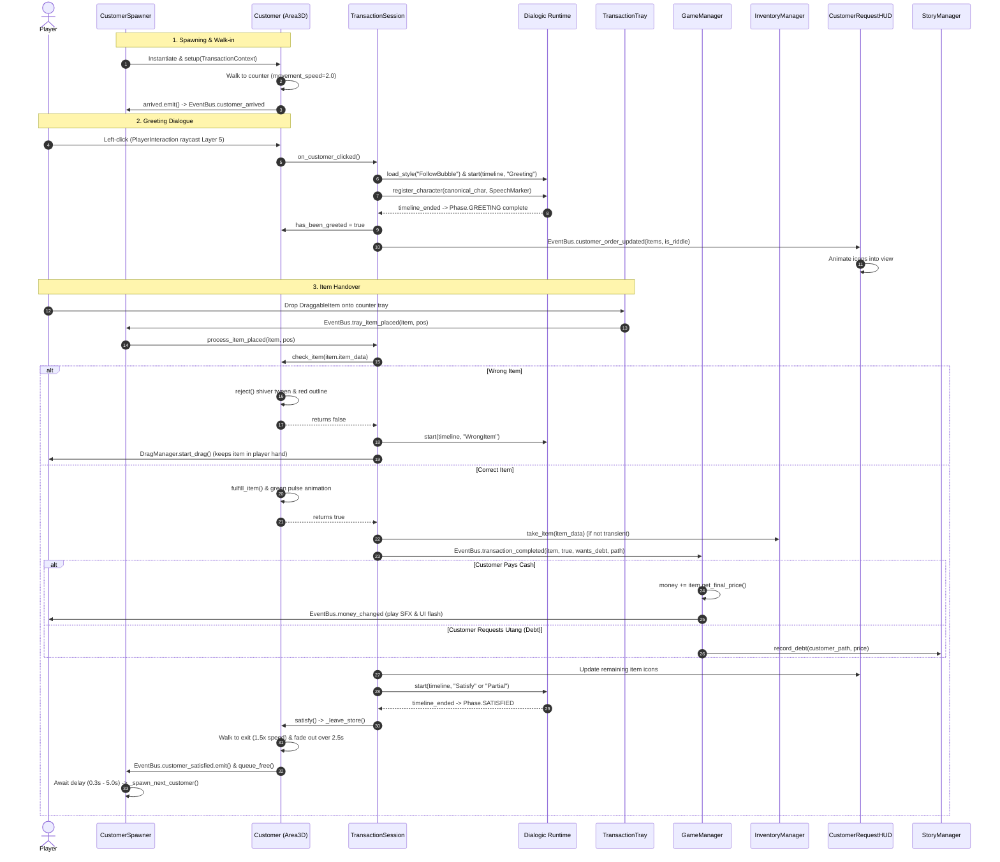
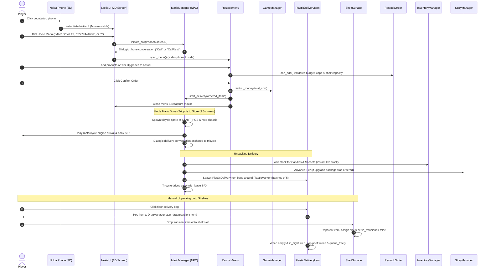
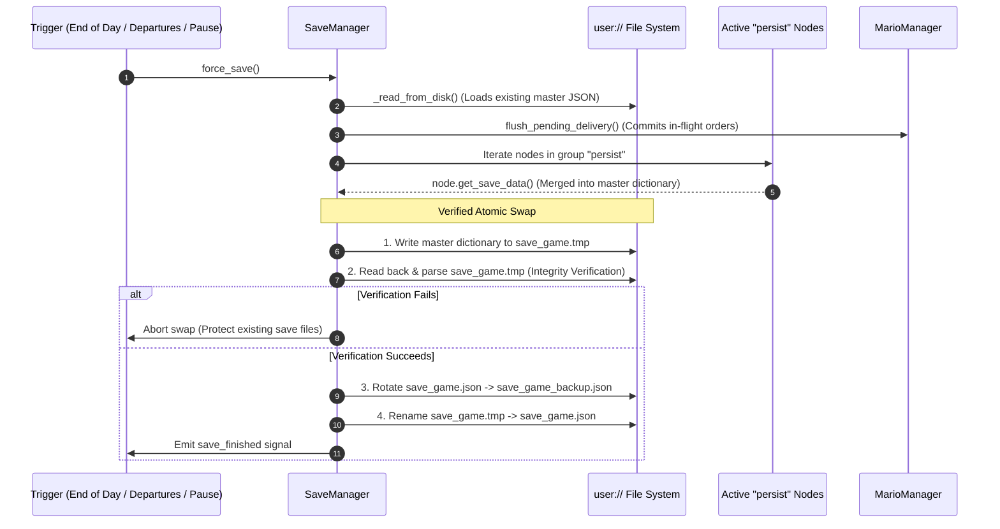

# Sari-Saring Katha — System Architecture & Engineering Reference

*A comprehensive technical guide to the architecture, lifecycles, bounded contexts, and subsystem interactions of the codebase.*

---

## 1. Executive Architectural Overview

**Sari-Saring Katha** is a first-person, point-and-click store management simulation built in **Godot 4.6 (Forward Plus / D3D12 / Jolt 3D Physics)**. The player operates a cozy Filipino *sari-sari* store in the mythical rural town of Karimlan, managing physical retail shelves, pricing margins, product restock deliveries, in-store customer haggling/debt, and narrative storylines featuring mythological neighbors.



### Architectural Paradigms

1. **Domain-Driven Bounded Contexts**: The codebase is partitioned into distinct subdomains: `Core`, `Store`, `World`, `Progression`, `Data`, `Audio`, and `UI`. Scripts avoid monolithic "God-object" coupling by delegating responsibilities to focused modules.
2. **Decoupled Publish-Subscribe Communication**: High-level systems interact across boundaries via the central [`EventBus`](../Scripts/Core/EventBus.gd). For instance, when a customer transaction finishes, [`TransactionSession`](../Scripts/Store/TransactionSession.gd:149) does not mutate UI or audio directly; it emits `EventBus.transaction_completed`, which [`GameManager`](../Scripts/World/GameManager.gd:48) handles for cash additions, [`MoneyLabelUI`](../Scripts/UI/MoneyLabelUI.gd:9) for visual punch effects, and [`CustomerRequestHUD`](../Scripts/UI/CustomerRequestHUD.gd:14) for icon dismissals.
3. **Strategy Pattern for Spatial Layout**: Rather than hardcoding 3D shelf coordinate math, [`ShelfSurface`](../Scripts/World/Entities/ShelfSurface.gd:66) delegates coordinate generation to polymorphic [`LayoutStrategy`](../Scripts/Store/Layout/LayoutStrategy.gd) resources ([`ProceduralPackStrategy`](../Scripts/Store/Layout/ProceduralPackStrategy.gd) for organic dry-goods wobble, and [`FridgeLayoutStrategy`](../Scripts/Store/Layout/FridgeLayoutStrategy.gd) for rigid commercial refrigerator rows).
4. **Group-Based Pull/Push Persistence**: The save pipeline utilizes a group-contract pattern (`"persist"`). Any active node implementing `get_save_data()` and `load_save_data()` is serialized into JSON using a verified atomic file swap pattern ([`SaveManager.gd:266-310`](../Scripts/Core/SaveManager.gd#L266-L310)).
5. **Data-Driven Narrative & Inventory**: Gameplay rules, character dialogue parameters, and product models are defined as custom Godot `Resource` `.tres` assets (`CustomerData`, `ItemData`, `ArcData`, `LightingKeyframe`) rather than hardcoded tables in GDScript.

---

## 2. Global Autoload Topology & Dependencies

All autoloads in `project.godot:29-45` are instantiated as direct children of the SceneTree root (`/root`). They initialize in strict top-down order during engine boot:



| Order | Autoload Name | Script Path | Responsibility & Architectural Role |
| :---: | :--- | :--- | :--- |
| **1** | **`EventBus`** | [`../Scripts/Core/EventBus.gd`](../Scripts/Core/EventBus.gd) | Pure event aggregator declaring 36 global signals. Zero state or logic. |
| **2** | **`DragManager`** | [`../Scripts/World/DragManager.gd`](../Scripts/World/DragManager.gd) | Drives the 2D cursor drag overlay (CanvasLayer 100), 3D ghost previews, and drop raycasting. |
| **3** | **`InventoryManager`** | [`../Scripts/Store/InventoryManager.gd`](../Scripts/Store/InventoryManager.gd) | Catalog database and digital stock tracker. Scans `res://Resources/items`. Member of `"persist"`. |
| **4** | **`Dialogic`** | `addons/dialogic/Core/DialogicGameHandler.gd` | Dialogic 2 engine singleton managing timelines, text layouts, and subsystems (`VAR`, `Styles`). |
| **5** | **`SceneTransition`** | [`../Scripts/Core/SceneTransitionManager.gd`](../Scripts/Core/SceneTransitionManager.gd) | Top-level CanvasLayer (128) rendering shader-based feathered eyelid transitions and scene swaps. |
| **6** | **`DialogueChoiceNavigator`**| [`../Scripts/UI/DialogueChoiceNavigator.gd`](../Scripts/UI/DialogueChoiceNavigator.gd) | Intercepts mouse wheel scrolls during dialogue to cycle focus on UI choice buttons. |
| **7** | **`SaveManager`** | [`../Scripts/Core/SaveManager.gd`](../Scripts/Core/SaveManager.gd) | Central persistence manager. Collects and distributes data across `"persist"` nodes. |
| **8** | **`AudioManager`** | [`../Scripts/Audio/AudioManager.gd`](../Scripts/Audio/AudioManager.gd) | Audio director for day/night BGM playlists, character themes, and child [`SFXPool`](../Scripts/Audio/SFXPool.gd). |
| **9** | **`StoryManager`** | [`../Scripts/Progression/StoryManager.gd`](../Scripts/Progression/StoryManager.gd) | Store tier progression (`1..10`), customer debts, and owner of [`DayClock`](../Scripts/Store/DayClock.gd). Member of `"persist"`. |
| **10** | **`MarioManager`** | [`../Scripts/World/MarioManager.gd`](../Scripts/World/MarioManager.gd) | Uncle Mario delivery NPC coordinator (phone calls, 3D tricycle tween, delivery bags). Member of `"persist"`. |
| **11** | **`VisualEffectManager`**| [`../Scripts/World/VisualEffectManager.gd`](../Scripts/World/VisualEffectManager.gd) | Procedural `CPUParticles3D` factory (dust, transaction glimmers, fridge mist, celebrations). |
| **12** | **`PricingOverlay`** | [`../Scripts/UI/PricingOverlay.gd`](../Scripts/UI/PricingOverlay.gd) | 3D billboard tooltip showing price margins, heatmap colors, and stock. Member of `"pricing_overlay"`. |
| **13** | **`LogManager`** | [`../Scripts/Core/LogManager.gd`](../Scripts/Core/LogManager.gd) | Rotating file and console logger (`debug.log` / `debug.log.old`). Configured in `_enter_tree()`. |
| **14** | **`CharacterProgressionManager`** | [`../Scripts/Progression/CharacterProgressionManager.gd`](../Scripts/Progression/CharacterProgressionManager.gd) | Tracks per-character story chapters (`0..9`), branches, daily caps, and focus weighting. Member of `"persist"`. |

---

## 3. Boot Sequence & Top-Level Game Lifecycle

### Boot Flow (Engine Launch to Gameplay)



1. **Launch Phase**:
   - `InventoryManager` scans [`res://Resources/items`](Resources/items) and registers all items ([`InventoryManager.gd:30-80`](../Scripts/Store/InventoryManager.gd#L30-L80)).
   - `AudioManager` reads `user://settings.cfg` via [`AudioSettings`](../Scripts/Audio/AudioSettings.gd:12-27) and loops morning ambience.
   - `StoryManager` sets in-game clock to golden hour (`16.89`, ~4:53 PM) for the title screen backdrop ([`DayClock.gd:8, 13`](../Scripts/Store/DayClock.gd#L8-L13)).
   - The engine loads the primary scene [`Scenes/MainMenu.tscn`](Scenes/MainMenu.tscn:1).
2. **Menu Phase**:
   - [`MainMenu._ready()`](../Scripts/UI/MainMenu.gd:36-76) sets `Input.MOUSE_MODE_VISIBLE`, attaches mouse-look parallax to the 3D title camera ([`MainMenu.gd:132-154`](../Scripts/UI/MainMenu.gd#L132-L154)), and checks `SaveManager.has_save()`. If false, `Continue` is hidden.
   - **New Game**: Calls `SaveManager.reset_all_state()` (clearing files, resetting singletons, resetting Dialogic vars) and transitions to [`Scenes/IntroCutscene.tscn`](Scenes/IntroCutscene.tscn).
   - **Continue**: Transitions directly to [`Scenes/MainGame.tscn`](Scenes/MainGame.tscn).
3. **Cutscene Phase (`IntroManager.gd`)**:
   - Iterates through child `CutsceneSequence` nodes (`Sequence_Road` through `Sequence_Countertop`), interpolating camera markers, displaying typewritten Philippine folklore lore, and allowing skip via `Escape` ([`IntroManager.gd:79-147`](../Scripts/Cutscene/IntroManager.gd#L79-L147)).
4. **Gameplay Initialization (`MainGame.tscn`)**:
   - `GameManager._ready()` runs before parent `MainGame` finishes: it schedules `call_deferred("_finish_initialization")` ([`GameManager.gd:59`](../Scripts/World/GameManager.gd#L59)). This guarantees that child `CustomerSpawner` and `ShelfSurface` instances are already in the tree and in the `"persist"` group.
   - `MainGame._ready()` awaits one `process_frame` ([`MainGame.gd:30`](../Scripts/World/MainGame.gd#L30)), sets camera FOV to `75.0`, spawns `PauseMenu` and `CustomerRequestHUD`, and links street lights to `TimeOfDay`.
   - `GameManager._finish_initialization()` executes: calls `SaveManager.request_load()` if a save exists, emits `EventBus.day_started.emit(StoryManager.day)`, and captures the mouse cursor ([`GameManager.gd:61-85`](../Scripts/World/GameManager.gd#L61-L85)).

### Daily Game Loop Lifecycle



1. **Morning Opening (5:00 AM)**:
   - `EventBus.day_started` triggers `DayClock.on_day_started()` ([`DayClock.gd:36-43`](../Scripts/Store/DayClock.gd#L36-L43)), snapping `TimeOfDay` to 5:00 AM and running at `1 hr / 50 real sec`.
   - `CustomerSpawner` spawns the first customer ([`CustomerSpawner.gd:63-65`](../Scripts/World/CustomerSpawner.gd#L63-L65)).
2. **Store Hours**:
   - Customers arrive sequentially. When a customer reaches the counter, `wait_limit_time` is set to `current_time + 4.0` in-game hours. If the player leaves them waiting for >4 hours, the clock pauses to prevent time loss ([`DayClock.gd:48, 87-92`](../Scripts/Store/DayClock.gd#L48-L92)).
3. **Closing Threshold (8:00 PM / `20.0`)**:
   - If no customer is present at 8:00 PM, the clock halts and emits `EventBus.closing_time_reached` ([`DayClock.gd:106-115`](../Scripts/Store/DayClock.gd#L106-L115)).
   - If a customer is mid-transaction, a grace period extends time until the customer leaves or midnight (`24.0`) is reached ([`DayClock.gd:95-103`](../Scripts/Store/DayClock.gd#L95-L103)).
4. **Reyna Mayari Nightly Collection**:
   - `CustomerSpawner` spawns Reyna Mayari ([`CustomerSpawner.gd:262-298`](../Scripts/World/CustomerSpawner.gd#L262-L298)).
   - In her dialogue, `[signal arg="deduct_quota"]` invokes `GameManager.deduct_money(_pending_quota)` ([`GameManager.gd:173-199`](../Scripts/World/GameManager.gd#L173-L199)). Formula: `quota = 50.0 + (quota_day - 1) * 15.0`.
   - When Mayari leaves, `CustomerSpawner` triggers `_end_day()` -> `EventBus.day_ended.emit(StoryManager.day)` ([`CustomerSpawner.gd:305-306`](../Scripts/World/CustomerSpawner.gd#L305-L306)).
5. **Night Sleep & Transition**:
   - `SaveManager` autosaves to disk immediately on `day_ended` ([`SaveManager.gd:72-74`](../Scripts/Core/SaveManager.gd#L72-L74)).
   - `GameManager._on_day_ended()` triggers `SceneTransition.blink_and_blackout()`, displays [`SleepOverlay`](../Scripts/UI/SleepOverlay.gd) with an authentic Philippine mythical quote (Bungisngis, Daligmata, Kapre, Manananggal, etc.), increments `StoryManager.day += 1`, resets time to 5:00 AM, and calls `SceneTransition.open_eyes()` ([`GameManager.gd:116-171`](../Scripts/World/GameManager.gd#L116-L171)).

---

## 4. The Event-Driven Core (`EventBus` Catalog)

[`EventBus.gd`](../Scripts/Core/EventBus.gd) centralizes 36 signals that decouple systems across boundaries:

| Category | Signal & Signature | Primary Emitters | Primary Subscribers |
| :--- | :--- | :--- | :--- |
| **Customer** | `customer_spawned(c: Customer)` | `CustomerSpawner` | `AudioManager` (swaps theme) |
| | `customer_arrived(c: Customer)` | `CustomerSpawner`, `MarioManager` | `StoryManager` (resets patience clock) |
| | `customer_satisfied(c: Customer)` | `Customer._leave_store` | `SaveManager` (autosave count), `StoryManager`, `AudioManager` |
| | `customer_partial_satisfaction(c)` | `Customer._on_item_accepted` | `CustomerSpawner` |
| | `customer_dismissed(c: Customer)` | `Customer._leave_store`, `MarioManager` | `CustomerSpawner` (spawns next), `SaveManager`, `StoryManager` |
| | `dialogue_character_speaking(data)`| `SFXPool` | `CustomerSpawner`, `MarioManager` (triggers speak bounce) |
| **Transaction**| `transaction_completed(item, ok, debt, path)` | `TransactionSession` | `GameManager` (adds cash or records debt) |
| | `tray_item_placed(item, pos)` | `TransactionTray` | `CustomerSpawner` -> `TransactionSession.process_item_placed` |
| | `customer_order_updated(name, items, riddle)`| `TransactionSession` | `CustomerRequestHUD` (animates order icons) |
| | `customer_order_cleared()` | `CustomerSpawner` | `CustomerRequestHUD` (slides panel out) |
| **Progression**| `day_started(day_number)` | `GameManager` | `DayClock`, `CustomerSpawner`, `AudioManager`, `MarioManager` |
| | `day_ended(day_number)` | `CustomerSpawner` | `SaveManager` (forces disk save), `GameManager` (sleep sequence) |
| | `closing_time_reached()` | `DayClock` | `CustomerSpawner` (spawns Mayari), `GameManager` (calculates quota) |
| | `tier_advanced(tier, source)` | `StoryManager` | `SaveManager`, `CustomerRequestHUD`, `DispenserContainerItem` |
| | `upgrade_available(tier, cost, items)` | `StoryManager` | `TierAdvanceOverlay` (displays gold banner & fanfare VFX) |
| **Economy** | `money_changed(amount)` | `GameManager` | `MoneyLabelUI` (punches scale, flashes green/red) |
| | `insufficient_funds()` | `RestockMenu` | `MoneyLabelUI` (shakes red warning) |
| | `pricing_mode_changed(active)` | `PlayerInteraction` | `TutorialManager` |
| | `price_increased(item)` / `price_decreased(item)`| `InventoryManager` | `TutorialManager` |
| | `debt_quota_met(success)` | `GameManager` | `StoryManager` (unlocks Mayari story progress) |
| **World & UI** | `nokia_opened()` / `nokia_closed()`| `NokiaClickRegion` | `CrosshairUI` (toggles crosshair), `CustomerSpawner` (suppresses clicks) |
| | `drag_started(item)` / `drag_ended(item, ok)` | `DragManager` | `CrosshairUI`, `ShelfSurface` (frees slot index) |
| | `request_camera_shake(intensity, dur)` | `TransactionSession` | `FPSController` (adds camera noise) |
| | `request_sfx(sfx_name)` | `DraggableItem`, `Trash`, `Fridge`, etc. | `SFXPool` (plays from audio pool) |
| | `helper_prompt_requested(text, active)` | `TutorialManager` | `HelperPrompt` (displays floating instruction banner) |
| | `show_notification(title, sub, sfx)` | `RestockMenu` | `NoticeOverlay` (slides toast message) |

---

## 5. Player Control & 3D Interaction Pipeline

First-person gameplay is split into two specialized component scripts:



### Locomotion & Camera (`FPSController.gd`)
* Extends `CharacterBody3D` ([`FPSController.gd:1`](../Scripts/Components/FPSController.gd#L1)).
* Captures mouse input in `_input(event)`: mouse delta updates `_yaw` on `$Head` and clamped `_pitch` (`[-89°, +89°]`) on `$Head/Camera3D` ([`FPSController.gd:65-72`](../Scripts/Components/FPSController.gd#L65-L72)).
* Implements crouch via height tweening, sinusoidal head bobbing, screen shake listener (`EventBus.request_camera_shake`), and programmatic camera tweening (`face_pos()`, `face_node()`) ([`FPSController.gd:80-204`](../Scripts/Components/FPSController.gd#L80-L204)).

### Dual-Layer Raycast Discovery (`PlayerInteraction.gd`)
Attached directly to the player's `Camera3D` ([`PlayerInteraction.gd:1-2`](../Scripts/Components/PlayerInteraction.gd#L1-L2)):
* Every `_physics_process()`, if `Input.MOUSE_MODE_CAPTURED`, projects two parallel center-screen raycasts (`10.0m` range, `collide_with_areas = true`, `collide_with_bodies = false`):
  1. `_q_items` on **Layer 1 (Bit 0)**: Collides with `DraggableItem`, container dispensers, shelves, trash, and tray.
  2. `_q_customer` on **Layer 5 (Bit 4 / Mask 16)**: Dedicated customer collision. Passing through Layer 1 geometry allows the player to click or hover a customer standing behind the counter, items, or tray without raycast occlusion ([`PlayerInteraction.gd:8-12, 33-41`](../Scripts/Components/PlayerInteraction.gd#L8-L12)).
* **Hover Priority Rules**:
  - While dragging (`DragManager.is_dragging == true`): shelf and item hovers are suppressed; only customer and trash colliders are hovered ([`PlayerInteraction.gd:85-92`](../Scripts/Components/PlayerInteraction.gd#L8-L92)).
  - While idle: items take priority over customer colliders.
  - Hover transitions invoke `on_hover(true/false)` (toggling spatial outline shaders) and open `PricingOverlay` if pricing mode is active ([`PlayerInteraction.gd:104-111`](../Scripts/Components/PlayerInteraction.gd#L104-L111)).

### The `WorldInteractor` Contract
Abstract base class [`WorldInteractor`](../Scripts/Components/WorldInteractor.gd) (extends `Area3D`) defines the polymorphic interface for all physical interactive objects:
* `on_hover(is_hovered: bool)`: Toggles `material_overlay` outline shaders and scales visual meshes by `1.05x` ([`WorldInteractor.gd:53-70`](../Scripts/Components/WorldInteractor.gd#L53-L70)).
* `on_interact()`: Primary interaction callback (clicking an item, cat, phone, notebook, or customer).
* `can_pickup() -> bool`: Returns `false` by default; overridden to `true` in `DraggableItem` ([`DraggableItem.gd:145-146`](../Scripts/World/Entities/DraggableItem.gd#L145-L146)).
* `can_adjust_price()`, `adjust_price(delta)`: Pricing adjustments via mouse wheel ([`WorldInteractor.gd:80-86`](../Scripts/Components/WorldInteractor.gd#L80-L86)).

---

## 6. Drag & Drop Engine & Shelf Spatial Layout

### `DragManager` State Machine



1. **`start_drag(item, texture)`** ([`DragManager.gd:45-105`](../Scripts/World/DragManager.gd#L45-L105)):
   - Hides the physical 3D sprite.
   - Activates a 2D `TextureRect` on `CanvasLayer` (layer 100), sizing it from the 3D collider dimensions (`collider_size * 960 * 1.5`).
   - Clones a 3D translucent `_ghost_sprite` into the scene tree to project visual placement on shelves.
   - Emits `EventBus.drag_started`. In response, [`ShelfSurface._on_any_drag_started`](../Scripts/World/Entities/ShelfSurface.gd:399-408) frees the item's previous slot index.
2. **`_process(delta)` Physics**:
   - The held 2D texture tracks the center screen or mouse with a spring-damper lag (`stiffness = 150.0`, `damping = 20.0`), applying horizontal tilt and mouse velocity sway ([`DragManager.gd:111-140`](../Scripts/World/DragManager.gd#L111-L140)).
   - A 3D raycast (`mask = 19`, checking items, shelf zones, and customers) aligns the ghost sprite to the nearest empty shelf slot, tinting it white (`accepts_drop() == true`) or red (`accepts_drop() == false`) ([`DragManager.gd:143-161`](../Scripts/World/DragManager.gd#L143-L161)).
3. **`end_drag()` Drop Target Priority** ([`DragManager.gd:200-231`](../Scripts/World/DragManager.gd#L200-L231)):
   - **Transaction Tray / Customer**: Dropping on a customer redirects to `TransactionTray`. Invokes `TransactionSession.process_item_placed()`.
   - **Trash Interactable**: Invokes `TrashInteractable.receive_item()` -> squashes trash bin, emits dust VFX, plays `trash` SFX, and calls `queue_free()`.
   - **Shelf Surface Drop Zone (`Layer 2`)**: Invokes `ShelfSurface.receive_item()`.
   - **Plastic Delivery Bag**: Invokes `PlasticDeliveryItem.receive_item()` to return unpacked items to their bag.
   - **Cancellation**: If dropped on invalid geometry, non-transient shelf items tween back to `_original_transform`. Transient items spawned from containers/bags refund their digital stock to `InventoryManager` and play a poof disappearance tween ([`DraggableItem.gd:227-255`](../Scripts/World/Entities/DraggableItem.gd#L227-L255)).

### Shelf Layout & Strategy Pattern (`ShelfSurface.gd`)
* [`ShelfSurface`](../Scripts/World/Entities/ShelfSurface.gd) (`@tool extends Node3D`) creates a child `Area3D` named `__DropZone` on **Collision Layer 2** with a box collider matching `shelf_width` (`1.0m`), depth (`0.5m`), and height (`0.4m`). Layer 2 ensures dragging queries detect the drop zone while player pickup rays (Layer 1) do not get occluded by the shelf plank itself ([`ShelfSurface.gd:143-157`](../Scripts/World/Entities/ShelfSurface.gd#L143-L157)).
* **Slot Layout Computation**:
  - `ProceduralPackStrategy`: Steps along `shelf_width` in increments of `slot_width = 0.4m`. Adds random Z-depth variance (`±0.03m`) and random Z-roll tilt (`±3.0°`) to mimic handmade retail shelves ([`ProceduralPackStrategy.gd:23-28`](../Scripts/Store/Layout/ProceduralPackStrategy.gd#L23-L28)).
  - `FridgeLayoutStrategy`: Generates perfectly aligned, zero-variance slot transforms with an identity basis for commercial glass beverage coolers ([`FridgeLayoutStrategy.gd:21-34`](../Scripts/Store/Layout/FridgeLayoutStrategy.gd#L21-L34)).
* **Slot Occupancy**: Managed via a parallel array `_slot_occupants: Array` matching `_slot_transforms.size()`. Dropping an item calls `_find_nearest_empty_slot(local_x)`, reparents the `DraggableItem` to the shelf, updates occupancy, and marks `item.is_transient = false` ([`ShelfSurface.gd:224-276`](../Scripts/World/Entities/ShelfSurface.gd#L224-L276)).

---

## 7. The Customer & Transaction Loop

### Transaction Domain Model Breakdown

| Component | Responsibility |
| :--- | :--- |
| **`TransactionContext`** ([`../Scripts/Data/TransactionContext.gd`](../Scripts/Data/TransactionContext.gd)) | Serializable value object representing an encounter: `customer_data`, `desired_items`, `delivered_items`, `timeline`, `is_riddle`, `wants_debt`, `is_repaying`, `rumor_active`. |
| **`TransactionBuilder`** ([`../Scripts/Store/TransactionBuilder.gd`](../Scripts/Store/TransactionBuilder.gd)) | Stateless factory pipeline. Evaluates Day 1 injections, Priority 0/1/2 customer selection rules, item request pools via `OrderItemPicker`, and random rolls (riddles, debt, rumors). |
| **`OrderItemPicker`** ([`../Scripts/Store/OrderItemPicker.gd`](../Scripts/Store/OrderItemPicker.gd)) | Stateless probability algorithms for order composition: 1-3 items based on tier, 60% display-stock / 40% catalog weighting, and category alias mapping. |
| **`TransactionSession`** ([`../Scripts/Store/TransactionSession.gd`](../Scripts/Store/TransactionSession.gd)) | Stateful controller managing active customer encounters, phase transitions (`GREETING -> TALK -> SATISFIED`), Dialogic 3D bubble anchors, and tray item validation. |

### Complete Transaction Sequence Diagram



---

## 8. Store Economy, Catalog & Restocking Pipeline

### Digital vs. Physical Inventory Architecture
Inventory tracking utilizes a dual-model system:
* **Digital Catalog (`InventoryManager.gd`)**: `_stock: Dictionary` maps `ItemData.resource_path -> int`. For candy containers and hanging sachets, this is the live consumable count ([`InventoryManager.gd:21`](../Scripts/Store/InventoryManager.gd#L21)).
* **Physical Shelf Stock**: Shelf and fridge items exist as active 3D `DraggableItem` nodes attached to `ShelfSurface` slots. Total owned items across the store are computed via `get_total_owned_count(type)`, which adds physical shelf items (`get_count_on_shelves`) to items still inside floor delivery bags ([`InventoryManager.gd:231-236`](../Scripts/Store/InventoryManager.gd#L231-L236)).

### Restocking Delivery Workflow



1. **Ordering (`RestockOrder.gd` Domain Validator)**:
   - Evaluates player money, 99-unit per-item hard caps, shared candy bowl caps (Pocha + Mentor <= 10 units pre-Tier 10), and store physical space limits (`SHELF: 36 slots`, `FRIDGE: 12 slots`) ([`RestockOrder.gd:67-165`](../Scripts/Store/RestockOrder.gd#L67-L165)).
   - Unpacks proposed tier upgrade packages into 2 preview units per sellable item to verify that the upgraded store capacity will fit the order ([`RestockOrder.gd:216-241`](../Scripts/Store/RestockOrder.gd#L216-L241)).
2. **Delivery Execution (`MarioManager.gd`)**:
   - `start_delivery()` records `_pending_delivery_items` to protect against save-quit loss via `flush_pending_delivery()` ([`MarioManager.gd:166-177`](../Scripts/World/MarioManager.gd#L166-L177)).
   - Tweens Uncle Mario's 2D-in-3D tricycle (`mario_tricycle.png`) from `z = 20.0` to `z = -6.055` over 3.5 seconds with engine audio and chassis rocking tweens ([`MarioManager.gd:180-216`](../Scripts/World/MarioManager.gd#L180-L216)).
   - Upon dialogue completion, non-container shelf/fridge goods are batched into groups of 5 and instantiated as 3D floor delivery bags ([`PlasticDeliveryItem`](../Scripts/World/Entities/PlasticDeliveryItem.gd)) around `PlasticMarker`. Candies and sachets immediately replenish digital container dispensers ([`MarioManager.gd:251-315`](../Scripts/World/MarioManager.gd#L251-L315)).

---

## 9. Narrative & Dual-Track Progression System

### Dual Progression Axes

```mermaid
graph TD
    subgraph StoreProgression ["Track 1: Store Tier Progression (1..10)"]
        Purchases["Customer Purchases<br>(purchase_counter)"] --> Threshold{"Crosses Tier Threshold?<br>(5 + tier/2 + (tier-6)*2)"}
        Threshold -->|Yes| UnlockNotice["max_unlocked_tier increments<br>EventBus.upgrade_available"]
        UnlockNotice --> MarioCatalog["Uncle Mario Catalog<br>Tier Upgrade Item becomes orderable"]
        MarioCatalog --> MarioDelivers["Mario Delivery Arrives<br>StoryManager.advance_tier()"]
        MarioDelivers --> TierAdvanced["current_tier increments<br>Unlocks new catalog items & customers"]
    end

    subgraph CharacterProgression ["Track 2: Character Story Progression (0..9 Chapters)"]
        Encounter["Customer Spawned<br>TransactionBuilder.select_character()"] --> PriorityCheck{"Priority Cascade<br>P0: First Story (force_story)<br>P1: Cooldown 0 (weighted)<br>P2: Generic (25% roll)"}
        PriorityCheck --> PlayStory["Play Customer story_timeline<br>Branch saved via Transaction_Branch"]
        PlayStory --> StorySuccess["Dialogic: story_success<br>or Customer leaves satisfied"]
        StorySuccess --> IncrementChapter["character_story_states[path] += 1<br>global_story_cooldown = rand(1, 3)"]
    end
```



### Story Prerequisites (`../Scripts/Data/Prerequisites/`)
Individual chapter availability is governed by composite prerequisite rules:
* [`StoryPrerequisite`](../Scripts/Data/Prerequisites/StoryPrerequisite.gd) (Abstract Base): Defines `is_met(sm: Node) -> bool`.
* [`ChapterPrerequisite`](../Scripts/Data/Prerequisites/ChapterPrerequisite.gd): Requires `target_character` to be at or beyond `min_chapter`.
* [`VariablePrerequisite`](../Scripts/Data/Prerequisites/VariablePrerequisite.gd): Evaluates a Dialogic variable comparison (`==`, `!=`, `<`, `>`, `<=`, `>=`) against `required_value`.
* [`StoryPrerequisiteGroup`](../Scripts/Data/Prerequisites/StoryPrerequisiteGroup.gd): Evaluates an array of prerequisites using logical **AND**.

### Dialogic 2 Variable Synchronization
Before any timeline begins, [`DialogicBridge.sync_transaction()`](../Scripts/Core/DialogicBridge.gd:18-74) synchronizes transaction data into Dialogic:
* Product requests: `Transaction_ItemWants` (e.g. `"Anoba, Kopimo, and Patos"`), `Transaction_HighestItemWants`, `Transaction_ItemHint`.
* Context: `Transaction_CustomerName`, `Transaction_Chapter`, `Transaction_Branch`, `Transaction_CurrentArc`, `Transaction_DeliveredCount`, `Transaction_RemainingCount`.
* Variety rolls: `Transaction_GreetingVar`, `Transaction_TalkVar`, `Transaction_SatisfyVar`, `Transaction_WrongItemVar`, `Transaction_VisitVar` (`0.0..100.0` random floats allowing `.dtl` branching).
* Outbound signals: Mid-dialogue `[signal arg="..."]` statements invoke game commands (`deduct_quota`, `repay_debt`, `refresh_desires`, `upgrade_desires`, `set_desire:<item>`, `story_success`).

---

## 10. Presentation Tier: Audio, Lighting, VFX & UI

### Audio Architecture (`AudioManager.gd` & `SFXPool.gd`)
* **Audio Buses**: `Master`, `Telephone` (band-pass filtered for phone calls), `Music` (with low-pass filter ducking during pause), `SFX`, `Voices` ([`default_bus_layout.tres`](default_bus_layout.tres)).
* **Phase-Based BGM Director**: Synchronizes background playlists with `TimeOfDay`:
  - `MORNING` (`04:00 - 11:00`): Light, cheerful tracks (`Boring Day`, `Brunch II`, `Kids Room`) + morning bird ambience.
  - `AFTERNOON` (`11:00 - 18:00`): Warm tracks (`Fantastic Idea`, `Not Me`, `Hermit Crab`).
  - `DUSK` (`18:00 - 04:00`): Mellow tracks (`Sleepy`, `Naptime`) + evening crickets.
  - Crossfades custom character themes (`theme_player`) when specific mythological customers arrive ([`AudioManager.gd:272-305`](../Scripts/Audio/AudioManager.gd#L272-L305)).
* **Object Pooling**: [`SFXPool`](../Scripts/Audio/SFXPool.gd) implements an 8-player ring-buffer object pool for sound effects, randomizing pitch (`0.9..1.1`) to avoid repetitive acoustic fatigue ([`SFXPool.gd:37-91`](../Scripts/Audio/SFXPool.gd#L37-L91)).

### Lighting & Atmospheric System
* [`DayClock`](../Scripts/Store/DayClock.gd) drives the `TimeOfDay` environmental node in `Sky3D`.
* [`TimeOfDayLighting`](../Scripts/World/Environment/TimeOfDayLighting.gd) interpolates 27 sky uniforms, volumetric fog, sun/moon energy, and color-grading LUT textures across sorted [`LightingKeyframe`](../Scripts/World/Environment/LightingKeyframe.gd) resources.
* [`FlickerLight`](../Scripts/World/Environment/FlickerLight.gd) modulates the store's overhead fluorescent tube with random noise and occasional voltage glitches (`0.015` probability).

### Procedural Particle Factory (`VisualEffectManager.gd`)
Constructs GPU/CPU particle instances programmatically from Brackeys VFX textures without relying on pre-saved `.tscn` files:
* `spawn_impact_dust(pos)`: 6 unshaded smoke particles on shelf item drop.
* `spawn_transaction_glimmer(pos, extents)`: 16 additive over-bright yellow star particles on sale completion.
* `spawn_cold_mist(pos)`: Continuous looping cold fog across the refrigerator door opening.
* `spawn_rank_up_fanfare(pos)`: Dual celebration (40 gold burst stars + 3m additive flare) in front of the camera on tier advance.

### UI Modal Architecture
Overlays (`OptionsOverlay`, `CollectionOverlay`, `StoryProgressOverlay`, `ConfirmationOverlay`) follow a duck-typed modal contract:
* Extend `ColorRect` for full-screen backdrop dimming.
* Own a private `_ui_player` for UI clicks and confirmation chimes.
* Provide `open()` and `close()` methods, emitting `closed`.
* Intercept `ui_cancel` (`Escape`) to navigate internal view history or close.
* Host scenes (`MainMenu` and `PauseMenu`) disable main navigation buttons via `MOUSE_FILTER_IGNORE` while a modal overlay is open.

---

## 11. Persistence Architecture (`SaveManager.gd`)

Persistence is handled by a group-contract pull/push architecture (`"persist"`) backed by a **Verified Atomic Swap** file rotation pattern.



### Save File Paths & Schema
* Primary Save: `user://save_game.json`
* Backup Save: `user://save_game_backup.json`
* Temp File: `user://save_game.tmp`

```json
{
  "_meta": {
    "last_save_time": "2026-11-12T01:30:00",
    "version": "0.9"
  },
  "manager": {
    "money": 250.0,
    "quota_day": 1,
    "pending_quota": 50.0
  },
  "StoryManager": {
    "day": 1,
    "current_tier": 1,
    "max_unlocked_tier": 1,
    "purchase_counter": 0,
    "customer_debts": {},
    "has_mayari_visited": false
  },
  "CharacterProgressionManager": {
    "character_story_states": {
      "res://Resources/customers/KuyaKap.tres": 1
    },
    "customer_story_branches": {},
    "encountered_characters": {},
    "global_story_cooldown": 2
  },
  "inventory": {
    "stock": {},
    "prices": {},
    "configured_ids": {}
  },
  "MarioManager": {
    "bags": []
  },
  "customer_spawner": {
    "current_customer": null
  },
  "shelf_MainGame_ShelfSurface": {
    "slots": [
      { "slot": 0, "item_path": "res://Resources/items/snack/Patos.tres" }
    ]
  }
}
```

### Auto-Save Triggers
1. **End of Day**: On `EventBus.day_ended` ([`SaveManager.gd:44, 72-74`](../Scripts/Core/SaveManager.gd#L44-L74)).
2. **Every 2 Customer Departures**: Every 2 customers leaving satisfied or dismissed ([`SaveManager.gd:48-49, 80-85`](../Scripts/Core/SaveManager.gd#L48-L85)).
3. **Tier Advance**: On `EventBus.tier_advanced` ([`SaveManager.gd:46, 76-78`](../Scripts/Core/SaveManager.gd#L46-L78)).
4. **Story / Debt Updates**: Coalesced via `StoryManager._save_progression()` using `call_deferred("_flush_save")` ([`StoryManager.gd:214-221`](../Scripts/Progression/StoryManager.gd#L214-L221)).
5. **Pause Menu Actions**: Manual Save, Main Menu return, or Exit ([`PauseMenu.gd:121-133`](../Scripts/UI/PauseMenu.gd#L121-L133)).
6. **Debug Bypass**: Pressing `Ctrl + P` in editor/debug builds toggles `debug_skip_save` ([`SaveManager.gd:55-62`](../Scripts/Core/SaveManager.gd#L55-L62)).

---

## 12. Offline Tooling & Pipeline Scripts

The root and [`Tools/`](Tools) directories contain headless utility scripts supporting design balancing and migrations:

* **Economy Balancing**:
  - `calculate_tier_profits.py`: Simulates store margins per tier based on wholesale and max retail pricing.
  - `list_by_tier.py` / `list_by_category.py` / `list_tiers.py`: Audits item catalog tier distribution and pricing.
* **Batch Metadata Migration**:
  - `migrate_customer_tiers.py`: Batch updates customer unlock tiers across `.tres` files.
  - `patch_item_ids.py`: Injects clean ID and metadata fields into `.tres` item definitions.
  - `../Scripts/Tools/extract_chapter_names.py`: Parses `# Chapter N: Title` comments in Dialogic `.dtl` timelines and writes them into customer `chapter_names` arrays.
  - `../Scripts/Tools/apply_arc_names.py`: Writes arc names into customer resource files.
* **Refactoring Automation**:
  - `Tools/PatchStoryManager.py`: Automation script previously used to extract `CharacterProgressionManager` and `DialogicBridge` out of `StoryManager.gd`.
  - `Tools/FixCyclicDependency.py`: Resolves cyclic autoload references by replacing static type references with dynamic `get_node("/root/...")` lookups.

---

## 13. Architectural Smells, Quirks & Technical Debt

A deep code audit identified several specific edge cases and historical quirks:

### 1. Stale Property Lookup in `ChapterPrerequisite.gd`
* **Location**: [`../Scripts/Data/Prerequisites/ChapterPrerequisite.gd:14-16`](../Scripts/Data/Prerequisites/ChapterPrerequisite.gd#L14-L16)
* **Issue**: The script queries `story_manager.get("character_story_states")`. However, `character_story_states` was migrated out of `StoryManager` into `CharacterProgressionManager`!
* **Impact**: `story_manager.get("character_story_states")` returns `null`, causing `ChapterPrerequisite.is_met()` to fall back to `return false`. Any story chapter gated by another character's chapter progress will fail evaluation unless patched to query `CharacterProgressionManager.get_chapter()`.

### 2. Logic Inversion in `TransactionBuilder.build_generic_transaction()`
* **Location**: [`../Scripts/Store/TransactionBuilder.gd:268`](../Scripts/Store/TransactionBuilder.gd#L268)
* **Issue**: The line reads `transaction.is_visit_story = not is_purchase and is_visit_story_chapter`.
* **Impact**: `is_purchase` is a boolean (true = Purchase, false = Visit). When `is_purchase == false`, `not is_purchase` evaluates to `true`. If this encounter is a generic visit, but happens to occur on a chapter index designated as a story visit in `visit_story_chapters`, the transaction erroneously sets `is_visit_story = true`. When the generic visit concludes, `CharacterProgressionManager.process_story_cooldown()` advances the character's main story chapter!

### 3. Autoload Logging Initialization Race
* **Location**: [`../Scripts/Store/InventoryManager.gd:39, 52, 59`](../Scripts/Store/InventoryManager.gd#L39) vs [`../Scripts/Core/LogManager.gd:12`](../Scripts/Core/LogManager.gd#L12)
* **Issue**: `InventoryManager` is autoload #3; `LogManager` is autoload #13. In `InventoryManager._ready() -> initialize()`, it invokes `LogManager.info()` and `LogManager.debug()` before `LogManager._enter_tree()` has initialized its file paths and rotated logs.
* **Impact**: The initial inventory catalog scan logs can miss the log file session header or fall back to defaults.

### 4. Premature Day Autosave Timing
* **Location**: [`../Scripts/Core/SaveManager.gd:44`](../Scripts/Core/SaveManager.gd#L44) vs [`../Scripts/World/GameManager.gd:164`](../Scripts/World/GameManager.gd#L164)
* **Issue**: `SaveManager._on_day_ended` immediately executes `force_save()`. However, `GameManager._on_day_ended` only increments `StoryManager.day += 1` *after* the `SleepOverlay` sequence finishes (~6 seconds later).
* **Impact**: The autosave written on day end persists the *day that just concluded*, not the newly beginning day. If the player hard-quits during the sleep quote screen, they reload into the evening of the previous day rather than the morning of the new day.

### 5. `WovenTravelBandana.tres` Catalog Exclusion
* **Location**: [`Resources/items/WovenTravelBandana.tres`](Resources/items/WovenTravelBandana.tres) vs [`../Scripts/Store/InventoryManager.gd:41-47`](../Scripts/Store/InventoryManager.gd#L41-L47)
* **Issue**: `InventoryManager._scan_directory()` only scans subdirectories of `res://Resources/items` (`bottle`, `can`, `snack`, etc.). `WovenTravelBandana.tres` sits directly in the root of `res://Resources/items`.
* **Impact**: The bandana item is completely omitted from `InventoryManager._items`, the restock menu, and player shelf placement.

### 6. Shelf Drag Cancellation Slot Occupancy Desync
* **Location**: [`../Scripts/World/Entities/ShelfSurface.gd:399-408`](../Scripts/World/Entities/ShelfSurface.gd#L399-L408) vs [`../Scripts/World/Entities/DraggableItem.gd:243-255`](../Scripts/World/Entities/DraggableItem.gd#L243-L255)
* **Issue**: When an item on a shelf is picked up, `_on_any_drag_started` immediately sets `_slot_occupants[idx] = null`. If the player cancels the drag by dropping on invalid ground, `DraggableItem.return_to_start()` tweens its transform back to the shelf slot, but `ShelfSurface` never re-registers the item in `_slot_occupants`!
* **Impact**: The slot remains marked unoccupied in `_slot_occupants`. If another item is subsequently dropped near that position, two items can occupy the same physical slot transform.

---

## 14. Summary & Mental Model for Developers

To navigate and extend this codebase without guesswork, keep this mental model in mind:

```
[World Interaction]
  Player Clicks Object -> Raycast (Layer 1 Items / Layer 5 Customer) -> WorldInteractor

[Transactions]
  CustomerSpawner -> TransactionBuilder -> OrderItemPicker (Stateless Generation)
  Customer Arrives -> TransactionSession (Stateful Dialogue & Item Evaluation)
  Drop on Counter -> TransactionTray -> TransactionSession -> Fulfill & Emit Signal

[Economy]
  Sale Signal -> GameManager (Adds Cash) / StoryManager (Records Debt)
  Restock -> NokiaUI -> MarioManager (Delivery NPC) -> PlasticDeliveryItem -> ShelfSurface

[Persistence]
  Save Trigger -> SaveManager -> Pull from "persist" group -> Atomic Disk Swap
```

1. **Keep `EventBus` signals clean**: If two systems in different folders need to talk, pass primitive data or Resource payloads through `EventBus` rather than direct `get_node()` paths.
2. **Respect the Bounded Contexts**:
   - Customer generation belongs in [`TransactionBuilder`](../Scripts/Store/TransactionBuilder.gd).
   - In-store encounter logic belongs in [`TransactionSession`](../Scripts/Store/TransactionSession.gd).
   - Retail space validation belongs in [`RestockOrder`](../Scripts/Store/RestockOrder.gd).
   - Spatial slot math belongs in [`LayoutStrategy`](../Scripts/Store/Layout/LayoutStrategy.gd).
3. **Data over Code**: Before creating complex branching logic in GDScript, inspect whether the behavior belongs in a `CustomerData`, `ItemData`, or Dialogic `.dtl` timeline resource.

