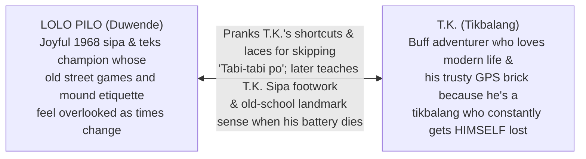

# Pair 1: "Old Tricks & New Trails" Story Bible
### Lolo Pilo (Duwende) <-> T.K. (Tikbalang)

> **Dialogue Craft Bible:** [MASTER_DIALOGUE_AND_NARRATIVE_DESIGN_GUIDE.md](file:///c:/Users/John%20Reniel/sari-saring-katha/docs/MASTER_DIALOGUE_AND_NARRATIVE_DESIGN_GUIDE.md)
> **Story, Pacing & Worldbuilding Bible:** [MASTER_STORY_PACING_AND_WORLDBUILDING_GUIDE.md](file:///c:/Users/John%20Reniel/sari-saring-katha/docs/MASTER_STORY_PACING_AND_WORLDBUILDING_GUIDE.md)
> **Architecture Spec:** [MACRO_NARRATIVE_ARCHITECTURE_SPEC.md](file:///c:/Users/John%20Reniel/sari-saring-katha/docs/MACRO_NARRATIVE_ARCHITECTURE_SPEC.md)
> **Authoring Playbook:** [NEIGHBOR_DIALOGUE_AUTHORING_WORKFLOW.md](file:///c:/Users/John%20Reniel/sari-saring-katha/docs/NEIGHBOR_DIALOGUE_AUTHORING_WORKFLOW.md)

---

## 1. World Tone, Folklore Grounding & Shared Street Geography

Where Triangle A explores neighborhood survival and Triangle B explores sight and healing, **Pair 1** is a bright, kinetic **Old Generation vs. Young Generation** slice-of-life comedy: Karimlan's oldest undefeated street-game *duwende* champion colliding with a buff, adventure-loving *tikbalang* who fell in love with modern life for one hilarious reason—**in folklore, tikbalangs are supposed to lead travelers astray, yet T.K. has zero sense of direction and constantly gets *himself* lost.**

Both characters weave authentic Philippine folklore straight into grounded barangay life:
- **Duwende (*Lolo Pilo* — *Matanda sa Punso*):** Grounded in reciprocal *taong-lupa* / *punso* lore—*"Tabi-tabi po"* courtesy, biting one's finger after pointing at a mound, sweet *alay* candy offerings, harmless domestic mischief (keys, slippers, or shoelaces turning up in impossible spots), and classic Filipino *larong kalye* (*sipa* lead-washer kicking and *teks* card flipping).
- **Tikbalang (*T.K.*):** Grounded in Tagalog and Rizal *tikbalang* lore—towering horse-headed build whose knees rise past his ears when he squats, the folk cure of turning one's shirt inside out (*baliktad ang damit*) when lost, one crisp nod to sunshowers (*"May kinakasal na tikbalang"*), and the three golden spines in his mane—flipped on its head through a lovable, shredded outdoorsman who embraces rugged modern conveniences (a beat-up Nokia handset with offline GPS, street signs, cold bottled drinks, trail sneakers, and gym routines) because modern navigation finally cured his lifelong embarrassment of getting lost on every hike.

### Shared Off-Screen Landmarks (Timeless & Calendar-Neutral Mental Map)
Both neighbors anchor their stories to the same 4 unseen places outside your open **counter** (zero time-of-day words, zero weekdays):
1. **The Mango Mound (*Punso*) by the Half-Court:** Just past the faded three-point line of the barangay basketball court, where Lolo Pilo keeps his neat underground parlor—and right where T.K.'s GPS voice tells him to "cut straight across."
2. **The Old Kalumpang Trailhead:** Where the paved barangay road turns into steep dirt switchbacks—where GPS bars drop to zero and T.K.'s directional confidence gets put to the test.
3. **The Plaza Bench & Painted Lines:** Where Lolo Pilo won the 1968 *sipa* championship, now quieter as neighbors hurry past with errands and gadgets.
4. **Your Open Storefront Counter:** Neutral ground (and T.K.'s #1 unmissable map pin!) where a tiny bearded elder and a seven-foot buff adventurer both refuel on sweets, snacks, and cold bottles.

### Shared Thematic Thread (*Kishōtenketsu* Braiding)
Both arcs explore the same human question from opposite ends of age: **When times change, how do old ways and new tools make room for each other?**
- **Lolo Pilo** is cheerful, witty, and proud of his championship glory days, yet quietly wonders if Karimlan has outgrown play—where nobody says *"Tabi-tabi po"* or pauses for a two-minute game anymore. His *Ten* (perspective turn): the old games aren't dead; they come roaring back to life the moment he takes a loud, clumsy newcomer under his wing.
- **T.K.** loves modern barangay life—his indestructible keypad GPS phone, cold fridge drinks, workout reps, and paved street signs—and hides his old-fashioned mountain name (**Tiburcio Kalumpang**) behind **"T.K."** Because his little GPS screen saved him from decades of getting lost in the woods, he stares at his map arrow so hard he forgets to look at the living ground under his hooves. His *Ten*: when his battery dies, Lolo Pilo's old-world landmark sense and *sipa* rhythm give T.K. real trail confidence even when the screen goes dark.

---

## 2. Legacy Audit — What We Are Replacing & Why

| Character | Legacy Problems | Modernized Pair 1 Fix |
| :--- | :--- | :--- |
| **Lolo Pilo** | Repetitive 6-chapter loop saying *"phones bad, let's play a random game"* six times; `Story.dtl` ended inside `Greeting` so he never bought items during his own story; zero connection to any neighbor; zero reaction to winning vs. losing Sipa/Teks. | Joyful, mischievous former plaza champ with genuine comedic escalation against **T.K.** Buys his favorite `candy`, `snack`, and `sachet` treats across all 6 story chapters, features real Win/Lose Fail-Forward reactions on `minigame:sipa` and `minigame:teks`, plus a sweet `allow_sub_cat:candy` substitution beat! |
| **T.K.** | Named *"Tikbalang Kamera"*; dated influencer slang (*"fam"*, *"based"*, *"major L for the vlog"*); `[pause=0.4]` spam on nearly every line; 9 bloated chapters about deleting a YouTube channel; zero interaction with Lolo Pilo. | Kept strictly as **T.K.** (later revealed as **Tiburcio Kalumpang**!). Rebuilt into a buff, upbeat adventurer who loves modern life—especially his rugged Nokia GPS phone that stops this *tikbalang* from getting himself lost! Matches his actual `tk_wrong_turn_enter` & `tk_cameo_lost_wander` animations. Distilled to **6 tight chapters**. |

---

## 3. The 5-Axis Voice & Agency Dossiers (Blind Cover Test Ready)

> **Global Language & Formatting Contract:**
> - **90–95% natural, idiomatic English** with light, effortless Filipino sprinkles (`apo`, `boss`, `Ho-ho`, `Aba`, `Sus`, `Tabi-tabi po`, `sipa`, `teks`, `punso`, `baliktad`, `maligaw`, `Salamat`, `ha`).
> - **100% spoken voice only:** Zero stage directions in parentheses `(...)`, zero `[Think: ...]`, zero `[b]...[/b]` tags, zero `[pause=...]` spam.
> - **Short player choices:** `3 to 7 words` (hard max 8 words).
> - **Clean cadence:** `6 to 16 words` per bubble (one thought per click), open `counter` (never `grille`), zero em-dashes, zero mid-sentence `...` crutches, and zero time-of-day or weekday words.

### A. Lolo Pilo (*Duwende* — Undefeated 1968 Plaza Champion & Mound Trickster)
- **External Agenda:** Pick up sweet treats for his *punso* pantry, keep your reflexes sharp with *sipa* and *teks*, and teach that galloping giant staring at a tiny keypad screen (**T.K.**) basic mound manners through harmless, surgically precise *duwende* tricks.
- **Internal Fear:** Feeling left behind by changing times—worrying that once your Lola left the counter and concrete crept around his mango mound, nobody in Karimlan remembers how to look up, say *"Tabi-tabi po,"* and play.
- **Tactical Filter:** Twinkling, theatrical grandpa bravado. Even when stung that the half-court stayed empty or that T.K. nearly jogged straight over his chimney root, Pilo frames everything like championship commentary or a cheeky riddle, laughing *"Ho-ho!"* before the wistfulness lingers.
- **Usual Order & Disruption:** Buys **`candy`** and **`snack`** favorites (`Pocha`, `Chubs`, `Mentor`, `Anoba`, `Patos`)—treats echoing traditional sweet *alay* offerings to a friendly *duwende*. Disruption: in Chapter 3, trying to understand what modern adults see in bitter hurried drinks, he glumly orders **`sachet`** coffee (`Kopimo`)—inviting you to swap his order back to **`candy`** via `allow_sub_cat:candy`!
- **Voice Fingerprint:**
  - *Sentence Geometry:* Spry, rhythmic, punchy grandpa lines (`6 to 15 words`), quick with a tease and a warm wink.
  - *Lexicon:* Ankles, footwork, lead washers, mound roots, lucky coins, Lola's counter (`"Ho-ho!"`, `"Apo"`, `"Aba"`, `"Tabi-tabi po"`, `"Sayang"`).
  - *Register:* Playful, warm, competitive Filipino Lolo—never a grumpy anti-modernity lecture, never self-pitying.
  - *Forbidden Words:* Never rants bitterly, never uses gym/tech jargon, never uses time-of-day or weekday words.
  - *Affection Tell:* Calls you his favorite doubles partner, brags that you inherited Lola's quick wrists, and leaves his shiny **1968 Lucky Plaza Coin** by your register.

### B. T.K. (*Tikbalang* — Buff Modern Adventurer, Secretly "Tiburcio Kalumpang")
- **External Agenda:** Live his best modern life—explore new trails without getting lost thanks to his beloved Nokia GPS handset, try every cold drink and hearty snack on your shelves, build strength, and prove a mountain *tikbalang* can be a modern neighborhood regular.
- **Internal Fear:** Losing his sense of bearing again. Other *tikbalangs* brag about leading humans in circles; T.K. once got lost for three weeks going out for firewood! Without his map pins and street signs, he worries he's still the laughingstock of the Kalumpang ridge.
- **Tactical Filter:** Big-hearted, confident athletic enthusiasm that hilariously cracks whenever directions come up (*"Didn't take a wrong turn, boss, just scouting an alternate route!"* or wearing his workout shirt inside-out *"for airflow"* after taking three wrong corners).
- **Usual Order & Disruption:** Buys cold **`bottle`** drinks, **`snack`** fuel, and **`pack`** carbs (`Tubig`, `Kokaloka`, `Patos`, `Dantes`, `Pantit`)—plus occasional old-habit **`cigarette`** orders when frazzled. Disruption: in Chapter 3, when his Nokia battery dies and he gets hopelessly turned around, he stress-orders an old-school **`cigarette`** like his mountain uncles—letting you secretly swap it for a cold **`bottle`** (`allow_sub_cat:bottle`) to keep his athletic streak going!
- **Voice Fingerprint:**
  - *Sentence Geometry:* Energetic, direct, good-natured bursts (`5 to 15 words`)—booming and friendly until someone brings up his real first name or his wrong turns.
  - *Lexicon:* Map pins, battery bars, cardio, trail markers, hooves, shortcuts, inside-out shirts (`"Uy, boss!"`, `"Solid"`, `"Grabe"`, `"Salamat, boss"`, `"Tabi-tabi"`).
  - *Register:* Warm, modern outdoorsy Kuya / buff adventurer—**zero** vlogger cringe (*never* says `"Tikbalang Kamera"`, `"vlog"`, `"fam"`, `"based"`, or `"B-roll"`), **zero** weird sci-fi "aura glitch" talk!
  - *Forbidden Words:* Never says `"Tikbalang Kamera"`, `"vlog"`, `"fam"`, `"based"`, `"aura"`, or `[pause]` tags; never uses time-of-day or weekday words.
  - *Affection Tell:* Offers to haul heavy delivery crates with one arm, trusts you with his real name (**Tiburcio**), and gifts his **Woven Travel Bandana** threaded with one shed golden mane spine as an equal's pact.

---

## 4. Shared Flag, Minigame & 4-Point Tally Matrix

Both characters strictly obey **Max 3 Persistent World Flags + 1 Integer Tally** and the **Strict 4-Point Inflection Tally Budget**:

| Character | World Flag (`Dialogic` Var) | Set When | Scheduled Cross-Web & Arc Payoff |
| :--- | :--- | :--- | :--- |
| **Lolo Pilo** | `pilo_punso_rattled` (`Flag_PiloPunsoRattled`) | **Pilo Ch. 2** (Pilo tells you a buff giant staring at a tiny buzzing phone thundered right past his *punso* without *"Tabi-tabi po"*) | Unlocks the **Trapdoor** in **T.K. Ch. 2** (*"Did you cut past the mango mound without 'Tabi-tabi po'?"*) explaining why T.K.'s shoelaces and wooden street arrows keep getting flipped! |
| **Lolo Pilo** | `pilo_sub_sweet` (`Flag_PiloSubSweet`) | **Pilo Ch. 3** (`allow_sub_cat:candy` -> handing Pilo sweet *alay* candy when he gloomily tries ordering adult `sachet` coffee) | Restores Pilo's trickster grin; shifts his `Purchase.dtl` banter and pays off in **T.K. Ch. 4** (*"Bring sweet candy for the mound"*). |
| **Lolo Pilo** | `pilo_wager_set` (`Flag_PiloWagerSet`) | **Pilo Ch. 4** (encouraging Pilo to challenge T.K. face-to-face at Sipa instead of spinning his trail signs around) | **Major Pair 1 Detonation:** Co-triggers the **Half-Court Sipa & Trail Lesson** in **Pilo Ch. 5** and **T.K. Ch. 5**; required for `outcome:grand_champion`. |
| **T.K.** | `tk_true_name_known` (`Flag_TKTrueNameKnown`) | **Pilo Ch. 3** (Pilo chuckles about remembering T.K. as a lost colt named *Tiburcio*) *or* **T.K. Ch. 3** (T.K. confesses what T.K. stands for) | Unlocks affectionate banter in **T.K. Ch. 4** and **Pilo Ch. 5** without embarrassing him in front of strangers. |
| **T.K.** | `tk_sub_hydrate` (`Flag_TKSubHydrate`) | **T.K. Ch. 3** (`allow_sub_cat:bottle` -> swapping his frazzled old-habit `cigarette` order for a cold `bottle` drink after getting lost) | Keeps T.K. committed to his modern athletic lifestyle; shifts his `Purchase.dtl` lines away from smoke. |
| **T.K.** | `tk_rematch_accepted` (`Flag_TKRematchAccepted`) | **T.K. Ch. 4** (convincing T.K. to pocket the Nokia for ten minutes, say *"Tabi-tabi po,"* and accept Lolo Pilo's Sipa wager) | **Major Pair 1 Detonation:** Co-triggers the **Ch. 5 Payoff** from T.K.'s side; required for `outcome:trail_warden`. |

*(Outcome convenience booleans synced in `DialogicBridge.gd`: `Flag_PiloChampion`, `Flag_TKTrailWarden`.)*

---

## 5. 6-Chapter Core Arc Blueprints (4-Point Tally Validated)

### Character #1: Lolo Pilo (*Duwende*)
*Core Spine:* Karimlan's joyful 1968 plaza champion discovering that modern times haven't killed play—he just needed to trade pranks for coaching a seven-foot rookie.
- **Ch. 1 — "The 1968 Wrist" (`candy` Purchase + `minigame:sipa` | `0` choice tally, `+1` if Sipa won):**
  - *Beat:* Late entry—Lolo Pilo hops up to your counter grinning ear to ear, admiring how much you remind him of your Lola. Before ordering `[color=#0f6e2f]{Transaction_ItemWants}[/color]` (`candy`), he pulls out his lucky lead *sipa* washer to wake up your shopkeeper ankles (`minigame:sipa`).
  - *Fail-Forward:*
    - **Win (`Transaction_MinigameWon == true`):** `tally:+1`. *"Ho-ho! Same lightning reflexes as your Lola!"* Orders sweet candy to celebrate.
    - **Lose (`Transaction_MinigameWon == false`):** `tally:0`. *"Stiff knees from standing behind that counter, apo! Good thing your coach lives down the road!"* Orders his candy warmly.
- **Ch. 2 — "Shortcut Past the Mound" (`snack` Purchase | Inflection #1: `+1 / 0 / -1`):**
  - *Beat:* Sets `pilo_punso_rattled = true`. Pilo arrives brushing loose dirt off his vest with a mischievous grin: a musclebound horse-man (**T.K.**) came jogging straight past the half-court mango mound glued to a loud little keypad phone barking *"Turn left!"*, rattling dust into Pilo's *punso* without a single *"Tabi-tabi po"*! So Pilo knotted the guy's sneakers together and spun the wooden trail sign ninety degrees.
  - *Choices:*
    - `- Classic trick. Still sharp, Lolo.` (`tally:+1` — appreciates his harmless old-school mischief).
    - `- He was probably just lost.` (`tally:0` — fair, even-handed neighborly take).
    - `- Don't mess with street signs.` (`tally:-1` — scolds him like a pest).
- **Ch. 3 — "Bitter Modern Taste" (`sachet` -> Secret Substitution `allow_sub_cat:candy` | Inflection #2):**
  - *Beat:* Pilo's smile is a touch wistful. He waited by the painted plaza lines with his *teks* deck and *sipa* washer, and nobody stopped—everyone rushed past with instant coffee and buzzing phones. He chuckles softly that he even recognized that big jogger as little **Tiburcio** from the Kalumpang ridge (`sets tk_true_name_known = true`), amazed how fast youngsters trade old games for buttons and screens. Wondering if sweets and street games belong to the past, Pilo tries ordering adult `[color=#0f6e2f]{Transaction_ItemWants}[/color]` (`sachet` coffee).
  - *Choices:*
    - `- [Slip him sweet candy instead.]` (`allow_sub_cat:candy` -> `label SubstituteItem`: sets `pilo_sub_sweet = true`, `tally:+1`! Pilo blinks at the candy, lets out a belly laugh, and admits coffee tastes like boiled tree bark anyway).
    - `- Good games never go out of style.` (`tally:+1` — warm reassurance, serves normal order).
    - `- Coffee suits the times better.` (`tally:-1` — reinforces his worry that his era has passed).
- **Ch. 4 — "The Champion's Wager" (`snack` Purchase + `minigame:teks` | Inflection #3: `+1 / 0 / -1`):**
  - *Beat:* Pilo laughs sheepishly—spinning T.K.'s trail arrows worked *too* well! Without his phone signal by the creek, poor T.K. walked around the basketball court five times wearing his shirt inside out in sheer panic. After a quick round of `minigame:teks` with you (`Win` vs. `Lose` banter, `0` extra tally), Pilo admits he feels a bit guilty picking on a *tikbalang* who genuinely can't tell north from left, and asks how to make it right.
  - *Choices:*
    - `- Teach him Sipa and real landmarks!` (`tally:+1`, sets `pilo_wager_set = true` — turns the prank war into mentorship and play!).
    - `- Put the trail sign back straight.` (`tally:0`, sets `pilo_wager_set = true` — fair truce).
    - `- Let his phone figure it out.` (`tally:-1` — keeps the generational wall up).
- **Ch. 5 — "Hooves on the Half-Court" (`candy` Purchase | `0` tallies — *Ten* Payoff):**
  - *Beat:*
    - *If `pilo_wager_set` or `tk_rematch_accepted`:* Pilo is beaming! T.K. came to the mango mound, pocketed his Nokia, bowed low with a booming *"Tabi-tabi po, Lolo Champ!"*, and took Pilo's challenge. T.K. punted the first *sipa* washer onto the barangay hall roof, then picked up the ankle rhythm—and before long, kids and passersby gathered around the half-court cheering every kick!
    - *If neither flag:* Pilo straightened the wooden trail sign himself; T.K. waves politely when jogging past, though they mostly keep to their own worlds.
- **Ch. 6 — "Keeper of the Play" (`candy` / `snack` Purchase + Optional Victory `minigame:sipa` | Accumulated Tally Resolution):**
  - *Outcomes:*
    - **`outcome:grand_champion`** (`Flag_PiloWagerSet` and `Tally >= 3`): Crowns your counter the undefeated heart of Karimlan, slides his shiny **1968 Lucky Plaza Coin** onto the wood, and promises an old *duwende* will gladly tip fortune in your favor when Reyna Mayari weighs your ledger.
    - **`outcome:happy_trickster`** (`Tally >= 1`): Joyful *suki* who buys sweets, swaps jokes, and keeps the plaza lively.
    - **`outcome:quiet_mound`** (`Tally <= 0`): Polite customer who buys his treats quickly and keeps his games to himself.

---

### Character #2: T.K. (*Tikbalang*)
*Core Spine:* A buff, modern-gadget-loving *tikbalang* who relies on a Nokia GPS because he secretly gets himself lost—learning to pair modern tools with old-world respect and landmark sense.
- **Ch. 1 — "Pin on the Map" (`bottle` Purchase | `0` tallies):**
  - *Beat:* Late entry—T.K. marches up (right off his signature wrong-turn walk!), broad-shouldered and grinning as he taps a chunky brick Nokia phone strapped to his forearm. Introduces himself strictly as **T.K.**, raves about how awesome modern offline GPS, street signs, and cold sari-sari fridges are (*"Saved your counter as Home Pin Number One, boss!"*), and orders an ice-cold `[color=#0f6e2f]{Transaction_ItemWants}[/color]` (`bottle`).
  - *Choices:*
    - `- Welcome to Karimlan, T.K.`
    - `- Took the scenic turn getting here?`
    - `- Cold bottle coming right up.`
- **Ch. 2 — "Inside-Out Jersey" (`snack` Purchase | Inflection #1: `+1 / 0 / -1`):**
  - *Beat:* T.K. arrives wearing his sleeveless gym jersey **inside out** (*baliktad*), scratching his mane in total bewilderment! His Nokia GPS swore the shortcut past the basketball court was a straight line, yet somehow his trail shoes got tied together and he ended up circling the same mango tree four times. He leans in and whispers his big secret: *"Don't laugh, boss—folklore says tikbalangs make people get lost, right? I'm the one tikbalang who gets lost all by himself! That's why I bought a GPS!"*
  - *Choices:*
    - *Trapdoor (if `pilo_punso_rattled`):* `- You skipped "Tabi-tabi po" by Pilo's mound!` (`tally:+1` — T.K.'s ears shoot straight up as the whole mystery clicks!).
    - `- Your secret's safe, T.K. Funny shirt.` (`tally:+1` — warm laugh *with* him, never *at* him).
    - `- Maybe recalibrate the phone compass.` (`tally:0` — practical tech answer).
    - `- A tikbalang who gets lost? Embarrassing.` (`tally:-1` — hits his exact insecurity).
- **Ch. 3 — "One Bar Battery & Sunshower" (`cigarette` -> Secret Substitution `allow_sub_cat:bottle` | Inflection #2):**
  - *Beat:* A brief five-second sunshower drizzles outside your awning just as T.K. ducks in—he shakes rain off his mane and groans *"Nobody's getting married out there, boss, I swear!"* (our single crisp sunshower nod!). Worse: his Nokia battery died up on the Kalumpang trailhead, he wandered into the next barangay's rice paddies before finding your roof, and an elder recognized him and shouted his real birth name across the road—**Tiburcio Kalumpang** (`sets tk_true_name_known = true`)! Flustered and discouraged, he stress-orders an old-habit `[color=#0f6e2f]{Transaction_ItemWants}[/color]` (`cigarette`) like his old mountain uncles.
  - *Choices:*
    - `- [Swap smoke for cold hydration.]` (`allow_sub_cat:bottle` -> `label SubstituteItem`: sets `tk_sub_hydrate = true`, `tally:+1`! T.K. catches the cold bottle, grins wide, and thanks you for keeping him on his healthy modern kick).
    - `- Tiburcio's a solid name. Keep going.` (`tally:+1` — steadies his pride without mocking him).
    - `- Buy a spare battery and stay home.` (`tally:-1` — tells him to give up on real trail confidence).
- **Ch. 4 — "Offline Navigation" (`snack` / `pack` Purchase | Inflection #3: `+2 / +1 / -1`):**
  - *Beat:* T.K. realizes a true adventurer can't fall apart every time a Nokia battery hits zero—and he owes **Lolo Pilo** a proper apology for stomping past his *punso* while glued to his screen. He asks how a modern gym horse makes peace with an old-school *duwende* legend.
  - *Choices:*
    - *Trapdoor (if `pilo_wager_set` or `pilo_sub_sweet`):* `- Bring sweet candy and play him at Sipa!` (`tally:+2`, sets `tk_rematch_accepted = true` — nails both *duwende* custom and Pilo's love of games!).
    - `- Pocket the phone and say "Tabi-tabi po."` (`tally:+1`, sets `tk_rematch_accepted = true` — genuine respect).
    - `- Just stick to paved roads with signal.` (`tally:-1`, leaves `tk_rematch_accepted = false` — stays reliant on the screen alone).
- **Ch. 5 — "Sipa and Landmarks" (`bottle` Purchase | `0` tallies — *Ten* Payoff):**
  - *Beat:*
    - *If `tk_rematch_accepted` or `pilo_wager_set`:* T.K. strides up beaming, jersey right-side out and Nokia clipped neatly to his belt! Lolo Pilo drilled his giant hooves in half-court *sipa* footwork—and in exchange for T.K. carrying him up the steep ridge on his shoulder, Pilo taught him how old spirits read wind direction, moss, and tree roots when there's zero GPS signal! *"Best of both worlds now, boss—five bars on the road, Lolo Pilo's tricks in the woods!"*
    - *If neither flag:* T.K. bought two spare Nokia batteries so his map never dies, friendly as ever though still hopeless whenever the screen blanks out.
- **Ch. 6 — "Base Camp Karimlan" (`pack` / `bottle` Purchase | Accumulated Tally Resolution):**
  - *Outcomes:*
    - **`outcome:trail_warden`** (`Flag_TKRematchAccepted` and `Tally >= 3`): Officially settles in Karimlan—escorting lost delivery riders back to the main road *without* checking his phone and playing *sipa* doubles with Lolo Pilo. Slides his **Woven Travel Bandana** (threaded with one shed golden mane spine—given freely to a friend, never plucked by force!) onto your counter and vows to stand by your shop when Reyna Mayari comes calling.
    - **`outcome:modern_strider`** (`Tally >= 1`): Cheerful, buff regular who always calls out *"Tabi-tabi po!"* on his runs and keeps your cold fridge stocked in business.
    - **`outcome:restless_wanderer`** (`Tally <= 0`): Drops by strictly for quick trail supplies with eyes glued to his Nokia arrow.

---

## 6. `P1` Cross-Web Openers & Papa Ulap Radio Breadcrumbs

- **Lolo Pilo** *(if `tk_rematch_accepted`)*: `"Ho-ho! Big Tiburcio kept the sipa airborne ten kicks straight without checking his phone, apo!"`
- **T.K.** *(if `pilo_punso_rattled` and before Ch. 4)*: `"Somebody tied my running shoes together again, boss. Fast little hands out here!"`
- **T.K.** *(if `tk_sub_hydrate`)*: `"Cold bottles over smoke any day, boss! Cardio feels brand new!"`
- **Lolo Pilo** *(if `pilo_sub_sweet`)*: `"Saved that sweet candy wrapper in my lucky vest pocket, apo!"`
- **Papa Ulap Radio Breadcrumb** *(if `pilo_wager_set` or `tk_rematch_accepted`)*: *"Word from the basketball half-court says sipa is making a comeback—one tiny legend and one very tall rookie keeping the washer flying, mga kapitbahay."*

---

## 7. Implementation Plan

1. **`LoloPilo.tres`:** 6 `ChapterData` with concrete purchase categories (`candy`, `snack`, `sachet`, `snack`, `candy`, `candy`) across 2 `ArcData` (`arc_0`, `arc_1`) so Lolo Pilo buys his favorite treats in every Story chapter alongside `minigame:sipa` / `minigame:teks`, plus optional games in `Visit.dtl`.
2. **`TK.tres` & `TK.dch`:** Trim from 9 legacy vlogger chapters to 6 crisp chapters (`bottle`, `snack`, `cigarette`, `snack`, `bottle`, `pack`) across 2 `ArcData` (`arc_0`, `arc_1`), keeping `tk_wrong_turn_enter` and `tk_cameo_lost_wander`, and give `TK.dch` a warm readable nameplate color.
3. **2-Batch Voice-Check Cadence:**
   - **Lolo Pilo — Batch 1:** Ch. 1–3 + `Purchase.dtl` + `Visit.dtl` + `LoloPilo.tres` + early flags -> pause for review -> **Batch 2:** Ch. 4–6 + `P1`/`P2`.
   - **T.K. — Batch 1:** Ch. 1–3 + `Purchase.dtl` + `Visit.dtl` + `TK.tres`/`TK.dch` + early flags -> pause for review -> **Batch 2:** Ch. 4–6 + `P1`/`P2` + headless verification.
