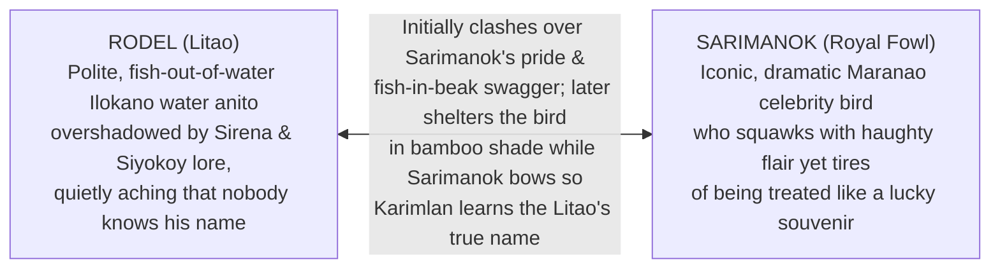

# Pair 2: "The Forgotten Tide & The Painted Crown" Story Bible
### Rodel (Litao) <-> Sarimanok (Maranao Royal Fowl)

> **Dialogue Craft Bible:** [MASTER_DIALOGUE_AND_NARRATIVE_DESIGN_GUIDE.md](file:///c:/Users/John%20Reniel/sari-saring-katha/docs/MASTER_DIALOGUE_AND_NARRATIVE_DESIGN_GUIDE.md)
> **Story, Pacing & Worldbuilding Bible:** [MASTER_STORY_PACING_AND_WORLDBUILDING_GUIDE.md](file:///c:/Users/John%20Reniel/sari-saring-katha/docs/MASTER_STORY_PACING_AND_WORLDBUILDING_GUIDE.md)
> **Architecture Spec:** [MACRO_NARRATIVE_ARCHITECTURE_SPEC.md](file:///c:/Users/John%20Reniel/sari-saring-katha/docs/MACRO_NARRATIVE_ARCHITECTURE_SPEC.md)
> **Authoring Playbook:** [NEIGHBOR_DIALOGUE_AUTHORING_WORKFLOW.md](file:///c:/Users/John%20Reniel/sari-saring-katha/docs/NEIGHBOR_DIALOGUE_AUTHORING_WORKFLOW.md)

---

## 1. World Tone, Folklore Grounding & Shared Street Geography

Where Triangle A explores neighborhood survival, Triangle B explores sight and healing, and Pair 1 explores Old vs. Young, **Pair 2** explores **memory, fame, and belonging**: what happens when two outsiders arrive in inland Karimlan from opposite ends of Philippine folklore fame — a **forgotten Ilokano water spirit** nobody recognizes anymore, and the **most famous mythical bird in the archipelago** who is secretly exhausted by being treated like a painted souvenir.

Both characters weave authentic Philippine ethnography straight into warm, funny slice-of-life:
- **Litao (*Rodel* — Ilokano Water & Bamboo-Grove Anito):** Grounded in Isabelo de los Reyes's *El Folk-Lore Filipino* (1889) and Vigan, Ilocos Sur oral tradition — the original indigenous male water *anito* of seas, rivers, and riverside bamboo groves (*"Dayu-dayu, bari-bari"*), remembered as the *sirena*'s husband who was later overshadowed and forgotten by the more famous European mermaid and *siyokoy*.
- **Sarimanok (*Maranao Royal Fowl*):** Grounded in Lake Lanao Maranao art and oral lore — the resplendent *okir*-plumed bridge spirit (*itotoro*) traditionally accompanied by royal banners (*panji*) and carrying a **fish** in its beak or talons as an emblem of abundance, now so famous nationwide (carvings, murals, broadcasts, mascots) that mortals treat it like a lucky-charm photo op rather than a living spirit.

### Shared Off-Screen Landmarks (Timeless & Calendar-Neutral Mental Map)
Both outsiders anchor their stories to the same 4 unseen places outside your open **counter** (zero time-of-day words, zero weekdays):
1. **The Creekside Bamboo Clump:** The cool, swaying riverside grove at the edge of Karimlan — the closest thing to Rodel's northern coastal home, and the one quiet hideout where Sarimanok can escape attention-seekers.
2. **The Painted Barangay Welcome Arch:** Down the main road, where a faded mural depicts a bright multicolored bird — making Sarimanok preen and Rodel quietly sigh.
3. **The Dry Concrete Crossing:** The sun-baked stretch of road connecting the creek to your awning, which feels utterly alien to a sea-born *anito*.
4. **Your Open Storefront Counter:** Neutral ground where a polite coastal stranger and a dramatic jeweled rooster both end up shopping side by side.

### Shared Thematic Thread (*Kishōtenketsu* Braiding)
Both arcs ask the same quiet human question from opposite mirrors: **What is the difference between being famous and truly being known?**
- **Rodel** has been forgotten by the mainland — people mistake him for a *siyokoy*, a *kataw*, or a stray fisherman, and inland conveniences (sealed plastic water, tinned fish) feel alien to him. His *Ten* (perspective turn): he doesn't need the whole archipelago to put him on a mural; being remembered by name at one warm counter and one shaded creek is enough to make a home.
- **Sarimanok** has the opposite problem — everyone knows its face, nobody sees *it*. It struts in expecting banners and flattery, communicating in imperious `BA-KAAWK!!` squawks and dramatic bird-body-language, yet hides in Rodel's bamboo clump when passersby try to pluck "lucky feathers." Its *Ten*: the one neighbor who never tried to use it as a mascot is the forgotten water spirit — so Sarimanok uses its own fame to bow its crowned head and make the whole street learn Rodel's name.

---

## 2. Legacy Audit — What We Are Replacing & Why

| Character | Legacy Problems | Modernized Pair 2 Fix |
| :--- | :--- | :--- |
| **Rodel** | Sci-fi alien jargon (*"stabilize my hydro-stasis"*, *"evaporation rate"*, *"Great Kraken"*); 9 repetitive chapters about searching for a missing wife that ended in *"She isn't here, goodbye"*; zero real *Litao* Ilokano lore; zero connection to Sarimanok. | Grounded, endearing **Ilokano *Litao* fish-out-of-water** from the northern seas — polite, curious about inland life (plastic bottles, tinned fish), quietly carrying the weight of being forgotten next to *Sirena* and *Siyokoy*. Distilled to **6 crisp chapters** braided directly with Sarimanok! |
| **Sarimanok** | 4 empty `Ba-kawk!` visit chapters followed by a jarring pivot into a British Wall Street finance bro talking about *"Q4 dividends"* and *"macroeconomics"*; zero connection to Rodel. | Keeps the beloved **Ch. 1 spontaneous `[shake]BA-KAAWK!![/shake]` zero-choice exit** AND uses expressive **bird squawks + deadpan parenthetical implications** across Chapters 2–5 (explicitly approved character exception!). In **Ch. 6 (best outcome only)**, clears its throat once to speak a brief, resonant 2-line blessing before snapping right back to `Ba-kawk.` and pretending it never spoke! Distilled to **6 tight chapters**. |

---

## 3. The 5-Axis Voice & Agency Dossiers (Blind Cover Test Ready)

> **Global Language & Formatting Contract:**
> - **Rodel:** **90–95% natural, idiomatic English** with light, dignified Ilokano/Filipino touches (`Dayu-dayu`, `bari-bari`, `Litao`, `sirena`, `siyokoy`, `Salamat`, `po`). **100% spoken voice** (zero parentheses).
> - **Sarimanok (Approved Character Exception):** Expressive avian squawks (`[shake]BA-KAAWK!![/shake]`, `Ba-kawk!`, `Cluck.`) paired with crisp, deadpan **parenthetical implications** `(It tilts its jeweled crest, visibly offended by your shelf spacing.)` across Ch. 2–5 and `Purchase`/`Visit` — reserving **spoken human words** strictly for one unforgettable 2-line blessing in Ch. 6's best outcome!
> - **Short player choices:** `3 to 7 words` (hard max 8 words).
> - **Clean cadence:** `6 to 16 words` per bubble, open `counter` (never `grille`), zero em-dashes, zero mid-sentence `...` crutches, zero `[pause=...]` spam, zero `[b]...[/b]` tags, and zero time-of-day or weekday words.

### A. Rodel (*Litao* — Courteous Coastal Outsider & Forgotten Water Anito)
- **External Agenda:** Navigate dry inland Karimlan politely, keep his throat cool with fresh water and chilled goods, tend the creekside bamboo clump, and figure out how an old northern sea *anito* fits into a town that has never heard the word *Litao*.
- **Internal Fear:** Fading completely from memory — watching *sirena* and *siyokoy* fill every storybook while the original water guardian who gave the sea its songs is met with blank stares.
- **Tactical Filter:** Gentle, slightly formal old-world courtesy. Masks quiet loneliness behind earnest curiosity about inland human habits (*"You sell cold rain inside plastic cylinders? Remarkable."* or calmly correcting *"No, not a siyokoy. Close, though."*).
- **Usual Order & Disruption:** Buys **`bottle`**, **`frozen`**, and **`can`** items (`Water`, `Coke`, `Tocino`, `Cenchuree`). Disruption: in Chapter 3, feeling invisible and trying too hard to act like a regular inlander, he orders dry **`pack`** snacks — letting you secretly hand him a cool **`bottle`** (`allow_sub_cat:bottle`) that eases his coastal homesickness!
- **Voice Fingerprint:**
  - *Sentence Geometry:* Measured, polite, gently curious (`7 to 16 words`), never robotic sci-fi jargon.
  - *Lexicon:* Tide, bamboo shade, salt air, northern coast, tinned fish, river stones (`"Dayu-dayu"`, `"Litao"`, `"Salamat"`, `"Pardon me"`).
  - *Register:* Dignified, warm visiting envoy — sincere, slightly literal, unexpectedly funny when encountering inland quirks.
  - *Forbidden Words:* Never says `"hydro-stasis"`, `"evaporation rate"`, `"Kraken"`, or time-of-day/weekday words.
  - *Affection Tell:* Greets your counter with a traditional Ilokano *"Dayu-dayu"*, stops apologizing for tracking creek dampness on the threshold, and leaves a **Sea-Smoothed River Stone** by your register.

### B. Sarimanok (*Maranao Royal Fowl* — Imperious Celebrity Bird)
- **External Agenda:** Inspect Karimlan's shelves with theatrical royal standards, obtain worthy snacks and shiny fish tins, and preserve its spotless golden-feathered dignity at all costs.
- **Internal Fear:** Being reduced to a silent painted mascot — grabbed for "lucky feathers," pointed at on street arches, and never respected as a real living spirit (*itotoro*).
- **Tactical Filter:** Maximum rooster diva energy! Covers exhaustion or gratitude with an outraged feather-puff, a haughty `BA-KAAWK!!`, or aggressively sliding coins across your counter as if bestowing royal patronage.
- **Usual Order & Disruption:** Buys **`snack`**, **`pack`**, and **`can`** items (`Patos`, `Dantes`, `Pantit`, `Cenchuree`, `Lucky9`). Disruption: in Chapter 3, ruffled from escaping feather-plucking fans, it pecks glumly at plain **`pack`** goods — letting you secretly slide it a gleaming **`can`** of fish (`allow_sub_cat:can`), honoring the authentic Maranao *Sarimanok* fish emblem!
- **Voice Fingerprint:**
  - *Sentence Geometry:* Punchy squawk + crisp 6–14 word parenthetical implication. (Single 2-line spoken reveal ONLY in Ch. 6 `outcome:living_emblem`!)
  - *Lexicon (in parentheticals):* Jeweled crest, okir plumage, ceremonial banners, beak-taps, indignantly puffed feathers.
  - *Forbidden Words:* Zero British finance/stock-market talk (`"Q4 dividends"`, `"macroeconomics"`, `"franchise"`), zero `[pause=...]` spam, zero time-of-day/weekday words.
  - *Affection Tell:* Stops glaring at your shelf alignment, nudges an extra coin toward you without looking, and leaves a gleaming **Golden Okir Feather** on your counter.

---

## 4. Shared Flag, Prerequisite DAG & 4-Point Tally Matrix

Both characters strictly obey **Max 3 Persistent World Flags + 1 Integer Tally** and the **Strict 4-Point Inflection Tally Budget**:

| Character | World Flag (`Dialogic` Var) | Set When | Scheduled Cross-Web & Arc Payoff |
| :--- | :--- | :--- | :--- |
| **Rodel** | `rodel_name_remembered` (`Flag_RodelNameRemembered`) | **Rodel Ch. 2** (player greets him properly as a *Litao* instead of calling him a *siyokoy* or shrugging) | Warms Rodel immediately; unlocks a proud callback in **Rodel Ch. 3** and **Sarimanok Ch. 4**. |
| **Rodel** | `rodel_sub_water` (`Flag_RodelSubWater`) | **Rodel Ch. 3** (`allow_sub_cat:bottle` -> swapping his dry `pack` "blend in" order for a cool `bottle`) | Eases his coastal homesickness; shifts his `Purchase.dtl` banter away from feeling out of place. |
| **Rodel** | `rodel_sheltered_bird` (`Flag_RodelShelteredBird`) | **Rodel Ch. 4** (encouraging Rodel to shelter the harried Sarimanok inside his creekside bamboo clump) | **Major Pair 2 Detonation:** Triggers the **Ch. 5 Bamboo Grove & Royal Bow** payoff in both arcs; required for `outcome:remembered_anito`. |
| **Sarimanok** | `smk_met_rodel` (`Flag_SmkMetRodel`) | **Sarimanok Ch. 2** (Sarimanok bristles at the damp stranger who didn't bow to its plumage) | Unlocks the **Trapdoor** in **Rodel Ch. 2** explaining why the famous rooster keeps glaring down the road! |
| **Sarimanok** | `smk_sub_fish` (`Flag_SmkSubFish`) | **Sarimanok Ch. 3** (`allow_sub_cat:can` -> sliding a gleaming fish `can` instead of plain `pack` food to honor its Maranao fish emblem) | Moves the proud bird deeply; shifts its `Purchase.dtl` parentheticals from haughty inspection to royal approval. |
| **Sarimanok** | `smk_honored_rodel` (`Flag_SmkHonoredRodel`) | **Sarimanok Ch. 4** (affirming that Rodel sheltered it in the bamboo shade as a true neighbor, not a trophy) | **Major Pair 2 Detonation:** Co-triggers the **Ch. 5 Royal Bow** payoff and unlocks Sarimanok's **Ch. 6 Spoken Blessing** (`outcome:living_emblem`)! |

*(Outcome convenience booleans synced in `DialogicBridge.gd`: `Flag_RodelRememberedAnito`, `Flag_SmkLivingEmblem`.)*

### Acyclic `ChapterPrerequisite` Ping-Pong Schedule (Both Unlock at Tier 2!)
| Chapter | Sarimanok (`sarimanok`) | Rodel (`rodel`) |
| :--- | :--- | :--- |
| **Ch. 1 (`0`)** | *The Arrival* (`is_visit_only = true`, spontaneous `BA-KAAWK!!`) — open at Tier 2 | *Stranded Inland* (`bottle`) — open at Tier 2 |
| **Ch. 2 (`1`)** | *The Royal Inspection* (`snack`) — requires `rodel >= 1` | *The Tinned Sea* (`can`) — requires `sarimanok >= 2` |
| **Ch. 3 (`2`)** | *Heavy Plumes* (`pack` -> `allow_sub_cat:can`) — requires `rodel >= 2` | *Name on the Water* (`pack` -> `allow_sub_cat:bottle`) — requires `sarimanok >= 3` |
| **Ch. 4 (`3`)** | *Bamboo in the Crest* (`snack`) — requires `rodel >= 3` | *Shade by the Creek* (`frozen`) — requires `sarimanok >= 4` |
| **Ch. 5 (`4`)** | *No Feathers Plucked* (`can`) — requires `rodel >= 4` | *The Bow by the Bamboo* (`bottle`) — requires `sarimanok >= 4` |
| **Ch. 6 (`5`)** | *The Crown's Word* (`can`/`snack`) — requires `rodel >= 5` | *The Tide Remembers* (`bottle`/`frozen`) — requires `sarimanok >= 5` |

---

## 5. 6-Chapter Core Arc Blueprints (4-Point Tally Validated)

### Character #1: Rodel (*Litao*)
*Core Spine:* A courteous, forgotten northern sea *anito* learning inland life and quietly tending Karimlan's neglected creekside bamboo bank — earning his own *atang* offering and name back from the neighborhood, with one natural crossover beat when Sarimanok ducks into his grove.
- **Ch. 1 — "Stranded Inland" (`bottle` Purchase | `0` tallies):** Late entry — politely bewildered by drinking water sealed in clear plastic; introduces himself as Rodel, a *Litao* (*"Not a sirena. Not a siyokoy."*).
- **Ch. 2 — "The Tinned Sea" (`can` Purchase | Inflection #1: `+1 / 0 / -1`):** Astonished by tinned silver fish; mentions a tricycle driver calling him *"that siyokoy from the creek"* while nobody inland has said *Litao* in a century.
- **Ch. 3 — "Name on the Water" (`pack` -> Secret Substitution `allow_sub_cat:bottle` | Inflection #2: `+1` sub OR `+1` warm / `-1` dismiss):** Spent hours pulling plastic wrappers out of the creekside bamboo roots; orders dry `pack` inland food to blend in, inviting you to slip him a cool `bottle` (`rodel_sub_water`, `tally:+1`).
- **Ch. 4 — "Shade by the Creek" (`frozen` Purchase | Inflection #3: `+2 / +1 / -1` | Prereq: `sarimanok >= 2`):** One organic crossover beat — the harried Sarimanok ducks into Rodel's cleared bamboo clump escaping feather-chasers; Rodel decides whether to share his hard-won shade (`rodel_sheltered_bird`).
- **Ch. 5 — "Rice Cake by the Roots" (`bottle` Purchase | `0` tallies — Rodel's OWN *Ten* Payoff):** Finds a clean creek bank, a banana leaf with rice cake (*atang*) by his bamboo roots, and a kid on the bridge calling out `"Dayu-dayu, Litao!"` (with an optional 1-line nod if `smk_honored_rodel` is also true).
- **Ch. 6 — "The Tide Remembers" (`bottle` / `frozen` Purchase | Accumulated Tally Resolution):** `outcome:remembered_anito` (Sea-Smoothed River Stone + Convergence pledge) / `outcome:coastal_envoy` / `outcome:drifting_tide`.

---

### Character #2: Sarimanok (*Maranao Royal Fowl*)
*Core Spine:* An iconic, dramatic celebrity bird communicating in `BA-KAAWK!!` and deadpan parentheticals — learning from a forgotten water spirit that true dignity isn't banners or souvenirs, culminating in one unforgettable spoken blessing.
- **Ch. 1 — "The Arrival" (`is_visit_only = true` | `0` tallies — Iconic Zero-Choice Entrance!):**
  - *Beat:* Pure comedic perfection:
    - `Sarimanok: [shake]BA-KAAWK!![/shake]`
    - `[signal arg="story_success"]`
    - `[end_timeline]`
- **Ch. 2 — "The Royal Inspection" (`snack` Purchase | Inflection #1: `+1 / 0 / -1`):**
  - *Beat:* Sets `smk_met_rodel = true`. Sarimanok struts up, drops shiny coins from its beak, and inspects your counter with `[shake]Ba-kawk![/shake] (It tilts its jeweled crest, clearly offended there are no royal banners out front.)` Then it glares down the road at damp coastal **Rodel** who walked past without gasping at its famous feathers!
  - *Choices:*
    - `- Welcome, honored guest. No banners needed.` (`tally:+1` — treats it with genuine respect, not hype).
    - `- That damp guy's just new here.` (`tally:0` — calms its ruffled pride).
    - `- Can I pluck one lucky feather?` (`tally:-1` — instant outraged `[shake]BA-KAAWK!![/shake]`).
- **Ch. 3 — "Heavy Plumes" (`pack` -> Secret Substitution `allow_sub_cat:can` | Inflection #2: `+1` sub OR `+1` empathy / `-1` exploit):**
  - *Beat:* Sarimanok swoops under your awning panting, one tail feather crooked! `Ba-kawk...` *(Wait — zero `...`! Use `Cluck.`)* `(It tucks its head beneath a bright wing, exhausted from folks chasing it for raffle luck.)` Glumly pecks toward plain `[color=#0f6e2f]{Transaction_ItemWants}[/color]` (`pack`).
  - *Choices:*
    - `- [Slide a shiny fish can instead.]` (`allow_sub_cat:can` -> `label SubstituteItem`: sets `smk_sub_fish = true`, `tally:+1`! Honors the authentic Maranao fish-in-beak emblem! `(It freezes, stares at the gleaming tin, and bows its crowned head in quiet awe.)`).
    - `- Rest under my awning. No photos.` (`tally:+1` — safe haven without spectacle).
    - `- Pose by my sign for customers?` (`tally:-1` — treats it like a living billboard!).
- **Ch. 4 — "Bamboo in the Crest" (`snack` Purchase | Inflection #3: `+2 / +1 / -1`):**
  - *Beat:* Sarimanok lands with two green bamboo leaves stuck right in its golden crest! `(It puffs up defensively, then nudges an extra coin toward the corner where Rodel usually stands.)` Clearly, the quiet coastal *Litao* sheltered it in the bamboo grove without asking for a single lucky feather.
  - *Choices:*
    - *Trapdoor (if `rodel_sheltered_bird` or `rodel_name_remembered`):* `- Nobody knows his name. Help them see.` (`flag:smk_honored_rodel=true`, `tally:+2` — sparks the Ch. 5 Royal Bow!).
    - `- Nice having a quiet neighbor, huh?` (`flag:smk_honored_rodel=true`, `tally:+1` — warm nod to Rodel's kindness).
    - `- Brush those cheap leaves off, royalty.` (`tally:-1` — pushes it back into lonely vanity).
- **Ch. 5 — "No Feathers Plucked" (`can` Purchase | `0` tallies — *Ten* Payoff):**
  - *Beat:*
    - *If `smk_honored_rodel` or `rodel_sheltered_bird`:* Sarimanok arrives calmer and brighter than ever — `(It lets a passing kid wave without puffing up, proud that everyone greeted Rodel the Litao by the creek first.)` Drops exact coins neatly instead of spitting them, ordering `[color=#0f6e2f]{Transaction_ItemWants}[/color]` (`can`).
    - *Else:* Still struts briskly under the awning to avoid crowds, tossing coins down with sharp, guarded dignity.
- **Ch. 6 — "The Crown's Word" (`can` / `snack` Purchase | Accumulated Tally Resolution + Single Spoken Reveal!):**
  - *Outcomes:*
    - **`outcome:living_emblem`** (`Flag_SmkHonoredRodel` and `Tally >= 3`): Lays a gleaming **Golden Okir Feather** beside your register. Clears its throat once — and speaks aloud for the **first and only time**:
      - `"A humble counter needs no banners when it remembers every guest's true name."`
      - `"When the Pale Moon weighs your ledger, my wings stand beside this house."`
      - Immediately snaps back: `[shake]Ba-kawk.[/shake] (It shuts its beak tightly and struts upright, pretending it never spoke a word.)`
    - **`outcome:proud_patron`** (`Tally >= 1`): Leaves a bright plume and stays a delighted, dramatic *suki* (`Ba-kawk!` + warm parentheticals only).
    - **`outcome:passing_spectacle`** (`Tally <= 0`): One disdainful `[shake]BA-KAAWK!![/shake]` and a brisk, aloof transaction.

---

## 6. `P1` Cross-Web Openers & Papa Ulap Radio Breadcrumbs

- **Rodel** *(if `smk_honored_rodel`)*: `"Two children called out Dayu-dayu by the creek earlier. That bright bird keeps its promises."`
- **Rodel** *(if `rodel_sub_water`)*: `"Your cold bottles remind me of the northern surf, keeper of the counter."`
- **Sarimanok** *(if `rodel_sheltered_bird`)*: `[shake]Ba-kawk![/shake] (It sports a fresh bamboo leaf tucked neatly behind one golden ear-feather, looking unusually content.)`
- **Sarimanok** *(if `smk_sub_fish`)*: `Cluck. (It inspects your canned-fish shelf first with unmistakable royal approval.)`
- **Papa Ulap Radio Breadcrumb** *(if `rodel_sheltered_bird` or `smk_honored_rodel`)*: *"Neighbors down by the creek say a dazzling bird bowed right toward the bamboo grove—and folks are finally learning to greet the Litao who tends the bank, mga kapitbahay."*

---

## 7. Implementation Plan

1. **`Rodel.tres` & `Rodel.dch`:** Trim from 9 legacy chapters to 6 crisp chapters (`bottle`, `can`, `pack`, `frozen`, `bottle`, `bottle`/`frozen`) across 2 `ArcData` entries, wire `ChapterPrerequisite` ping-pong with `sarimanok`, preserve `rodel_heavy_diplomat` & `rodel_cameo_patrol`, and give `Rodel.dch` a readable sea-teal color.
2. **`Sarimanok.tres` & `Sarimanok.dch`:** Trim from 9 legacy chapters to 6 crisp chapters (Ch. 1 `is_visit_only = true`, Ch. 2–6 purchases: `snack`, `pack`, `snack`, `can`, `can`/`snack`) across 2 `ArcData` entries, wire `ChapterPrerequisite` ping-pong with `rodel`, preserve `sarimanok_flap_swoop` & `sarimanok_cameo_swoop`, and give `Sarimanok.dch` a readable royal-gold color.
3. **2-Batch Voice-Check Cadence:**
   - **Rodel — Batch 1:** Ch. 1–3 + `Purchase.dtl` + `Visit.dtl` + `Rodel.tres`/`Rodel.dch` + Pair 2 flags -> pause for review -> **Batch 2:** Ch. 4–6 + `P1`/`P2`.
   - **Sarimanok — Batch 1:** Ch. 1–3 + `Purchase.dtl` + `Visit.dtl` + `Sarimanok.tres`/`Sarimanok.dch` -> pause for review -> **Batch 2:** Ch. 4–6 + `P1`/`P2` + full Pair 2 verification.
