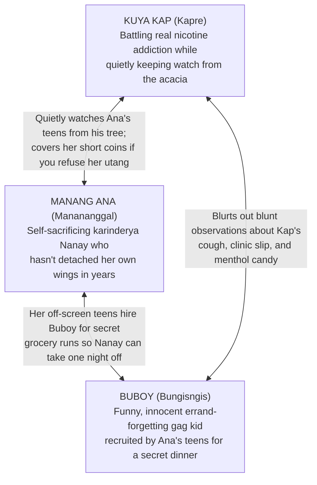

# Triangle A: "The Street & The Shade" Story Bible
### Kuya Kap (Kapre) <-> Manang Ana (Manananggal) <-> Buboy (Bungisngis)

> **Dialogue Craft Bible:** [MASTER_DIALOGUE_AND_NARRATIVE_DESIGN_GUIDE.md](file:///c:/Users/John%20Reniel/sari-saring-katha/docs/MASTER_DIALOGUE_AND_NARRATIVE_DESIGN_GUIDE.md)
> **Story, Pacing & Worldbuilding Bible:** [MASTER_STORY_PACING_AND_WORLDBUILDING_GUIDE.md](file:///c:/Users/John%20Reniel/sari-saring-katha/docs/MASTER_STORY_PACING_AND_WORLDBUILDING_GUIDE.md)
> **Architecture Spec:** [MACRO_NARRATIVE_ARCHITECTURE_SPEC.md](file:///c:/Users/John%20Reniel/sari-saring-katha/docs/MACRO_NARRATIVE_ARCHITECTURE_SPEC.md)

---

## 1. World Tone & Shared Street Geography (Iceberg & Bottle Design)

Karimlan is a warm, friendly barangay where everyone already knows each other's folklore nature. Nobody is hunting Manang Ana's kids, and nobody treats Kuya Kap like a monster. The drama here is **timeless everyday slice-of-life** (*Midnight Diner* intimacy): stubborn habits, Filipino *hiya* (pride over debt), loving a family so hard you forget yourself, and a loud kid who cannot remember a single grocery list.

### Shared Off-Screen Landmarks (Mental Map)
All three neighbors casually reference the same 4 unseen places so the street feels alive outside your counter:
1. **Kap's Acacia Corner:** The shaded post across the road where Kap leans at dusk and Buboy plays Teks.
2. **Ana's Karinderya:** Two blocks down, always smelling of garlic rice and adobo, where Ana works solo while her four teens (strictly off-screen/mentioned) raid the pots.
3. **The Barangay Clinic:** Where Kap quietly picked up a folded prescription slip he refuses to talk about.
4. **The Main Road:** The road connecting their homes to your storefront.

### Shared Thematic Thread (*Kishōtenketsu* Braiding)
All three arcs mirror the same human question from different angles: **How do you let the people who love you actually carry some of the weight?**
- **Kuya Kap** fights nicotine addiction alone because he thinks his smoke and his stoic front are how he stays strong. His quiet realization: *the street loves him for the shade, not the smoke.*
- **Manang Ana** smothers herself in work and *hiya* until she forgets she's allowed to fly. Her *Ten* (perspective turn): her chaotic teens aren't helpless; they've been clumsily plotting to give her one free night in the sky.
- **Buboy** is the comic glue who keeps messing up errands, until he's trusted with the one real job that ties Ana's surprise dinner together.

---

## 2. The 5-Axis Voice & Agency Dossiers (Blind Cover Test Ready)

### A. Kuya Kap (*Kapre*)
- **External Agenda:** Enjoy his familiar sari-sari routine (usual cigarette, easy chat at the window, watching the road from his acacia) while fighting a worsening nicotine addiction he waves off like every stubborn Filipino tito.
- **Internal Fear:** Admitting forty years of smoke is catching up to his lungs; losing his steady, dependable presence in front of the younger generation.
- **Tactical Filter:** Warm, affectionate elderly Tito deflection. Whenever health or smoking comes up, he blames tricycle mufflers, bored young clinic doctors, or smoothly pivots to asking if *you've* eaten yet.
- **Usual Order & Disruption:** Always buys `cigarette` (`Champyon` / `Marboro` / `Mayti`). If you secretly pivot his request to the **`candy`** category via dialogue (`allow_sub_cat:candy`), he gets hilariously sheepish and cranky about unwrapping sweets like a grade-schooler.
- **Voice Fingerprint:**
  - *Sentence Geometry:* Warm, unhurried, conversational (`6 to 15 words` per bubble, zero time-of-day words).
  - *Lexicon:* Shade, road, counter, candy jars, old knees (`"Aba"`, `"Sus"`, `"O, apo"`, `"Nak"`, `"Ikaw talaga"`).
  - *Register:* Homey Filipino-English Tito cadence. Never preachy, never noir-clipped, never fortune-cookie wise.
  - *Forbidden Words:* Never denotes time of day (`tonight`, `morning`, `dusk`), never counts coins out loud as a gimmick, never says `"I'm addicted"`.
  - *Affection Tell:* Fusses over whether you've eaten or sat down, leaves extra coins for your merienda, or watches out for neighbors across the road.

### B. Manang Ana (*Manananggal*)
- **External Agenda:** Stretch karinderya wages to feed four ravenous, half-bodied teens (strictly off-screen) without ever feeling indebted (*hiya*) to anyone.
- **Internal Fear:** Stepping away from the stove for even one night and watching her household fall apart; being a burden on neighbors.
- **Emotional Core (No Tactical Filter):** She is an **old, tired Tita soul**, not a brisk strategist. She is warm, candid, easily winded, and fusses over you like an auntie even when she's the one exhausted.
- **Usual Order & Disruption:** Canned/frozen staples (`Argentita`, `Mema`, `Aryel`, `Kopimo`). When she starts buying double `Kopimo` sachets, the player *feels* her pulling double shifts before she even explains why.
- **Voice Fingerprint:**
  - *Sentence Geometry:* Warm, unhurried, slightly breathless Tita cadence. Often trails off to check if you've eaten.
  - *Lexicon:* Shifts, stains, centavos, Friday (`"Susmaryosep"`, `"Sa Biyernes"`, `"Anak, kumain ka na ba?"`).
  - *Register:* Warm, candid working-class Taglish.
  - *Forbidden Words:* Never begs, never sounds cold or corporate, never says `"It takes a village"`.
  - *Affection Tell:* Fusses over your sleep/meals or slides a warm container across the counter and walks away before you can thank her.

### C. Buboy (*Bungisngis*)
- **External Agenda:** Finish his mom's grocery errands (which he immediately forgets on the walk over), win at Teks, and prove he can be trusted with a real mission.
- **Internal Fear (Light & Grounded, Never Depressing):** Messing up another errand and being treated like the goofy kid nobody trusts with important stuff.
- **Tactical Filter:** Big laughs, wild descriptions of items whose names he forgot, terrible excuses that fall apart in two seconds.
- **Usual Order & Disruption:** Snacks & candy (`Anoba`, `Patos`, `Chubs`, `Pocha`) ordered via hilarious forgotten-name "riddles". Disruption: suddenly trying to buy real cooking ingredients (`Argentita`, `Pantit`, `Tocino`) for Ana's teens' secret dinner!
- **Voice Fingerprint:**
  - *Sentence Geometry:* Bouncy, run-on bursts crashing into blunt 4-word kid observations (`"Manong, why are you chewing mint?"`).
  - *Lexicon:* Errands, Teks dares, food (`"Kuya!"`, `"Nakakainis, nakalimutan ko!"`, `"Taya!"`, `"Promise!"`).
  - *Register:* Energetic, innocent Taglish kid-speak.
  - *Forbidden Words:* Never talks like a sad philosopher; never hides his excitement.
  - *Affection Tell:* Shares accidental street intel for free and challenges you to a fair Teks match.

---

## 3. Shared Flag & Delayed-Consequence Matrix (Max 3 Flags + 1 Tally Each)

Every flag pays off on **both** warm and tough player paths (zero orphan flags, zero dead ends, zero extra Journal text required):

| Flag / Variable | Set When (Flexible Timing) | Delayed Payoff Across Both Paths |
| :--- | :--- | :--- |
| **`kap_clinic_known`** | **Buboy Ch. 2** (blurts out seeing Kap at the clinic) *or* **Kap Ch. 2** (dropped clinic slip) | Unlocks a **Trapdoor** in **Kap Ch. 3** (skip his excuses immediately) and lets **Ana Ch. 4** quietly ask if Kap is alright. |
| **`kap_sub_candy`** | **Kap Ch. 3 or 4** (*VA-11 HALL-A* substitution: handing him `Mentor` candy or `Water` instead of cigarettes) | Puts Kap on the cranky, funny withdrawal road toward `quit_smoking`; **Buboy Ch. 5** hilariously busts him chewing mint candy! |
| **`kap_shade_affirmed`** | **Kap Ch. 4** (Respectful dialogue choice reminding him the street comes for his shade, not his smoke) | Deepens Kap's trust without needing any new Journal text, strengthening his presence at Mayari's Convergence. |
| **`ana_utang_accepted_early`** | **Ana Ch. 2** (Warm/intended path: player accepts her first *utang* ask) | **Active Consequence (Not Boring!):** Ana's *hiya* kicks in. In **Ana Ch. 3 & 4**, she starts buying double `Kopimo` and working exhausting double shifts just to clear her tab early, forcing *you* to decide whether to accept full early cash or tell her to slow down! |
| **`ana_utang_refused_early`** | **Ana Ch. 2** (Tough path: player refuses her first *utang* ask) | **Delayed Ripple:** In **Kap Ch. 4**, Kap is short on coins because he quietly covered Ana's groceries instead. Meanwhile, Ana stops babying her teens at home, pushing them to step up sooner! |
| **`ana_sub_feast`** | **Ana Ch. 4** (*VA-11 HALL-A* substitution: handing her `Tocino` / `Hotdog` / `Kopimo` when she asks for cheap `Mema`) | Big `+2` tally burst and warm counter note; softens her *hiya* and unlocks her fullest resolution. |
| **`buboy_teks_won`** | **Buboy Ch. 2** (*Pyre* Fail-Forward: Win vs. Lose Teks Memory minigame) | Both advance Ch. 2! Win = Buboy respects your sharp eyes and spills `kap_clinic_known`. Lose = Buboy laughs and gloats so hard he accidentally spills `kap_clinic_known` anyway! |
| **`buboy_trusted_errand`** | **Buboy Ch. 4** (Player helps Buboy decode Ana's teens' garbled secret dinner list and trusts him with the bag) | Sets up **Ana Ch. 5's *Ten* Twist** (her teens actually pull off the surprise dinner so she can fly!) and unlocks Buboy's `trusted_scout` outcome. |

**Behavioral Tallies (1 integer each):** `kuyakap`, `manangana`, `buboy`.

---

## 4. Key Mechanical Notes (Utang & Dialogue-Driven Substitutions)

- **Dialogue-Driven Secret Category Substitutions (Thought/Action Pivot):**
  Instead of making the player blindly guess a specific item, substitutions are **category-based** (for example, `candy` for Kuya Kap, never beverages) and **decided inside dialogue** via a subtle internal thought/action choice (`[signal arg="allow_sub_cat:candy"]`). Picking that thought choice secretly pivots the active request to that category on the HUD without tipping the customer off in dialogue until you hand over the item (`label SubstituteItem`).
- **Manang Ana's Everyday Utang Bridge & Repayment Choices:**
  - Because Manang Ana can also ask for *utang* on regular everyday `Purchase` encounters, her **first utang** (even if triggered outside a story chapter) smoothly connects into her Story Ch. 2 flags (`ana_utang_accepted_early` / `ana_utang_refused_early`) so it never feels duplicated.
  - Whenever Manang Ana tries to **repay utang** (story or regular purchase), give the player **3 real choices**: **(1) Accept payment**, **(2) Tell her to keep it, it's fine** (forgive the debt for a big warmth/`+tally` burst), or **(3) Tell her to pay later, no rush** (keeps the tab open gently and eases her *hiya*).

---

## 5. Flexible 6-Chapter Core Arc Blueprints

### Arc 1: Kuya Kap (*Pilot Character #1*)
*Core Spine:* Real nicotine addiction, cranky withdrawal, and discovering the street loves him for the shade, not the smoke.
- **Ch. 1 (Exact Change):** Late entry. Counts exact coins for `Champyon`. First posture triad (Accept his quiet routine / Deflect with a light jab about the smoke / `[Say Nothing]` and slide the pack across). Establishes his exact-change habit in 8 lines.
- **Ch. 2 (The Folded Slip):** Kap hides a sharp cough while buying `Champyon` and accidentally drops a folded barangay clinic slip on your counter. Hand it back silently (`tally +1`, sets `kap_clinic_known`), ask about it (he deflects, sets `kap_clinic_known`), or leave it untouched (`tally -1`).
- **Ch. 3 (One Stick Short / Dialogue-Driven Substitution + Trapdoor):** Kap asks for `Marboro`.
  - *Trapdoor (if `kap_clinic_known`):* Mention the clinic straight away, cutting through his excuses.
  - *Dialogue-Driven Substitution:* A subtle thought/action option (`[Hand him Mentor candy or Water instead of cigarettes]`) secretly pivots the accepted request to `Mentor` / `Water` without tipping him off (`label SubstituteItem`, sets `kap_sub_candy = true`, `tally +2`). He scowls, grumbles that candy is for kids, and pockets it anyway. Selling him cigarettes still advances cleanly (`tally 0`, he mutters `"Last pack, apo."`).
- **Ch. 4 (Cranky Withdrawal / Cross-Web Detonation):**
  - *If `ana_utang_refused_early`:* Kap is surprisingly short on change because he quietly lent Ana grocery money earlier.
  - *If `kap_sub_candy`:* Kap is hilariously irritable from nicotine withdrawal, snapping at the heat while aggressively unwrapping a `Mentor`.
  - *Core Choice:* Remind him nobody comes to the acacia for his smoke, they come for his shade (`kap_shade_affirmed = true`, `tally +1`), joke about his mood (`Deflect`), or push another pack (`tally -1`).
- **Ch. 5 (Smoke or Shade):** Parallel Track split on `kap_sub_candy` and `{Transaction_Tally}`. Either he's genuinely fighting off a late-night craving and asks you point-blank not to sell him cigarettes even if he asks (a real boundary test!), or he's back to buying `Marboro` quietly with a heavier cough.
- **Ch. 6 (The Acacia Holds):** Kap makes his own resolution based on `{Transaction_Tally}` and `kap_sub_candy`.
  - **Bespoke Outcomes:**
    - `outcome:quit_smoking` *(High tally + `kap_sub_candy`)*: Drops his lighter on the counter for you to toss; promises to stand by your counter when Mayari's ledger closes.
    - `outcome:cutting_back` *(Mixed tally)*: Down to one stick at dusk; buys `Mentor` on weekdays and stays a warm ally.
    - `outcome:kept_the_smoke` *(Low tally / gouged / kept enabling)*: Stays behind his curtain of smoke; polite, exact-change regular only.

### Arc 2: Manang Ana
*Core Spine:* The Nanay who forgot she's allowed to fly, where both accepting and refusing her utang create rich, distinct stories.
- **Ch. 1 (Smudge on the Apron):** Late entry. Two cans of `Argentita`, fast, already mentally planning dinner for four teens. Sets her brisk, warm, practical voice.
- **Ch. 2 (Short Before Friday / Early Branching Consequence):** Ana comes up short for groceries and asks for *utang* until Friday.
  - **Accept (`utang_accepted`):** Sets `ana_utang_accepted_early = true`, `tally +1`.
  - **Refuse (`utang_rejected` + `story_fail_forward`):** Sets `ana_utang_refused_early = true`, `tally -1`. Advances cleanly with dry dignity; ripples into Kap Ch. 4!
- **Ch. 3 (Double Kopimo):**
  - *If `ana_utang_accepted_early`:* Her *hiya* is in overdrive. She buys double `Kopimo` sachets because she took graveyard dishwashing shifts just to clear your tab early. You can tell her to stop killing herself over fifty pesos (`tally +1`) or take the early payment (`tally 0`).
  - *If `ana_utang_refused_early`:* She's buying smaller portions because she finally told her teens to stop expecting four dishes every night.
  - *Subtext Slip:* Mentions offhand she hasn't detached her own wings since her kids were in elementary school.
- **Ch. 4 (Empty Pantry / *VA-11 HALL-A* Substitution):** Exhausted after a long shift, she asks for the cheapest `Mema` tin.
  - *Signature Substitution:* Hand her **`Tocino` / `Hotdog` / `Kopimo`** instead of cheap `Mema` (`label SubstituteItem`, sets `ana_sub_feast = true`, `tally +2`).
  - *Cross-Web Beat (if `kap_clinic_known`):* Quietly asks if you've noticed Kap coughing less lately.
- **Ch. 5 (The *Ten* Twist: Burnt Adobo & Open Sky):**
  - *If `buboy_trusted_errand` is true (or high tally):* She walks in laughing for the first time in the whole game. Her four teens (using the groceries Buboy barely managed to deliver!) burned the first batch of adobo, kicked her out of the kitchen, and told her to go fly over the river tonight!
  - *If low tally / refused:* Her teens still clumsily stepped up out of necessity, giving her a smaller, quieter breather, though she keeps a polite distance from your counter.
- **Ch. 6 (Warm Container):** Ana's resolution based on `{Transaction_Tally}` and her path.
  - **Bespoke Outcomes:**
    - `outcome:flew_again` *(High tally)*: Tells you how cool the night air felt above the road, slides a warm container of adobo across the counter (`"Wash the lid"`), and vows to stand by you at Mayari's Convergence.
    - `outcome:steady_kitchen` *(Mixed tally)*: Tab cleared, kitchen stable, warm regular.
    - `outcome:closed_ledger` *(Low tally / gouged)*: Exact cash only, brisk and strictly business.

### Arc 3: Buboy
*Core Spine:* Hilarious, innocent errand-forgetting kid who accidentally weaves the whole street together and earns one proud moment of trust.
- **Ch. 1 (What Did Mama Say Again?):** Late entry. Slams coins on the counter and gives a totally garbled forgotten-name "riddle" for `Anoba` or `Patos`. Pure comedy, zero angst.
- **Ch. 2 (Teks for the Street Scoop / *Pyre* Fail-Forward):** Buboy forgets his mom's errand *again* because he got distracted playing Teks, and challenges you (`minigame:teks`).
  - **Win (`Transaction_MinigameWon == true`):** Amazed you beat him; happily chatters about seeing Manong Kap hiding a clinic paper behind the acacia (`kap_clinic_known = true`, `tally +1`).
  - **Lose (`Transaction_MinigameWon == false`):** Gloats loudly, accidentally blurts out the exact same clinic clue while bragging (`kap_clinic_known = true`, `tally 0`). Both advance Ch. 2!
- **Ch. 3 (The Secret Grocery List):** Buboy shows up trying to buy `Argentita` and `Pantit` instead of candy, furiously squinting at a crumpled note he can barely read. He accidentally lets slip it's for Ana's teens' top-secret surprise dinner (then panics and begs you not to tell Manang Ana!).
  - *Choices:* Promise to keep it secret (`tally +1`), tease him about forgetting half the list (`Deflect`), or jokingly threaten to tell Ana (he freaks out hilariously).
- **Ch. 4 (The Big Errand / Sweet Vulnerable Beat + Substitution):** Buboy mixes up the list again and suddenly deflates for 2 real lines: he's sheepish because he always messes up errands and worries Ana's teens will never trust him with anything important.
  - *Help him sort the right items (or hand him **`Chubs` / `Pocha`** as a signature `SubstituteItem` bonus snack for the walk!):* Sets `buboy_trusted_errand = true`, `tally +2`. He beams and sprints off determined not to drop a single bag!
- **Ch. 5 (Mint Candy Detective):** Buboy returns victorious (if `buboy_trusted_errand`, bragging that the adobo was only *a little* burnt!) and blurts out a hilarious callback about Kap (`kap_sub_candy`: `"Manong Kap smells like toothpaste instead of smoke now!"`).
- **Ch. 6 (Official Street Runner):** Buboy's resolution based on `{Transaction_Tally}` and `buboy_trusted_errand`.
  - **Bespoke Outcomes:**
    - `outcome:trusted_runner` *(High tally + `buboy_trusted_errand`)*: Proudly appoints himself your unofficial delivery scout and enthusiastically shows up to cheer/vouch for you at Mayari's Convergence.
    - `outcome:teks_buddy` *(Mixed tally)*: Still forgets half his mom's list, always up for a game of Teks.
    - `outcome:still_goofing` *(Low tally / gouged)*: Keeps his coins tight and runs off laughing.

---

## 5. `P1` Reactive Openers & Papa Ulap Radio Breadcrumbs

- **Manang Ana** *(if `kap_sub_candy`)*: `"Saw Kap chewing menthol candy by the acacia. Your doing, anak?"`
- **Kuya Kap** *(if `ana_utang_refused_early`)*: `"Ana's been pulling double shifts since Tuesday. Rough week, apo."`
- **Buboy** *(if `buboy_trusted_errand`)*: `"Kuya! I remembered all three things Mama asked for today! Well, two!"`
- **Papa Ulap Radio Breadcrumb** *(if `ana_utang_accepted_early` or `buboy_trusted_errand`)*: *"Word along the road says someone finally got a night off from the stove. Good breeze up above the rooftops tonight, mga kapitbahay."*

---

## 6. Next Step: Pilot Character #1 (Kuya Kap)
With Triangle A's creative heart locked, we are ready to build **Kuya Kap** end-to-end as our Gold Standard Pilot (`KuyaKap.tres` 6 chapters + `Mentor`/`Water` substitution + `Story.dtl`, `Purchase.dtl`, `Visit.dtl`, and `P1`/`P2` rules)!
