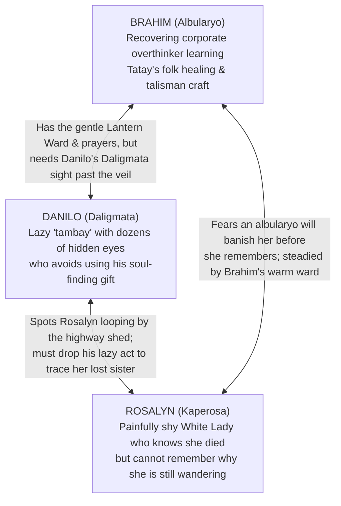

# Triangle B: "The Lamp, The Lens & The Unfinished Errand" Story Bible
### Brahim (Albularyo) <-> Danilo (Daligmata) <-> Rosalyn (Kaperosa)

> **Dialogue Craft Bible:** [MASTER_DIALOGUE_AND_NARRATIVE_DESIGN_GUIDE.md](file:///c:/Users/John%20Reniel/sari-saring-katha/docs/MASTER_DIALOGUE_AND_NARRATIVE_DESIGN_GUIDE.md)
> **Story, Pacing & Worldbuilding Bible:** [MASTER_STORY_PACING_AND_WORLDBUILDING_GUIDE.md](file:///c:/Users/John%20Reniel/sari-saring-katha/docs/MASTER_STORY_PACING_AND_WORLDBUILDING_GUIDE.md)
> **Architecture Spec:** [MACRO_NARRATIVE_ARCHITECTURE_SPEC.md](file:///c:/Users/John%20Reniel/sari-saring-katha/docs/MACRO_NARRATIVE_ARCHITECTURE_SPEC.md)
> **Authoring Playbook:** [NEIGHBOR_DIALOGUE_AUTHORING_WORKFLOW.md](file:///c:/Users/John%20Reniel/sari-saring-katha/docs/NEIGHBOR_DIALOGUE_AUTHORING_WORKFLOW.md)

---

## 1. World Tone, Folklore Grounding & Shared Street Geography

Where Triangle A (*Kuya Kap, Manang Ana, Buboy*) explores everyday barangay survival—habits, *utang*, and feeding a household—**Triangle B** explores **sight, healing, and the unseen**: what happens at the edge of Karimlan's warm storefront light when an anxious apprentice healer, a lazy many-eyed soul-finder, and a painfully shy wandering ghost cross paths at your counter.

Rather than treating folklore like a horror movie or an encyclopedia lecture, Triangle B grounds real Philippine ethnographic traditions straight into neighborhood slice-of-life:
- **Albularyo (*Brahim*):** Grounded in traditional Filipino folk medicine (*pagpupulso*, *pagtatawas*, infused *lana* coconut oil, boiled *lagundi* and *sambong*, whispered *orasyon* from Tatay's worn *librito*, and bronze *anting-anting* inscription) and its core ethical taboo: healing is a vocation paid only in voluntary *alay*/donations, never a commercial fee.
- **Daligmata (*Danilo*):** Grounded in both Visayan "many shining eyes" lore and Agusan Manobo healing ethnography, where the *daligmata* is a spirit ally (*abyan*) gifted with **"fast vision"** to trace lost or wandering souls across unseen realms alongside a healer.
- **Kaperosa (*Rosalyn*):** Grounded in Visayan and Luzon *kalag*/*multo* folk-Catholic tradition—not a Hollywood jump-scare monster, but a quiet, shrouded human soul met with lit candles and gentle patience rather than weapons, lingering by an old road because an ordinary act of love was cut short.

### Shared Off-Screen Landmarks (Timeless & Calendar-Neutral Mental Map)
All three characters casually anchor their stories to the same 4 places outside your open **counter** (zero time-of-day words, zero weekdays):
1. **Tatay's Porch & Herb Shed:** Just past the creek bridge, smelling of boiled *lagundi*, melted candle wax, and *kamangyan* resin, where Brahim's aging father has tended neighbors for forty years while Brahim nervously practices brushwork at the kitchen table.
2. **The Waiting Shed by the Highway Bend:** Just beyond the last barangay streetlamp, where rain collects near the guardrail and passing trucks cut straight through the mist—where **Rosalyn** keeps finding herself mid-step, drawn toward your storefront bulb.
3. **The Storefront Tambayan Shade:** Right beside your counter eaves—**Danilo's** self-appointed prime observation post (*"best view on the road, boss, zero rent"*), where he slouches in dark amber sunglasses pretending he is strictly off duty.
4. **The Creek Bridge & Old Stone Chapel:** Where neighbors leave white candles and *sampaguita* for wandering *kalag* souls.

### Shared Thematic Thread (*Kishōtenketsu* Braiding)
All three arcs ask the same human question from three angles: **What is the difference between fixing or watching someone from a safe distance, and actually staying present with them?**
- **Brahim** fled corporate Manila because spreadsheets hollowed him out, yet he still approaches *albularyo* work like an anxious project manager terrified of failing a KPI. Trying to help Rosalyn teaches him that folk healing is not "troubleshooting an anomaly"—it is holding a warm lamp so someone frightened can breathe.
- **Danilo** hides dozens of sleepless eyes behind dark lenses and lazy *tambay* banter (*"Not my department, boss, I just watch"*), because opening his full *Daligmata* soul-sight hurts like welding glare and forces him to care. Stepping off the bench to trace Rosalyn's broken thread turns him from a detached spectator into a true neighbor.
- **Rosalyn** feels quietly ashamed that she is "doing death wrong," walking from the highway to your sari-sari counter without remembering why. Her *Ten* (perspective turn): she wasn't haunting the road out of vengeance—**she died mid-errand running to a sari-sari store after telling her feverish little sister to wait under the highway shed**, and once Danilo and Brahim prove her sister grew up safe without blaming her, the terrified loop finally lets go.

---

## 2. Legacy Audit — What We Are Replacing & Why

| Character | Legacy Problems | Modernized Triangle B Fix |
| :--- | :--- | :--- |
| **Brahim** | Blandly serene from Chapter 1 (zero internal friction); forced 10 back-to-back minigames with placeholder sigil names; praised the player identically even when losing; zero ties to Danilo or Rosalyn. | **Recovering Corporate Overthinker** with genuine imposter syndrome under Tatay's shadow. Uses **4 purposeful, story-driven talismans** mapped to real `TalismanTraceMinigame.gd` sigils (`1`, `4`, `7`/`10`, `20`) with full Win/Fail-Forward (`{Transaction_MinigameWon}`) reactions and a moral choice over how to treat Rosalyn. |
| **Danilo** | 9 cluttered chapters recapping *other* characters' scenes in brown BBCode walls; `[pause=0.4]` spam; hardcoded `3 AM last Tuesday` / `Sunday`; passive gossip machine with zero personal stakes. | Distilled to **6 crisp chapters** (`is_visit_only` Ch. 1–5, iconic First Purchase in Ch. 6). Lean, funny **lazy *tambay* voice** whose core conflict is whether he will endure the migraine of opening his *Daligmata* soul-sight to trace Rosalyn's lost tether alongside Brahim. |
| **Rosalyn** | Unreadable `[wave]H[pause=1.0]-hello.[pause=0.6]...[/wave]` spam; **zero player choices across 9 chapters**; abruptly disappeared at the end despite still spawning in regular store gameplay. | **Zero `[pause]` spam and zero stuttering soup.** Ch. 1 opens with pure, striking `...` silence while the player gently tries talking to her before she slips away. Ch. 2–6 use hushed, clean `4 to 12 word` lines, real player choices in every chapter, and a cozy resolution that breaks her trauma loop while letting her peacefully visit your warm light until the pale moon closes. |

---

## 3. The 5-Axis Voice & Agency Dossiers (Blind Cover Test Ready)

> **Global Language & Formatting Contract:**
> - **90–95% natural, idiomatic English** with light, effortless Filipino sprinkles (`anak`, `boss`, `Salamat`, `Tatay`, `Ate`, `albularyo`, `anting-anting`, `lagundi`, `kamangyan`, `alay`, `po`, `ha`).
> - **100% spoken voice only:** Zero stage directions in parentheses `(...)`, zero `[Think: ...]`.
> - **Short player choices:** `3 to 7 words` (hard max 8 words).
> - **Clean cadence:** `6 to 16 words` per bubble (one thought per click), open `counter` (never `grille`), zero em-dashes, zero mid-sentence `...` crutches, and zero time-of-day or weekday words.

### A. Brahim (*Albularyo* — Recovering Corporate Apprentice)
- **External Agenda:** Master his aging father *Tatay*'s herbal remedies, pulse-reading (*pagpupulso*), and bronze *anting-anting* brushwork so Tatay can finally rest his arthritic hands.
- **Internal Fear:** Deep imposter syndrome—worrying that ten years behind a Manila office desk ruined his intuition, that neighbors secretly look past him waiting for his "real" healer father, and that he's treating sacred craft like a corporate checklist.
- **Tactical Filter:** Earnest, polite, slightly over-prepared ex-office worker. When nervous, corporate phrasing accidentally slips into his folk healing (*"actionable remedies," "color-coding Tatay's dried roots," "quarterly—sorry, seasonal herbs"*), followed by an embarrassed laugh at himself.
- **Usual Order & Disruption:** Buys `can`, `sachet`, and `pack` staples for Tatay's kitchen. Disruption: in Chapter 2 he backslides into buying `Kopimo` coffee sachets to pull a corporate-style all-nighter cramming Tatay's *librito*—inviting you to swap his order to calming **`bottle`** (`Tubig`) via `allow_sub_cat:bottle`.
- **Voice Fingerprint:**
  - *Sentence Geometry:* Warm, articulate, slightly self-correcting (`7 to 15 words`).
  - *Lexicon:* Ink, brass, wrist pulse, boiled leaves, Tatay, brush steadiness, old desk habits (`"Salamat"`, `"Tatay"`, `"albularyo"`, `"orasyon"`, `"alay"`).
  - *Register:* Courteous, grounded neighbor in his late twenties/early thirties—never a cryptic wizard, never an internet-meme caricature.
  - *Forbidden Words:* Never talks like a fantasy mage, never charges cash for healing, never uses time-of-day or weekday words.
  - *Affection Tell:* Credits your steady hand on talismans, brings soothing herbal advice for your sore shoulders, and treats your counter as the one place he doesn't have to pretend he knows everything yet.

### B. Danilo (*Daligmata* — Lazy "Tambay" Soul-Finder)
- **External Agenda:** Claim the shady corner of your counter for free, trade dry street observations, keep his heavy amber sunglasses firmly on, and avoid "clocking in" on supernatural problems at all costs.
- **Internal Fear:** Opening all his hidden *Daligmata* eyes at once. Tracing a fractured soul across the spirit plane triggers blinding sensory overload—and worse, breaks his safe rule of watching Karimlan from an emotional distance.
- **Tactical Filter:** Effortless barangay *tambay* deflection. Frames uncanny, impossible visual details (seeing through walls, spotting spirits half a kilometer away, noticing what someone held inside a closed pocket) as casual street *tsismis*, shrugging off follow-up questions with *"lucky guess, boss"* or *"I'm on permanent break."*
- **Usual Order & Disruption:** **Buys nothing at all (`is_visit_only = true`) across Chapters 1 to 5** (`purchase_only_on_final_chapter = true`). Disruption: in **Chapter 6**, once Rosalyn's highway loop is broken and he finally lets himself belong to the street instead of just surveilling it, he slaps real coins onto your counter for his **very first `snack` / `bottle` purchase**!
- **Voice Fingerprint:**
  - *Sentence Geometry:* Crisp, punchy, laid-back fragments (`4 to 13 words`), often contrasting a sharp observation with a lazy 3-word shrug.
  - *Lexicon:* Shade, glare, lenses, front-row view, off the clock (`"Uy, boss"`, `"Psst"`, `"Relax, boss"`, `"Sayang"`, `"'no?"`).
  - *Register:* Cool, wry, neighborly *tambay* uncle/older-brother energy—never verbose, never melodramatic, zero colored-text gimmicks.
  - *Forbidden Words:* Never begs, never gives long speeches, never uses `[pause]` tags or hardcoded clock times (`3 AM`, `Tuesday`).
  - *Affection Tell:* Quietly tips you off when someone vulnerable needs gentleness, takes off his glasses for two seconds to rub his temples around you, and finally becomes a paying customer.

### C. Rosalyn (*Kaperosa* — Shy, Quiet Wandering Ghost)
- **External Agenda:** Step up to the one warm light along the dark road that doesn't pass straight through her, hold onto something solid, and piece together why her feet keep walking from the highway waiting shed to a sari-sari counter.
- **Internal Fear:** Being chased away or "cleansed" by a folk healer before she remembers what unfinished promise kept her here; feeling terribly impolite for taking up a living shopkeeper's attention.
- **Tactical Filter:** Hushed, earnest brevity and quiet ghost pragmatism. In Chapter 1 she can't get a single word out (`...`). Once she finds her voice in Chapter 2, she speaks in short, soft, crystal-clear sentences (`3 to 11 words`—**zero** stuttering `H-h-hello` or `[pause=1.0]` tags!), treating ghostly inconveniences (coins slipping through un-concentrated palms, needing ice-cold bottles to feel an edge) with gentle, self-aware politeness.
- **Usual Order & Disruption:** Starts `is_visit_only` in Ch. 1, moves to cold **`bottle`** drinks (`Tubig` / `Kokaloka`) in Ch. 2–3 as physical anchors, and pivots in Ch. 4 to **`candy`** (`Mentor` menthol sweets via `allow_sub_cat:candy`), unlocking the sensory memory of her coughing little sister!
- **Voice Fingerprint:**
  - *Sentence Geometry:* Short, still, delicate sentences (`3 to 11 words`). Standalone `...` is used **only** for her silent Chapter 1 beat—never as mid-sentence filler!
  - *Lexicon:* Cold glass, warm bulb, coins, guardrail, rain puddles, footsteps (`"po"`, `"Ate"`, `"Salamat po"`).
  - *Register:* Soft, polite, slightly formal English with tiny tender Filipino family touches once her memory returns.
  - *Forbidden Words:* Never wails or threatens like a horror ghost, never stutters with hyphens (`I-I`), never uses `[wave]` or `[pause]` spam.
  - *Affection Tell:* Stops apologizing for standing in your light, holds an item cleanly with one hand without dropping it, and leaves dried *sampaguita* by your register.

---

## 4. Shared Flag, Talisman & 4-Point Tally Matrix

Every character strictly obeys our **Max 3 Persistent World Flags + 1 Integer Tally** rule and **Strict 4-Point Inflection Tally Budget** (zero tallies on Ch. 1 introductions, smalltalk, or Ch. 5–6 payoffs):

### A. Shared World Flags (9 Total — 3 Per Character, Zero Orphans)

| Character | World Flag (`Dialogic` Var) | Set When | Scheduled Cross-Web & Arc Payoff |
| :--- | :--- | :--- | :--- |
| **Rosalyn** | `rosalyn_seen` (`Flag_RosalynSeen`) | **Rosalyn Ch. 1** (her silent `...` first visit) | Unlocks recognition in **Danilo Ch. 2** (*"You met my pale highway regular, boss?"*) and unlocks the **Trapdoor** in **Brahim Ch. 4** (*"Wait—she isn't dangerous, she visits my counter"*). |
| **Rosalyn** | `rosalyn_cold_anchor` (`Flag_RosalynColdAnchor`) | **Rosalyn Ch. 2** (patiently helping her hold her first cold bottle without flinching) | Deepens trust in **Rosalyn Ch. 3** and lets **Danilo Ch. 3** remark that she stopped fading at the curb. |
| **Rosalyn** | `rosalyn_memory_sparked` (`Flag_RosalynMemorySparked`) | **Rosalyn Ch. 4** (`allow_sub_cat:candy` -> `label SubstituteItem`: handing her menthol/sweet candy) | Sparks the half-memory of someone small coughing under a tin shed; unlocks the fullest **Rosalyn Ch. 5–6** payoff. |
| **Brahim** | `brahim_steady_start` (`Flag_BrahimSteadyStart`) | **Brahim Ch. 1** (winning `minigame:talisman:1` *First Ward*) | Gives Brahim early confidence in **Brahim Ch. 3** and a warm `P2` callback. |
| **Brahim** | `brahim_sub_rest` (`Flag_BrahimSubRest`) | **Brahim Ch. 2** (`allow_sub_cat:bottle` -> swapping his cramming `Kopimo` order for `Tubig` water) | Breaks his corporate all-nighter reflex; shifts his `Purchase.dtl` request pool away from frantic caffeine. |
| **Brahim** | `brahim_lantern_ward` (`Flag_BrahimLanternWard`) | **Brahim Ch. 4** (choosing gentle `minigame:talisman:7` *Suki's Lantern* over forceful `talisman:10` *Wind Shield*) | **Major Triangle B Detonation:** Warms **Rosalyn Ch. 5** so her memory clears gently instead of scattering; praised by **Danilo Ch. 5**; required for `outcome:true_albularyo`. |
| **Danilo** | `danilo_saw_rosalyn` (`Flag_DaniloSawRosalyn`) | **Danilo Ch. 2** (Danilo tips you off about Rosalyn looping by the highway waiting shed) | Unlocks a perceptive choice in **Rosalyn Ch. 3** (*"Someone mentioned the waiting shed"*) and informs **Brahim Ch. 4**. |
| **Danilo** | `danilo_eyes_known` (`Flag_DaniloEyesKnown`) | **Danilo Ch. 3** (catching his *"three of them won't shut"* Daligmata slip with chill respect) | Unlocks the direct **Trapdoor** in **Danilo Ch. 4** (*"Drop the tambay act, Daligmata—help Brahim look"*). |
| **Danilo** | `danilo_traced_tether` (`Flag_DaniloTracedTether`) | **Danilo Ch. 4** (convincing lazy Danilo to open his full soul-sight past the highway bend) | **Major Triangle B Detonation:** Delivers the concrete vision of Rosalyn's grown sister *Lia* in **Danilo Ch. 5** and **Rosalyn Ch. 5**; required for `outcome:watchful_ally`. |

*(Outcome convenience booleans synced in `DialogicBridge.gd` for `Purchase.dtl` / `Visit.dtl` pools: `Flag_BrahimTrueAlbularyo`, `Flag_DaniloWatchfulAlly`, `Flag_RosalynAtPeace`.)*

### B. Brahim's Curated Talisman Progression (Real `TalismanTraceMinigame.gd` IDs)
Instead of exhausting the player with 10 back-to-back tracing screens, Story Chapters feature **4 meaningful inscriptions** (1 single sigil per beat, each with bespoke `if {Transaction_MinigameWon}:` Win and Fail-Forward lines!):
1. **Brahim Ch. 1 -> `minigame:talisman:1` (*First Ward*):** Charcoal pillar & Crimson crossbar. Testing if your storekeeper hand shakes less than his ex-corporate coffee hand.
2. **Brahim Ch. 3 -> `minigame:talisman:4` (*Watcher's Eye*):** Indigo eye, Charcoal iris & Fine Gold lashes. A threshold sight-ward that Danilo later roasts with affectionate precision.
3. **Brahim Ch. 4 -> Choice-Driven Talisman:**
   - **Gentle Path (`minigame:talisman:7` — *Suki's Lantern*):** Crimson lantern, Gold core & Indigo tassel—warms a lost *kalag*'s memory without forcing her off the road (`sets brahim_lantern_ward = true`).
   - **Strict Path (`minigame:talisman:10` — *Wind Shield*):** Charcoal crest & Indigo chevron—seals the street coldly to push lingering spirits away (`sets brahim_lantern_ward = false`).
4. **Brahim Ch. 6 -> `minigame:talisman:20` (*Grand Agimat*):** All four ritual inks—Brahim's masterwork threshold gift to protect your counter before Reyna Mayari's pale-moon reckoning.
- **Everyday `Visit.dtl`:** Offers an **optional** `minigame:talisman_random` choice (`- Sure, pass me the brush.` vs. `- Busy behind the counter right now.`) so players can freely practice all 20 sigils for bonus pesos/XP without ever feeling trapped!

---

## 5. 6-Chapter Core Arc Blueprints (4-Point Tally Validated)

### Character #1: Brahim (*Albularyo*)
*Core Spine:* Unlearning anxious corporate "optimization" to inherit Tatay's quiet, ethical folk-healing heart.
- **Ch. 1 — "Spreadsheet Hands" (`frozen` / `can` | `0` choice tally, `+1` if `talisman:1` won):**
  - *Beat:* Late entry—Brahim holds his palm over your counter to show a faint tremor, laughing sheepishly that ten years of Manila office espresso is bad training for an apprentice *albularyo*. Introduces his aging father *Tatay* down by the creek bridge and asks to test one beginner bronze blank together (`minigame:talisman:1` — *First Ward*).
  - *Fail-Forward:*
    - **Win (`Transaction_MinigameWon == true`):** Sets `brahim_steady_start = true`, `tally:+1`. He marvels at how steady a neighborhood storekeeper's hand is.
    - **Lose (`Transaction_MinigameWon == false`):** `tally:0`. He laughs warmly with genuine relief—*"Thank goodness, I thought I was the only one drawing crooked crossbars!"*—and keeps the smudged charm as a lucky practice piece.
- **Ch. 2 — "Cramming the Librito" (`sachet` -> Secret Substitution `allow_sub_cat:bottle` | Inflection #1):**
  - *Beat:* Brahim arrives bleary-eyed trying to buy `Kopimo` (`sachet`), confessing he stayed up making color-coded study tabs for Tatay's Latin *orasyon* booklet because a grandmother came to the porch and asked *"Where's the real albularyo?"* right to his face.
  - *Choices (3–7 words):*
    - `- [Swap his coffee for cold water.]` (`allow_sub_cat:bottle` -> `label SubstituteItem`: sets `brahim_sub_rest = true`, `tally:+1`). He blinks at the water bottle, laughs at himself for treating folk healing like a corporate deadline, and promises to rest.
    - `- Give yourself time to learn, Brahim.` (`tally:0` — warm reassurance, serves his normal order).
    - `- Memorize faster so they respect you.` (`tally:-1` — feeds his corporate hustle anxiety).
- **Ch. 3 — "What the Pulse Costs" (`can` + `minigame:talisman:4` *Watcher's Eye* | Inflection #2):**
  - *Beat:* A man in a shiny SUV offered Brahim five hundred pesos cash to rush a private luck charm ahead of neighbors waiting on Tatay's porch. Brahim is conflicted—old corporate instinct says *bill the premium client*, while Tatay's iron *albularyo* rule says healing only accepts voluntary *alay* or the gift dries up.
  - *Choices:*
    - `- Trust Tatay's rule. Keep it sacred.` (`tally:+1` — affirms *albularyo* ethics).
    - `- Take the cash if it helps.` (`tally:-1` — treats the calling like consultancy).
    - `- Tell him to wait in line.` (`tally:0` — practical middle ground).
  - *Minigame Beat:* Inscribes `minigame:talisman:4` (*Watcher's Eye*) for the creek bridge (`Win` vs. `Lose` fail-forward reaction, `0` extra tally so there's no inflation).
- **Ch. 4 — "Cold Draft by the Guardrail" (`pack` + Moral Talisman Choice | Inflection #3):**
  - *Beat:* Neighbors reported sudden cold spots and melted candle scent near the highway waiting shed. Tatay's knees are swollen, so Brahim has to handle it solo—and he's nervous it's a restless *kaperosa*.
  - *Trapdoor (if `rosalyn_seen` or `danilo_saw_rosalyn`):* `- Wait. That's Rosalyn, she's harmless!` immediately stops Brahim from assuming danger!
  - *Core Moral Choice:*
    - `- Craft a warm lantern to guide.` -> Runs `minigame:talisman:7` (*Suki's Lantern*), sets `brahim_lantern_ward = true`, `tally:+1` (`+1` bonus if `Transaction_MinigameWon == true`!). Warms Rosalyn's path without forcing her away!
    - `- Seal the road so she leaves.` -> Runs `minigame:talisman:10` (*Wind Shield*), sets `brahim_lantern_ward = false`, `tally:-1`. Pushes a harsh barrier ward that makes Rosalyn's edges ache.
- **Ch. 5 — "Smoke and Still Water" (`can` | `0` tallies — *Ten* Payoff):**
  - *Beat:* Cross-web detonation!
    - *If `brahim_lantern_ward` + `danilo_traced_tether`:* Brahim beams in quiet awe—when he hung *Suki's Lantern* by the waiting shed, that sunglasses *tambay* from your bench (**Danilo**) actually showed up, took off his shades, and pointed straight across the creek toward the next parish so Brahim knew where to aim the calming *orasyon*!
    - *If `brahim_lantern_ward` alone:* The lantern steadied the cold air by the shed without hurting a soul, and Tatay squeezed Brahim's shoulder without correcting a single word.
    - *If barrier ward (`!brahim_lantern_ward`):* The road went heavy and silent, leaving Brahim uneasy that he "solved" a symptom while missing the person underneath.
- **Ch. 6 — "Tatay's Brass Bell" (`pack` + `minigame:talisman:20` *Grand Agimat* | Accumulated Tally Resolution):**
  - *Outcomes:*
    - **`outcome:true_albularyo`** (`Flag_BrahimLanternWard` and `Tally >= 3`): Tatay passes him the family's worn brass bell. Together you trace `talisman:20` (*Grand Agimat*) to ward your counter, and Brahim vows to stand beside you when Reyna Mayari weighs Karimlan's ledger.
    - **`outcome:steady_apprentice`** (`Tally >= 1`): Still learning at Tatay's side at an unhurried pace; traces `talisman:20` with gratitude as a warm neighborhood friend.
    - **`outcome:textbook_herbalist`** (`Tally <= 0`): Competent with boiled leaves and polite transactions, though the deeper spiritual warmth stayed closed off.

---

### Character #2: Danilo (*Daligmata*)
*Core Spine:* Karimlan's lazy sunglasses *tambay* finally taking off his shades and risking a splitting soul-sight migraine to bring a lost girl's memory home.
- **Ch. 1 — "Zero Rent Shade" (`is_visit_only = true` | `0` tallies):**
  - *Beat:* Late entry—Danilo leans under your awning in oversized amber sunglasses, admiring the sightline down the road and cheerfully informing you upfront he isn't buying a single thing. Drops one uncanny detail (noticing T.K. circling the same mango tree four times) before strolling off.
  - *Choices:* `- Buying anything, or just loafing?` / `- Nice sunglasses for standing in shade.` / `- Suit yourself, shade's free.`
- **Ch. 2 — "Girl by the Guardrail" (`is_visit_only = true` | Inflection #1: `+1 / 0 / -1`):**
  - *Beat:* Sets `danilo_saw_rosalyn = true`. Danilo leans in (`"Psst, boss"`), mentioning the pale girl in the white shawl (**Rosalyn**) standing by the highway waiting shed while tricycles pass straight through her—then lazily shrugs that lost *kalag* souls are *"way above a retired tambay's pay grade."*
  - *Choices:*
    - `- Sounds like you actually care, Danilo.` (`tally:+1` — catches the worry behind his lazy mask).
    - `- Thanks for the heads-up, boss.` (`tally:0` — casual acknowledgment).
    - `- Not our problem if she lingers.` (`tally:-1` — reinforces his detached apathy).
- **Ch. 3 — "Fluorescent Glare" (`is_visit_only = true` | Inflection #2: `+1 / 0 / -1`):**
  - *Beat:* Danilo winces at your storefront bulb, rubbing his forehead and accidentally slipping: *"Wish I could shut my eyes and sleep, boss, except three of them always stay open."* Catches himself immediately and blames cheap instant coffee—then chuckles about watching **Brahim** down by the creek practicing pulse-reading on his own wrist like an exam.
  - *Choices:*
    - `- Your secret's safe here, boss.` (`tally:+1`, sets `danilo_eyes_known = true` — quiet respect without making it weird).
    - `- Must be some strong coffee.` (`tally:0`, sets `danilo_eyes_known = true` — plays along smoothly).
    - `- Wait, how many eyes?!` (`tally:-1` — makes him clam up and pull his brim down).
- **Ch. 4 — "Clocking Back In" (`is_visit_only = true` | Inflection #3: `+2 / +1 / -1`):**
  - *Beat:* Rosalyn keeps walking the same hundred meters between the waiting shed and your counter because she can't see past the highway bend, and mortal apprentice **Brahim** can't see soul-threads across towns. Danilo knows *exactly* what you're about to ask him, groaning that opening full *Daligmata* fast-vision gives him a two-day migraine.
  - *Choices:*
    - *Trapdoor (if `danilo_eyes_known` or `brahim_lantern_ward`):* `- Pair your eyes with Brahim's lantern.` (`tally:+2`, sets `danilo_traced_tether = true` — invokes the real folklore healer + *Daligmata* partnership!).
    - `- Just one look for her, Danilo.` (`tally:+1`, sets `danilo_traced_tether = true` — convinces him softly).
    - `- Stay on break then, boss.` (`tally:-1`, leaves `danilo_traced_tether = false` — lets him off the hook).
- **Ch. 5 — "Welding Sparks" (`is_visit_only = true` | `0` tallies — *Ten* Payoff):**
  - *Beat:*
    - *If `danilo_traced_tether`:* Danilo slouches against your counter pressing two fingers to his brow, groaning about "welding-spark headaches"—then drops the gossip act completely. He traced Rosalyn's silver thread two towns past the bridge: **a young schoolteacher named Lia lighting a white church candle and setting a menthol candy beside a framed photo of her older sister Rosalyn.** *"Tell the kid in the white shawl nobody's shivering under that shed anymore, boss."*
    - *If `!danilo_traced_tether`:* Danilo admits quietly he still glanced toward the highway shed from afar, wishing someone had untangled it sooner, admitting his "retired" excuse feels hollow lately.
- **Ch. 6 — "First Paying Customer" (`snack` / `bottle` Purchase! | Accumulated Tally Resolution):**
  - *Beat:* For the **first time in the entire game**, Danilo sets real coins on your wood and orders `[color=#0f6e2f]{Transaction_ItemWants}[/color]`.
  - *Outcomes:*
    - **`outcome:watchful_ally`** (`Flag_DaniloTracedTether` and `Tally >= 3`): Slides a spare pair of **Amber Spectacles** onto your counter, grins that he could finally blink for five whole seconds thanks to your store, and promises every eye he has will back your ledger when the Queen of Biringan visits.
    - **`outcome:bench_regular`** (`Tally >= 1`): Buys his snack happily, officially upgrades himself from freeloader to *suki*, and keeps friendly watch on the road.
    - **`outcome:distant_eyes`** (`Tally <= 0`): Pays exact coins once out of curiosity, tips his hat politely, and keeps his distance behind dark glass.

---

### Character #3: Rosalyn (*Kaperosa*)
*Core Spine:* From wordless `...` silence to remembering the little sister she ran into the rain for—finding peace under your warm storefront light without a single `[pause]` tag.
- **Ch. 1 — "Under the Bulb" (`is_visit_only = true` | `0` tallies — Pure Silence Beat):**
  - *Beat:* Rosalyn drifts into your warm light in her pale hooded shawl. Zero stuttering tags, zero `[pause=1.0]` delays—just pure, delicate silence:
    - `Rosalyn: ...`
    - Player tries greeting her (`- Hi there. Need something?` / `- Take your time, miss.` / `- [Wait quietly and nod.]`).
    - `Rosalyn: ...`
    - Player offers one gentle follow-up (`- Looking for something cold?` / `- Warm light's free. No rush.`).
    - `Rosalyn: ...`
    - Overwhelmed by being looked *at* instead of *through*, she gives up and slips quietly back out (`sets rosalyn_seen = true`, `[signal arg="story_success"]`).
- **Ch. 2 — "Cold Glass" (`bottle` Purchase | Inflection #1: `+1 / 0 / -1`):**
  - *Beat:* She returns and speaks her very first hushed, clear words: `"Good day. Sorry I ran off last time."` She explains with earnest, heartbreakingly practical ghost logic that coins slip straight through her palms unless she focuses hard—and **cold bottles** (`Tubig` / `Kokaloka`) give her fingers a crisp edge she can actually hold.
  - *Choices:*
    - `- Set the coins down slow. Ready.` (`tally:+1`, sets `rosalyn_cold_anchor = true` — treats her like any welcome neighbor).
    - `- Cold bottle, coming right up.` (`tally:0`, sets `rosalyn_cold_anchor = true` — calm and straightforward).
    - `- Wait, your hand went right through!` (`tally:-1` — startles her into apologizing for scaring you).
- **Ch. 3 — "The Hundred-Meter Walk" (`bottle` Purchase | Inflection #2: `+1 / 0 / -1`):**
  - *Beat:* Holding cold glass gets easier. Rosalyn quietly admits she *knows* she died by the highway bend—what embarrasses her is not knowing **why** she hasn't crossed over, or why her feet keep walking from the waiting shed straight to a sari-sari counter. Worse, she smelled *kamangyan* smoke near the bridge (**Brahim**) and worries the *albularyo* will sweep her out like dust before she remembers.
  - *Choices:*
    - *Trapdoor (if `danilo_saw_rosalyn`):* `- Nobody here is chasing you away.` (`tally:+1` — promises your counter and neighbors won't banish her).
    - `- Maybe you were buying something important.` (`tally:+1` — gently nudges her errand memory).
    - `- Usually spirits cross over faster.` (`tally:-1` — stings her quiet insecurity about "doing death wrong").
- **Ch. 4 — "Tin Roof Rain" (`bottle` -> Secret Substitution `allow_sub_cat:candy` | Inflection #3):**
  - *Beat:* Rosalyn stares at your shelves, remembering rain hammering a corrugated waiting-shed roof and telling someone smaller than her, *"Stay dry right here, Ate will run across."* Her throat feels scratchy just remembering—someone was coughing hard. She asks politely for `[color=#0f6e2f]{Transaction_ItemWants}[/color]`.
  - *Choices:*
    - `- [Reach for the candy jar instead.]` (`allow_sub_cat:candy` -> `label SubstituteItem`: sets `rosalyn_memory_sparked = true`, `tally:+2`! The menthol/sweet wrapper hits her senses immediately: *"Cough candy. Oh. I ran across the highway for cough candy, po."*).
    - `- Your little sibling was sick?` (`tally:+1` — gentle listening without item swap).
    - `- Here's your drink, miss.` (`tally:0` — routine service).
- **Ch. 5 — "Lia's Candle" (`is_visit_only = true` | `0` tallies — *Ten* Convergence Payoff):**
  - *Beat:* Everything from **Brahim** and **Danilo** converges here!
    - *Full Convergence (`danilo_traced_tether` + `brahim_lantern_ward`):* Rosalyn steps up without trembling—Brahim's warm lantern by the shed steadied the cold mist, and when you tell her what Danilo saw two towns past the bridge (her little sister **Lia**, grown up safe into a schoolteacher, lighting a white candle beside menthol candy for her *Ate*), Rosalyn goes completely still. *"She made it home. She didn't stay in the rain waiting for me."*
    - *Partial / Solo Path:* Even if Danilo didn't trace the thread or Brahim sealed the road harshly, your counter conversations help Rosalyn piece together that decades have passed since that storm—meaning Lia isn't a child under that shed anymore—bringing a quieter, bittersweet release.
- **Ch. 6 — "Still Light" (`candy` / `bottle` Purchase | Accumulated Tally Resolution):**
  - *Beat:* Why doesn't she vanish mid-game? Because **breaking a trauma loop isn't being deleted**—for the first time, the highway isn't yanking her backward into headlights anymore! She can rest gently in Karimlan's warm light until the pale moon closes its cycle, holding `[color=#0f6e2f]{Transaction_ItemWants}[/color]` with one steady hand without a single apology.
  - *Outcomes:*
    - **`outcome:peaceful_anchor`** (`(Flag_RosalynMemorySparked or Flag_DaniloTracedTether)` and `Tally >= 3`): Leaves a dried, rain-scented **Sampaguita** beside your register and promises softly that when Reyna Mayari comes to weigh your store, she will stand in your light as living proof of who you sheltered.
    - **`outcome:lingering_guest`** (`Tally >= 1`): Peaceful, soft-spoken regular who enjoys cold drinks under your bulb without fear.
    - **`outcome:faint_echo`** (`Tally <= 0`): Polite, translucent, and distant—buys quietly and drifts back into the mist.

---

## 6. `P1` Cross-Web Openers & Papa Ulap Radio Breadcrumbs

- **Brahim** *(if `rosalyn_seen` and before Ch. 4)*: `"Felt a sudden chill near the waiting shed earlier, though it felt more shy than harmful."`
- **Danilo** *(if `brahim_lantern_ward`)*: `"That herbalist kid hung a red lantern by the guardrail, boss. First smart thing I've seen all week."`
- **Rosalyn** *(if `brahim_lantern_ward`)*: `"Someone hung a warm little charm near the waiting shed. The mist doesn't sting as much now, po."`
- **Brahim** *(if `danilo_traced_tether`)*: `"That guy in the amber sunglasses knows way more than gossip, doesn't he? Pointed me straight across the bridge."`
- **Papa Ulap Radio Breadcrumb** *(if `brahim_lantern_ward` or `danilo_traced_tether`)*: *"Drivers rounding the old highway bend say the fog lifted early by the waiting shed, mga kapitbahay. Drive gentle and keep your porch bulbs warm."*

---

## 7. Pre-Implementation Engine Notes (For When We Start Character #1 Later)

1. **`TransactionBuilder.gd` Visit-Story Fix (2-Line Bugfix Before Danilo/Rosalyn):**
   - Currently `if data.is_visit_story_chapter(chapter): transaction.is_visit_story = true` sits inside `build_generic_transaction()` (`TransactionBuilder.gd:384`), which is skipped when `transaction_type = STORY` rolls on lines 196/200. Moving those two lines right after story assignment in `build_transaction_context()` ensures `is_visit_only = true` chapters (`Danilo` Ch. 1–5, `Rosalyn` Ch. 1 & Ch. 5) never roll accidental item orders.
2. **Optional Talisman Choice on `Brahim/Visit.dtl`:**
   - Give the player a crisp 2-choice prompt (`- Sure, pass me the brush.` -> `[signal arg="minigame:talisman_random"]` vs. `- Hands are full right now, Brahim.`) plus `{Transaction_MinigameWon}` acknowledgment so everyday visits stay snappy when the counter is busy.
3. **Recommended Authoring Order (Following Pilot Workflow):**
   - **Character #1: Brahim** (locks the Talisman Win/Fail-Forward cadence + `brahim_lantern_ward` setup) -> **Character #2: Danilo** (wires the 5 Visit-Only chapters + Ch. 6 First Purchase + `danilo_traced_tether`) -> **Character #3: Rosalyn** (wires Ch. 1 silent `...` visit, cold-bottle/candy anchors, and the full Triangle B convergence payoff).
