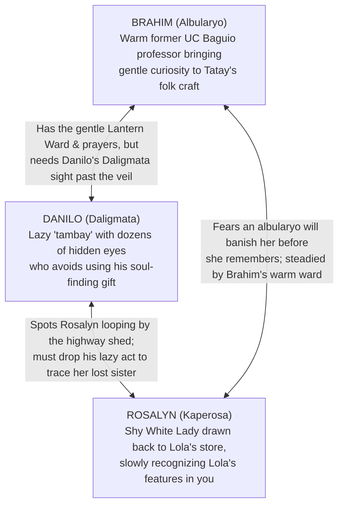
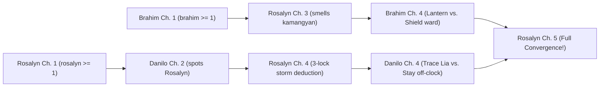

# Triangle B: "The Lamp, The Lens & The Unfinished Errand" Story Bible
### Brahim (Albularyo) <-> Danilo (Daligmata) <-> Rosalyn (Kaperosa)

> **Dialogue Craft Bible:** [MASTER_DIALOGUE_AND_NARRATIVE_DESIGN_GUIDE.md](file:///c:/Users/John%20Reniel/sari-saring-katha/docs/MASTER_DIALOGUE_AND_NARRATIVE_DESIGN_GUIDE.md)
> **Story, Pacing & Worldbuilding Bible:** [MASTER_STORY_PACING_AND_WORLDBUILDING_GUIDE.md](file:///c:/Users/John%20Reniel/sari-saring-katha/docs/MASTER_STORY_PACING_AND_WORLDBUILDING_GUIDE.md)
> **Architecture Spec:** [MACRO_NARRATIVE_ARCHITECTURE_SPEC.md](file:///c:/Users/John%20Reniel/sari-saring-katha/docs/MACRO_NARRATIVE_ARCHITECTURE_SPEC.md)
> **Authoring Playbook:** [NEIGHBOR_DIALOGUE_AUTHORING_WORKFLOW.md](file:///c:/Users/John%20Reniel/sari-saring-katha/docs/NEIGHBOR_DIALOGUE_AUTHORING_WORKFLOW.md)

---

## 1. World Tone, Folklore Grounding & Shared Street Geography

Where Triangle A (*Kuya Kap, Manang Ana, Buboy*) explores everyday barangay survival—habits, *utang*, and feeding a household—**Triangle B** explores **sight, healing, and the unseen**: what happens at the edge of Karimlan's warm storefront light when an anxious apprentice healer, a lazy many-eyed soul-finder, and a painfully shy wandering ghost cross paths at your counter.

Rather than treating folklore like a horror movie or an encyclopedia lecture, Triangle B grounds real Philippine ethnographic traditions straight into neighborhood slice-of-life:
- **Albularyo (*Brahim*):** Grounded in traditional Filipino folk medicine (*pagpupulso*, *pagtatawas*, infused *lana* coconut oil, boiled *lagundi* and *sambong*, whispered *orasyon* from Tatay's worn *librito*, and bronze *anting-anting* inscription) and its core ethical taboo: healing is a vocation paid only in voluntary *alay*/donations, never a commercial fee.
- **Daligmata (*Danilo*):** Grounded in both Visayan "many shining eyes" lore and Agusan Manobo healing ethnography, where the *daligmata* is a spirit ally (*abyan*) gifted with **"fast vision"** to trace lost or wandering souls across unseen realms alongside a healer.
- **Kaperosa (*Rosalyn*):** Grounded in Visayan and Luzon *kalag*/*multo* folk-Catholic tradition—not a Hollywood jump-scare monster, but a quiet, shrouded human soul met with lit candles and gentle patience rather than weapons, lingering by an old road because an ordinary act of love was cut short.

### Shared Off-Screen Landmarks (Timeless & Calendar-Neutral Mental Map)
All three characters casually anchor their stories to the same 4 places outside your open **counter** (zero time-of-day words, zero weekdays):
1. **Tatay's Porch & Herb Shed:** Just past the creek bridge, smelling of boiled *lagundi*, melted candle wax, and *kamangyan* resin, where Brahim's aging father has tended neighbors for forty years while Brahim nervously practices brushwork at the kitchen table.
2. **The Waiting Shed by the Highway Bend:** Just beyond the last barangay streetlamp, where rain collects near the guardrail and passing trucks cut straight through the mist—where **Rosalyn** keeps finding herself mid-step, drawn toward your storefront bulb.
3. **The Storefront Tambayan Shade:** Right beside your counter eaves—**Danilo's** self-appointed prime observation post (*"best view on the road, boss, zero rent"*), where he slouches in dark amber sunglasses pretending he is strictly off duty.
4. **The Creek Bridge & Old Stone Chapel:** Where neighbors leave white candles and *sampaguita* for wandering *kalag* souls.

### Shared Thematic Thread (*Kishōtenketsu* Braiding)
All three arcs ask the same human question from three angles: **What is the difference between studying or watching someone from a safe distance, and actually staying present with them?**
- **Brahim** happily traded his lectern as a professor at the **University of the Cordilleras in Baguio** to come home and learn *Tatay*'s craft—bringing an easygoing educator's curiosity, neat margin notes, and gentle warmth, while discovering that some neighborhood mysteries ask for an open heart rather than a lecture outline.
- **Danilo** hides dozens of sleepless eyes behind dark lenses and lazy *tambay* banter (*"Not my department, boss, I just watch"*), because opening his full *Daligmata* soul-sight hurts like welding glare and forces him to care. Stepping off the bench to trace Rosalyn's broken thread turns him from a detached spectator into a true neighbor.
- **Rosalyn** feels quietly ashamed that she is "doing death wrong," walking from the highway to **this exact sari-sari store** without remembering why—while slowly catching uncanny echoes of your **Lola** (and a tiny childhood version of *you*) in your eyes and hands. Her *Ten* (perspective turn): she died mid-errand running to **Lola's counter** for cough candy while her feverish little sister waited under the highway shed, and once Danilo and Brahim prove her sister grew up safe without blaming her, she finally completes that last errand across Lola's wood—handed to her by Lola's grown grandchild.

---

## 2. Legacy Audit — What We Are Replacing & Why

| Character | Legacy Problems | Modernized Triangle B Fix |
| :--- | :--- | :--- |
| **Brahim** | Temporary corporate placeholder; forced 10 back-to-back minigames with placeholder sigil names; praised the player identically even when losing; zero ties to Danilo or Rosalyn. | **Warm Former UC Baguio Professor**—lighthearted, grounded, and curious, with affectionate ex-faculty quirks (annotating Tatay's *librito*, Benguet coffee). Uses **4 purposeful, story-driven talismans** mapped to real `TalismanTraceMinigame.gd` sigils (`1`, `4`, `7`/`10`, `20`) with full Win/Fail-Forward reactions and a moral choice over how to treat Rosalyn. |
| **Danilo** | 9 cluttered chapters recapping *other* characters' scenes in brown BBCode walls; `[pause=0.4]` spam; hardcoded `3 AM last Tuesday` / `Sunday`; arbitrarily blocked from buying items despite being a physical *tambay*. | Distilled to **6 crisp chapters** where he **actually buys snacks, cold drinks, and coffee** like a true *sari-sari tambay*! Lean, wry voice whose core conflict is whether he will endure the migraine of opening his *Daligmata* soul-sight to trace Rosalyn's lost tether alongside Brahim. |
| **Rosalyn** | Unreadable `[wave]H[pause=1.0]-hello.[pause=0.6]...[/wave]` spam; **zero player choices across 9 chapters**; held physical bottles as early as Ch. 3; abruptly vanished at the end despite still spawning in gameplay. | **She is the intangible visitor (`is_visit_only` across Ch. 1–5, `purchase_only_on_final_chapter = true`)!** Her hands pass straight through coins and counter wood until Brahim's lantern and Danilo's sight anchor her—making **Chapter 6 her unforgettable First Real Purchase** across Lola's counter! Zero `[pause]` spam; Ch. 1 opens with pure `...` silence. |

---

## 3. The 5-Axis Voice & Agency Dossiers (Blind Cover Test Ready)

> **Global Language & Formatting Contract:**
> - **90–95% natural, idiomatic English** with light, effortless Filipino sprinkles (`anak`, `boss`, `Salamat`, `Tatay`, `Ate`, `albularyo`, `anting-anting`, `lagundi`, `kamangyan`, `alay`, `po`, `ha`).
> - **100% spoken voice only:** Zero stage directions in parentheses `(...)`, zero `[Think: ...]`.
> - **Short player choices:** `3 to 7 words` (hard max 8 words).
> - **Clean cadence:** `6 to 16 words` per bubble (one thought per click), open `counter` (never `grille`), zero em-dashes, zero mid-sentence `...` crutches, and zero time-of-day or weekday words.

### A. Brahim (*Albularyo* — Warm Former UC Baguio Professor)
- **External Agenda:** Happily apprentice under his aging father *Tatay* after stepping away from his teaching post at the **University of the Cordilleras in Baguio**, learning herbal remedies, pulse-reading (*pagpupulso*), and bronze *anting-anting* brushwork so Tatay can finally rest his hands.
- **Internal Tension (Light & Grounded, Zero Imposter Angst):** Balancing an educator's fondness for neat notes, clear explanations, and late-night coffee with Tatay's unhurried, intuitive folk tradition—learning when to put the notebook down and simply listen to a neighbor's story.
- **Tactical Filter:** Warm, encouraging, lightly humorous favorite-professor energy. Drops charming little faculty habits into everyday conversation (*bookmarking Tatay's handwritten librito like a favorite text, explaining sigil geometry like an engaging seminar, laughing about drinking too much Baguio coffee while grading papers*).
- **Usual Order & Disruption:** Buys `can`, `sachet`, and `pack` staples for Tatay's kitchen. Disruption: in Chapter 2 he cheerfully admits old Baguio faculty habits die hard—buying `Kopimo` coffee sachets while cross-referencing Tatay's *librito* late—inviting you to swap his order to refreshing **`bottle`** (`Tubig`) via `allow_sub_cat:bottle`.
- **Voice Fingerprint:**
  - *Sentence Geometry:* Warm, articulate, gently self-correcting (`7 to 15 words`).
  - *Lexicon:* Ink, brass, wrist pulse, boiled leaves, Tatay, lecture notes, Baguio fog (`"Salamat"`, `"Tatay"`, `"albularyo"`, `"orasyon"`, `"alay"`).
  - *Register:* Courteous, grounded former professor in his early thirties—never a cryptic wizard, never pompous, never an internet-meme caricature.
  - *Forbidden Words:* Never talks like a fantasy mage, never charges cash for healing, never uses time-of-day or weekday words.
  - *Affection Tell:* Credits your steady hand on talismans, checks on your posture/shoulders like a caring mentor, and treats your counter as the one place he doesn't have to pretend he has all the answers.

### B. Danilo (*Daligmata* — Snack-Munching "Tambay" Soul-Finder)
- **External Agenda:** Claim the shady corner of your counter with a bag of crunchy snacks or a cold bottle, trade dry street observations, keep his heavy amber sunglasses firmly on, and avoid "clocking in" on supernatural problems at all costs.
- **Internal Fear:** Opening all his hidden *Daligmata* eyes at once. Tracing a fractured soul across the spirit plane triggers blinding sensory overload—and worse, breaks his safe rule of watching Karimlan from an emotional distance.
- **Tactical Filter:** Effortless barangay *tambay* deflection. Frames uncanny, impossible visual details (seeing through walls, spotting spirits half a kilometer away, noticing what someone held inside a closed pocket) as casual street *tsismis* over snacks, shrugging off follow-up questions with *"lucky guess, boss"* or *"I'm on permanent break."*
- **Usual Order & Disruption:** Buys **`snack`**, **`bottle`**, and **`sachet`** staples (`Dantes`, `Marites`, `NgaragYa`, `Kokaloka`, `Kopimo`) right from Chapter 1, with light occasional *utang* (`utang_chance = 0.12`, *"Left my coins in my other pants, boss"*). Disruption: in Chapter 3, when fluorescent glare triggers a *Daligmata* eye-strain migraine and he orders `Kopimo` (`sachet`), you can swap his order to cold **`bottle`** (`Tubig`) via `allow_sub_cat:bottle` to press against his aching temples!
- **Voice Fingerprint:**
  - *Sentence Geometry:* Crisp, punchy, laid-back fragments (`4 to 13 words`), often contrasting a sharp observation with a lazy 3-word shrug.
  - *Lexicon:* Shade, glare, lenses, crunchy snacks, front-row view, off the clock (`"Uy, boss"`, `"Psst"`, `"Relax, boss"`, `"Sayang"`, `"'no?"`).
  - *Register:* Cool, wry, neighborly *tambay* uncle/older-brother energy—never verbose, never melodramatic, zero colored-text gimmicks.
  - *Forbidden Words:* Never begs, never gives long speeches, never uses `[pause]` tags or hardcoded clock times (`3 AM`, `Tuesday`).
  - *Affection Tell:* Quietly tips you off when someone vulnerable needs gentleness, takes off his glasses for two seconds to rub his temples around you, and leaves his spare **Amber Spectacles** behind your register.

### C. Rosalyn (*Kaperosa* — Shy, Intangible Wandering Ghost)
- **External Agenda:** Step up to **this exact sari-sari store**—the only warm light along the dark road that doesn't pass straight through her—and piece together why both this wooden counter and *your* face feel hauntingly familiar, even though she physically **cannot touch or hold a single solid thing**.
- **Internal Fear:** Being chased away or "cleansed" by a folk healer before she remembers what unfinished promise kept her walking to this counter; feeling terribly impolite for standing at a shopkeeper's counter when her hands pass right through coins and glass.
- **Tactical Filter:** Hushed, earnest brevity, quiet ghost pragmatism, and **gradual recognition of Lola in you**. In Chapter 1 she can't get a single word out (`...`), lingering a beat on your eyes before retreating. Across Chapters 2 to 5 (`is_visit_only = true`), she cannot hold physical items at all—yet breadcrumb by breadcrumb, she recognizes your shared features with the silver-haired woman (**Lola**) who used to run this exact store, and faintly remembers a small kid (*you!*) peeking from behind Lola's candy jars. Speaks in short, soft, crystal-clear sentences (`3 to 11 words`—**zero** stuttering `H-h-hello` or `[pause=1.0]` tags!).
- **Usual Order & Disruption:** **Strictly Visit-Only (`is_visit_only = true`, `purchase_only_on_final_chapter = true`) across Chapters 1 to 5** because her ghostly hands pass through matter! Disruption: once Brahim's *Suki's Lantern* and Danilo's *Daligmata* trace anchor her spirit at the end of Chapter 5, **Chapter 6 unlocks her very first real `candy` / `bottle` purchase** across Lola's wood—and opens her post-arc `Purchase.dtl` visits!
- **Voice Fingerprint:**
  - *Sentence Geometry:* Short, still, delicate sentences (`3 to 11 words`). Standalone `...` is used **only** for her silent Chapter 1 beat—never as mid-sentence filler!
  - *Lexicon:* Warm bulb, counter wood, coins slipping through, guardrail, rain puddles, footsteps (`"po"`, `"Ate"`, `"Salamat po"`).
  - *Register:* Soft, polite, slightly formal English with tiny tender Filipino family touches once her memory returns.
  - *Forbidden Words:* Never wails or threatens like a horror ghost, never stutters with hyphens (`I-I`), never uses `[wave]` or `[pause]` spam.
  - *Affection Tell:* Stops apologizing for standing in your light without buying anything, finally taps solid knuckles on your counter in Ch. 5, holds her Ch. 6 cough candy with steady hands, and leaves dried *sampaguita* by your register.

---

## 4. Shared Flag, Talisman & 4-Point Tally Matrix

Every character strictly obeys our **Max 3 Persistent World Flags + 1 Integer Tally** rule and **Strict 4-Point Inflection Tally Budget** (zero tallies on Ch. 1 introductions, smalltalk, or Ch. 5–6 payoffs):

### A. Shared World Flags (9 Total — 3 Per Character, Zero Orphans)

| Character | World Flag (`Dialogic` Var) | Set When | Scheduled Cross-Web & Arc Payoff |
| :--- | :--- | :--- | :--- |
| **Rosalyn** | `rosalyn_seen` (`Flag_RosalynSeen`) | **Rosalyn Ch. 1** (her silent `...` first visit) | Unlocks recognition in **Danilo Ch. 2** (*"You met my pale highway regular, boss?"*) and unlocks the **Trapdoor** in **Brahim Ch. 4** (*"Wait—she isn't dangerous, she visits my counter"*). |
| **Rosalyn** | `rosalyn_welcome` (`Flag_RosalynWelcome`) | **Rosalyn Ch. 2** (welcoming her under your light even after her hands pass right through her coins) | Deepens trust in **Rosalyn Ch. 3** so she lingers long enough to recognize Lola's eyes in yours. |
| **Rosalyn** | `rosalyn_errand_known` (`Flag_RosalynErrandKnown`) | **Rosalyn Ch. 4** (deducing from her storm memory that she ran across the highway to Lola's store for cough candy) | Unlocks the fullest **Rosalyn Ch. 5–6** convergence payoff when she finally holds real cough candy in Ch. 6. |
| **Brahim** | `brahim_steady_start` (`Flag_BrahimSteadyStart`) | **Brahim Ch. 1** (winning `minigame:talisman:1` *First Ward*) | Gives Brahim early confidence in **Brahim Ch. 3** and a warm `P2` callback. |
| **Brahim** | `brahim_sub_rest` (`Flag_BrahimSubRest`) | **Brahim Ch. 2** (`allow_sub_cat:bottle` -> swapping his cramming `Kopimo` order for `Tubig` water) | Breaks his old faculty exam-cramming reflex; shifts his `Purchase.dtl` request pool away from frantic caffeine. |
| **Brahim** | `brahim_lantern_ward` (`Flag_BrahimLanternWard`) | **Brahim Ch. 4** (choosing gentle `minigame:talisman:7` *Suki's Lantern* over forceful `talisman:10` *Wind Shield*) | **Major Triangle B Detonation:** Warms **Rosalyn Ch. 5** so her memory clears gently instead of scattering; praised by **Danilo Ch. 5**; required for `outcome:true_albularyo`. |
| **Danilo** | `danilo_saw_rosalyn` (`Flag_DaniloSawRosalyn`) | **Danilo Ch. 2** (Danilo tips you off about Rosalyn looping by the highway waiting shed) | Unlocks a perceptive choice in **Rosalyn Ch. 3** (*"Someone mentioned the waiting shed"*) and informs **Brahim Ch. 4**. |
| **Danilo** | `danilo_eyes_known` (`Flag_DaniloEyesKnown`) | **Danilo Ch. 3** (handing him cold `bottle` water for his eye-glare migraine via `allow_sub_cat:bottle` or catching his slip with chill respect) | Unlocks the direct **Trapdoor** in **Danilo Ch. 4** (*"Pair your eyes with Brahim's lantern"*). |
| **Danilo** | `danilo_traced_tether` (`Flag_DaniloTracedTether`) | **Danilo Ch. 4** (convincing lazy Danilo to open his full soul-sight past the highway bend) | **Major Triangle B Detonation:** Delivers the concrete vision of Rosalyn's grown sister *Lia* in **Danilo Ch. 5** and **Rosalyn Ch. 5**; required for `outcome:watchful_ally`. |

*(Outcome convenience booleans synced in `DialogicBridge.gd` for `Purchase.dtl` / `Visit.dtl` pools: `Flag_BrahimTrueAlbularyo`, `Flag_DaniloWatchfulAlly`, `Flag_RosalynAtPeace`.)*

### B. Brahim's Curated Talisman Progression (Real `TalismanTraceMinigame.gd` IDs)
Instead of exhausting the player with 10 back-to-back tracing screens, Story Chapters feature **4 meaningful inscriptions** (1 single sigil per beat, each with bespoke `if {Transaction_MinigameWon}:` Win and Fail-Forward lines!):
1. **Brahim Ch. 1 -> `minigame:talisman:1` (*First Ward*):** Charcoal pillar & Crimson crossbar. Testing if your storekeeper hand shakes less than a former Baguio professor's chalk-and-coffee hand.
2. **Brahim Ch. 3 -> `minigame:talisman:4` (*Watcher's Eye*):** Indigo eye, Charcoal iris & Fine Gold lashes. A threshold sight-ward that Danilo later roasts with affectionate precision.
3. **Brahim Ch. 4 -> Choice-Driven Talisman:**
   - **Gentle Path (`minigame:talisman:7` — *Suki's Lantern*):** Crimson lantern, Gold core & Indigo tassel—warms a lost *kalag*'s memory without forcing her off the road (`sets brahim_lantern_ward = true`).
   - **Strict Path (`minigame:talisman:10` — *Wind Shield*):** Charcoal crest & Indigo chevron—seals the street coldly to push lingering spirits away (`sets brahim_lantern_ward = false`).
4. **Brahim Ch. 6 -> `minigame:talisman:20` (*Grand Agimat*):** All four ritual inks—Brahim's masterwork threshold gift to protect your counter before Reyna Mayari's pale-moon reckoning.
- **Everyday `Visit.dtl`:** Offers an **optional** `minigame:talisman_random` choice (`- Sure, pass me the brush.` vs. `- Busy behind the counter right now.`) so players can freely practice all 20 sigils for bonus pesos/XP without ever feeling trapped!

---

## 5. 6-Chapter Core Arc Blueprints (4-Point Tally Validated)

### Character #1: Brahim (*Albularyo*)
*Core Spine:* A warm, curious former UC Baguio professor trading chilly lecture halls for Tatay's porch—blending gentle educator wit with traditional folk-healing heart.
- **Ch. 1 — "Chalk and Bronze" (`frozen` / `can` | `0` choice tally, `+1` if `talisman:1` won):**
  - *Beat:* Late entry—Brahim introduces himself warmly, joking that his fingers are more used to whiteboard markers and grading bluebooks than bronze *anting-anting* brushes. Mentions moving home to help *Tatay* down by the creek bridge and invites you—like a favorite professor pairing up for a lab exercise—to trace a beginner ward together (`minigame:talisman:1` — *First Ward*).
  - *Fail-Forward:*
    - **Win (`Transaction_MinigameWon == true`):** Sets `brahim_steady_start = true`, `tally:+1`. Gives you top marks with an appreciative grin.
    - **Lose (`Transaction_MinigameWon == false`):** `tally:0`. Chuckles warmly—*"Every first draft needs a little character!"*—and pockets the smudged charm happily.
- **Ch. 2 — "Margin Notes in the Librito" (`sachet` -> Secret Substitution `allow_sub_cat:bottle` | Inflection #1):**
  - *Beat:* Brahim drops by for `Kopimo` (`sachet`), smiling sheepishly that old habits from teaching at the **University of the Cordilleras in Baguio** die hard—he caught himself staying up late writing neat margin notes beside Tatay's herbal recipes like a course syllabus, while Tatay teased him to go touch actual leaves instead.
  - *Choices (3–7 words):*
    - `- [Swap his coffee for cold water.]` (`allow_sub_cat:bottle` -> `label SubstituteItem`: sets `brahim_sub_rest = true`, `tally:+1`). He laughs warmly at getting "assigned hydration" by his own storekeeper and takes the hint to rest.
    - `- Old professor habits die hard, ha?` (`tally:0` — friendly banter, serves his normal order).
    - `- Just skip the notes altogether.` (`tally:-1` — brushes off his thoughtful care).
- **Ch. 3 — "What the Pulse Costs" (`can` + `minigame:talisman:4` *Watcher's Eye* | Inflection #2):**
  - *Beat:* An old acquaintance offered Brahim five hundred pesos cash as a "consultation fee" to rush a private luck charm ahead of neighbors waiting on Tatay's porch. In academia, guest lectures and consultations carry a stipend; in Tatay's *albularyo* ethic, charging fixed fees instead of humble *alay* hollows out the gift.
  - *Choices:*
    - `- Trust Tatay's rule. Keep it sacred.` (`tally:+1` — affirms *albularyo* ethics).
    - `- Charge a fee for your expertise.` (`tally:-1` — treats the calling like paid consultancy).
    - `- Tell him to wait in line.` (`tally:0` — practical middle ground).
  - *Minigame Beat:* Inscribes `minigame:talisman:4` (*Watcher's Eye*) for the creek bridge (`Win` vs. `Lose` fail-forward reaction, `0` extra tally so there's no inflation).
- **Ch. 4 — "Cold Draft by the Guardrail" (`pack` + Moral Talisman Choice | Inflection #3):**
  - *Beat:* Neighbors reported sudden cold spots and melted candle scent near the highway waiting shed. Tatay's knees are swollen, so Brahim has to handle it solo—and he's nervous it's a restless *kaperosa*.
  - *Trapdoor (if `rosalyn_seen` or `danilo_saw_rosalyn`):* `- Wait. That's Rosalyn, she's harmless!` immediately stops Brahim from assuming danger!
  - *Core Moral Choice:*
    - `- Craft a warm lantern to guide.` -> Runs `minigame:talisman:7` (*Suki's Lantern*), sets `brahim_lantern_ward = true`, `tally:+1` (`+1` bonus if `Transaction_MinigameWon == true`!). Warms Rosalyn's path without forcing her away!
    - `- Seal the road so she leaves.` -> Runs `minigame:talisman:10` (*Wind Shield*), sets `brahim_lantern_ward = false`, `tally:-1`. Pushes a harsh barrier ward that makes Rosalyn's edges ache.
- **Ch. 5 — "Smoke and Still Water" (`can` | `0` tallies — *Ten* Payoff):**
  - *Beat:* Cross-web detonation!
    - *If `brahim_lantern_ward` + `danilo_traced_tether`:* Brahim beams in quiet awe—when he hung *Suki's Lantern* by the waiting shed, that sunglasses *tambay* from your bench (**Danilo**) actually showed up, took off his shades, and pointed straight across the creek toward the next parish so Brahim knew where to aim the calming *orasyon*!
    - *If `brahim_lantern_ward` alone:* The lantern steadied the cold air by the shed without hurting a soul, and Tatay squeezed Brahim's shoulder without correcting a single word.
    - *If barrier ward (`!brahim_lantern_ward`):* The road went heavy and silent, leaving Brahim uneasy that he "solved" a symptom while missing the person underneath.
- **Ch. 6 — "Tatay's Brass Bell" (`pack` + `minigame:talisman:20` *Grand Agimat* | Accumulated Tally Resolution):**
  - *Outcomes:*
    - **`outcome:true_albularyo`** (`Flag_BrahimLanternWard` and `Tally >= 3`): Tatay passes him the family's worn brass bell. Together you trace `talisman:20` (*Grand Agimat*) to ward your counter, and Brahim vows to stand beside you when Reyna Mayari weighs Karimlan's ledger.
    - **`outcome:steady_apprentice`** (`Tally >= 1`): Still learning at Tatay's side at an unhurried pace; traces `talisman:20` with gratitude as a warm neighborhood friend.
    - **`outcome:textbook_herbalist`** (`Tally <= 0`): Competent with boiled leaves and polite transactions, though the deeper spiritual warmth stayed closed off.

---

### Character #2: Danilo (*Daligmata*)
*Core Spine:* Karimlan's snack-munching sunglasses *tambay* finally taking off his shades and risking a splitting soul-sight migraine to bring a lost girl's memory home.
- **Ch. 1 — "Front-Row Snacks" (`snack` Purchase | `0` tallies):**
  - *Beat:* Late entry—Danilo leans under your awning in oversized amber sunglasses, ordering `[color=#0f6e2f]{Transaction_ItemWants}[/color]` just so he has a polite excuse to claim your shady corner. Crunches happily, admires the sightline down the road, and drops one uncanny detail (noticing T.K. circling the same mango tree four times).
  - *Choices:* `- Best view on the road, boss.` / `- Nice sunglasses for standing in shade.` / `- Long as you're a paying customer.`
- **Ch. 2 — "Girl by the Guardrail" (`bottle` / `snack` Purchase | Inflection #1: `+1 / 0 / -1`):**
  - *Beat:* Sets `danilo_saw_rosalyn = true`. While asking for `[color=#0f6e2f]{Transaction_ItemWants}[/color]`, Danilo leans in (`"Psst, boss"`), mentioning the pale girl in the white shawl (**Rosalyn**) standing by the highway waiting shed whose hands pass straight through everything—then lazily shrugs that lost *kalag* souls are *"way above a snacking tambay's pay grade."*
  - *Choices:*
    - `- Sounds like you actually care, Danilo.` (`tally:+1` — catches the worry behind his lazy mask).
    - `- Thanks for the heads-up, boss.` (`tally:0` — casual acknowledgment).
    - `- Not our problem if she lingers.` (`tally:-1` — reinforces his detached apathy).
- **Ch. 3 — "Fluorescent Glare" (`sachet` -> Secret Substitution `allow_sub_cat:bottle` | Inflection #2):**
  - *Beat:* Danilo winces at your storefront bulb with a brutal headache, ordering `[color=#0f6e2f]{Transaction_ItemWants}[/color]` (`sachet` coffee) and accidentally slipping: *"Wish I could shut my eyes and sleep, boss, except three of them always stay open."* Catches himself immediately, blames cheap coffee, and chuckles about watching **Brahim** down by the creek practicing pulse-reading on his own wrist like a Baguio finals exam.
  - *Choices:*
    - `- [Swap to cold water for his eyes.]` (`allow_sub_cat:bottle` -> `label SubstituteItem`: sets `danilo_eyes_known = true`, `tally:+1`! Pressing a cold bottle against his temples catches the untouchable watcher completely off guard—nobody ever looks out for *him*).
    - `- Your secret's safe here, boss.` (`tally:+1`, sets `danilo_eyes_known = true` — quiet respect without making it weird).
    - `- Wait, how many eyes?!` (`tally:-1` — makes him clam up and pull his brim down).
- **Ch. 4 — "Clocking Back In" (`snack` Purchase | Inflection #3: `+2 / +1 / -1`):**
  - *Beat:* Rosalyn still can't touch a single solid thing or see past the highway bend, and mortal ex-professor **Brahim** can't trace soul-threads across towns. Over `[color=#0f6e2f]{Transaction_ItemWants}[/color]`, Danilo knows *exactly* what you're about to ask him, groaning that opening full *Daligmata* fast-vision gives him a brutal migraine.
  - *Choices:*
    - *Trapdoor (if `danilo_eyes_known` or `brahim_lantern_ward`):* `- Pair your eyes with Brahim's lantern.` (`tally:+2`, sets `danilo_traced_tether = true` — invokes the real folklore healer + *Daligmata* partnership!).
    - `- Just one look for her, Danilo.` (`tally:+1`, sets `danilo_traced_tether = true` — convinces him softly).
    - `- Stay on break then, boss.` (`tally:-1`, leaves `danilo_traced_tether = false` — lets him off the hook).
- **Ch. 5 — "Welding Sparks" (`bottle` Purchase | `0` tallies — *Ten* Payoff):**
  - *Beat:*
    - *If `danilo_traced_tether`:* Danilo slouches against your counter asking for a cold `[color=#0f6e2f]{Transaction_ItemWants}[/color]` to press to his brow after "welding-spark headaches"—then drops the gossip act completely. He traced Rosalyn's silver thread two towns past the bridge: **a young schoolteacher named Lia lighting a white church candle and setting menthol candy beside a framed photo of her older sister Rosalyn.** *"Tell the kid in the white shawl nobody's shivering under that shed anymore, boss."*
    - *If `!danilo_traced_tether`:* Danilo quietly buys `[color=#0f6e2f]{Transaction_ItemWants}[/color]`, admitting he still glanced toward the highway shed from afar and that his "retired" excuse feels hollow lately.
- **Ch. 6 — "Eyes on Your Corner" (`snack` / `can` Purchase | Accumulated Tally Resolution):**
  - *Beat:* With the highway finally quiet, Danilo strolls up without his old guarded distance and orders `[color=#0f6e2f]{Transaction_ItemWants}[/color]`.
  - *Outcomes:*
    - **`outcome:watchful_ally`** (`Flag_DaniloTracedTether` and `Tally >= 3`): Slides a spare pair of **Amber Spectacles** onto your counter, grins that he could finally blink for five whole seconds thanks to your store, and promises every eye he has will back your ledger when the Queen of Biringan visits.
    - **`outcome:bench_regular`** (`Tally >= 1`): Munching happily on his favorite snacks as a true *suki* who keeps friendly watch on the road.
    - **`outcome:distant_eyes`** (`Tally <= 0`): Pays exact coins, tips his hat politely, and keeps his distance behind dark glass.

---

### Character #3: Rosalyn (*Kaperosa*)
*Core Spine:* Completely intangible across Chapters 1–5 (`is_visit_only = true`, `purchase_only_on_final_chapter = true`)—moving from wordless `...` silence to recognizing **Lola** in your face, until Brahim's lantern and Danilo's trace anchor her enough to **finally touch and buy cough candy across Lola's counter in Chapter 6**.
- **Ch. 1 — "Under the Bulb" (`is_visit_only = true` | `0` tallies — Pure Silence & First Foreshadowing):**
  - *Beat:* Rosalyn drifts into your warm light in her pale hooded shawl. Zero stuttering tags, zero `[pause=1.0]` delays—just pure, delicate silence while her gaze catches on your face behind the counter:
    - `Rosalyn: ...`
    - Player tries greeting her (`- Hi there. Need something?` / `- Take your time, miss.` / `- [Wait quietly and nod.]`).
    - `Rosalyn: ...`
    - Player offers one gentle follow-up (`- Looking for something cold?` / `- Warm light's free. No rush.`).
    - `Rosalyn: ...`
    - Startled by something familiar in your eyes—and overwhelmed by being looked *at* instead of *through*—she slips quietly back out (`sets rosalyn_seen = true`, `[signal arg="story_success"]`).
- **Ch. 2 — "Coins Through the Wood" (`is_visit_only = true` | Inflection #1: `+1 / 0 / -1` + Foreshadowing #2):**
  - *Beat:* She returns and speaks her very first hushed, clear words: `"Good day. Sorry I ran off last time."` She tries to buy something, reaches out carefully—and **her fingers and coins pass straight through your wooden counter**. Embarrassed (*"Sorry. My hands still don't listen when I'm nervous."*), she apologizes for taking up counter space when she physically cannot buy anything, pausing as you rest your hand on the wood: *"Sorry. Someone else used to rest their hand in that exact spot."*
  - *Choices:*
    - `- Stay in the light anytime.` (`tally:+1`, sets `rosalyn_welcome = true` — welcomes her warmly even though she can't buy a thing).
    - `- No problem, try another visit.` (`tally:0`, sets `rosalyn_welcome = true` — calm and polite).
    - `- Your hand went right through!` (`tally:-1` — startles her into retreating fast).
- **Ch. 3 — "Same Eyes Behind the Counter" (`is_visit_only = true` | Inflection #2: `+1 / 0 / -1` + Foreshadowing #3):**
  - *Beat:* Still unable to touch the counter, she keeps her hands folded politely in her sleeves—and looking closer at your brow and eyes under the bulb, puts another piece together: *"You have her eyes. An older lady with silver hair used to stand here, with a little kid peeking behind the candy jars."* She admits she *knows* she died by the highway bend: she wasn't walking toward *any* store, she was trying to reach **Lola's store**, and worries the *albularyo* smoke by the bridge (**Brahim**) will sweep an intangible ghost away before she remembers why.
  - *Choices:*
    - *Trapdoor (if `danilo_saw_rosalyn`):* `- That was Lola. You're safe here.` (`tally:+1` — confirms Lola's memory and promises nobody will banish her).
    - `- Was that little kid me?` (`tally:+1` — warm, wondering connection to her memory of Lola's shop).
    - `- Usually spirits cross over faster.` (`tally:-1` — stings her quiet insecurity about "doing death wrong").
- **Ch. 4 — "Tin Roof Rain" (`is_visit_only = true` | Inflection #3: Multi-Step Dialogic Deduction Puzzle!):**
  - *Beat:* Looking past you at **Lola's shelves** unlocks sensory fragments of the storm, staged as a **2-step Dialogic choice deduction puzzle** inside `Story.dtl`:
    1. *Clue 1 (Who was waiting?):* Rain hammering corrugated tin across the road, a tiny hand gripping her hem, someone small burning up and coughing. Player deduces *who* she left under the waiting shed (`- A younger sibling waiting in the rain?` vs. distractions).
    2. *Clue 2 (What did she run to Lola's counter for?):* Only a few centavos in her wet pocket—not enough for bottled syrup or canned food, something cool and sharp from the glass jar on Lola's counter to soothe a raw throat (`- Menthol candy from Lola's jar.` vs. `- Cold bottled soda.` vs. `- Canned soup for dinner.`).
  - *Payoff:* Solving the deduction (`tally:+2`, sets `rosalyn_errand_known = true`; partial guess `tally:+1` still fails forward cleanly!) makes her breath catch—remembering the exact unfinished errand to Lola's counter!
- **Ch. 5 — "Lia's Candle & First Tap" (`is_visit_only = true` | `0` tallies — *Ten* Convergence & Becoming Solid!):**
  - *Beat:* Everything from **Brahim**, **Danilo**, and **Lola's store** converges here!
    - *Full Convergence (`danilo_traced_tether` + `brahim_lantern_ward`):* Brahim's warm *Suki's Lantern* steadied her flickering edges by the shed, and when you share what Danilo traced two towns past the bridge (her little sister **Lia**, grown up safe into a schoolteacher, lighting a white candle beside menthol candy for her *Ate*), Rosalyn looks at you in quiet wonder: *"You grew up too. Just like Lia did. Nobody's shivering under that shed waiting for me anymore."* As she exhales, **her fingertips actually tap solidly against Lola's wooden counter for the very first time**.
    - *Partial / Solo Path:* Realizing the little kid behind Lola's candy jars is now grown—and running the shop—proves to Rosalyn how many years have passed and that Lia made it out of the rain, letting her fingertips brush solid wood at last.
- **Ch. 6 — "Errand Finished" (`candy` Purchase — HER VERY FIRST PURCHASE! | Accumulated Tally Resolution):**
  - *Beat:* For the **first time in the entire game**, Rosalyn carefully sets real coins onto Lola's counter—and **they stay put**. An Order HUD opens for `[color=#0f6e2f]{Transaction_ItemWants}[/color]` (`candy`)! Handing her the candy across Lola's wood finally completes the errand she started years ago—fulfilled by Lola's own grandchild. Free from the highway's trauma loop, she can now touch solid things and peacefully visit your warm light (`Purchase.dtl` / `Visit.dtl`) until the pale moon closes its cycle.
  - *Outcomes:*
    - **`outcome:peaceful_anchor`** (`(Flag_RosalynErrandKnown or Flag_DaniloTracedTether)` and `Tally >= 3`): Holds her candy with both steady hands, leaves a dried, rain-scented **Sampaguita** beside your register, and promises softly that when Reyna Mayari weighs your Lola's covenant, she will stand in your light as witness to both generations who kept this counter warm.
    - **`outcome:lingering_guest`** (`Tally >= 1`): Peaceful, newly solid regular who buys sweets and cold drinks under your bulb without fear.
    - **`outcome:faint_echo`** (`Tally <= 0`): Barely solid enough to take her single order quietly before drifting back into the mist.

---

## 6. `P1` Cross-Web Openers & Papa Ulap Radio Breadcrumbs

- **Brahim** *(if `rosalyn_seen` and before Ch. 4)*: `"Felt a sudden chill near the waiting shed earlier, though it felt more shy than harmful."`
- **Danilo** *(if `brahim_lantern_ward`)*: `"That herbalist kid hung a red lantern by the guardrail, boss. First smart thing I've seen all week."`
- **Rosalyn** *(if `brahim_lantern_ward`)*: `"Someone hung a warm little charm near the waiting shed. The mist doesn't sting as much now, po."`
- **Brahim** *(if `danilo_traced_tether`)*: `"That guy in the amber sunglasses knows way more than gossip, doesn't he? Pointed me straight across the bridge."`
- **Papa Ulap Radio Breadcrumb** *(if `brahim_lantern_ward` or `danilo_traced_tether`)*: *"Drivers rounding the old highway bend say the fog lifted early by the waiting shed, mga kapitbahay. Drive gentle and keep your porch bulbs warm."*

---

## 7. Inter-Arc `ChapterPrerequisite` DAG & Pre-Implementation Notes

Because players do not control random customer spawn order, Triangle B uses an **acyclic `ChapterPrerequisite` graph** (`target_character_id` in `.tres`, zero circular preload risk!) so cross-character story turns **never** fire before their setup scenes:

1. **Guaranteed Cross-Web State on `Rosalyn` Ch. 5:**
   - `Rosalyn` Ch. 3 requires `brahim >= 1`; `Rosalyn` Ch. 4 requires `danilo >= 2`; `Rosalyn` Ch. 5 requires **`brahim >= 4` AND `danilo >= 4`**.
   - Whenever Rosalyn spawns while waiting on Brahim or Danilo, `TransactionBuilder` automatically routes her to her shy, interactive `Visit.dtl`.
2. **Swapping Visit-Only Mechanic From Danilo to Rosalyn (`TransactionBuilder.gd` & `TransactionSession.gd`):**
   - `Rosalyn.tres` owns `purchase_only_on_final_chapter = true` + `is_visit_only = true` on Chapters 1–5; `Danilo.tres` switches to `purchase_only_on_final_chapter = false` when authored.
3. **Optional Talisman Choice on `Brahim/Visit.dtl`:**
   - Crisp 2-choice prompt (`- Sure, pass me the brush.` -> `[signal arg="minigame:talisman_random"]` vs. `- Hands are full right now, Brahim.`).
4. **Authoring Order:**
   - **Character #1: Rosalyn** (Done — ultra-shy 1–7 word interactive deduction voice + `ChapterPrerequisite` gates) -> **Character #2: Brahim** (UC Baguio professor + `brahim_lantern_ward` choice + `rosalyn >= 3` gate on Ch. 4) -> **Character #3: Danilo** (snack/drink *tambay* + `danilo_traced_tether` choice + `rosalyn >= 1` / `rosalyn >= 4` gates).
